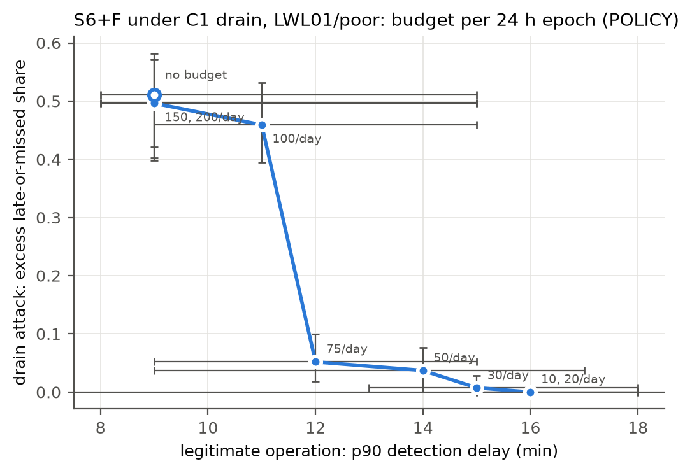

# pq-cap-bench report

_Generated by `make report` from `results/`. Do not edit by hand: every number below is read from a CSV/JSON produced by an actual run (`make bench`, `make model`) or from the cited specification tables in `config/radio.yaml`._

> **All timings: Apple M5 host, not MCU.** They rank algorithms on a general-purpose CPU; they do not predict MCU cycles or energy. An x86 re-run is optional (`make bench` on that host).

## 0. Repository state

- kept `7df90f4` - Align naming with the Étape 2 threat model: C0-C4, A1-A5, P1-P8, T1-T10 (make cov: 93 passed, 100 % coverage at that commit)
- discarded (uncommitted): task B partial work: config/mcu.yaml, data/pqm4/, src/pqcap/pqm4.py, tests/test_pqm4.py and edits to README.md, model.py, report.py, tests
- redone: task B from a clean tree (same pqm4 pins; SHA-256 identical to the cancelled fetch)

## 1. Environment

| item | value |
|---|---|
| label | Apple M5 host, not MCU |
| date (UTC) | 2026-11-04T04:13:13+00:00 |
| CPU | Apple M5 |
| arch | arm64 |
| cores (logical) | 10 |
| frequency / governor | not exposed by macOS on Apple silicon; not applicable: macOS has no cpufreq governor; DVFS is OS-managed |
| OS | macOS-26.6.2-arm64-arm-64bit |
| Python | 3.12.16 |
| liboqs | 0.16.0 @ 5a1a854b0dc9f2141bdc771c555ee60c37950183 |
| liboqs-python | 0.16.0.2 |
| compiler | Apple clang version 21.0.0 (clang-2100.3.34.2) |
| C flags (Release) | -O3 -DNDEBUG |
| cryptography / OpenSSL | 50.0.2 / OpenSSL 4.0.3 29 Sep 2026 |
| CPU pinning | pinning unsupported on darwin (no sched_setaffinity); process not pinned |

## 2. Algorithm resolution

| requested | kind | status | liboqs / library name | reason |
|---|---|---|---|---|
| ML-DSA-44 | pq | ok | ML-DSA-44 | - |
| ML-DSA-65 | pq | ok | ML-DSA-65 | - |
| ML-DSA-87 | pq | ok | ML-DSA-87 | - |
| Falcon-512 | pq | ok | Falcon-512 | - |
| Falcon-1024 | pq | ok | Falcon-1024 | - |
| SLH-DSA-SHA2-128s | pq | ok | SLH_DSA_PURE_SHA2_128S | - |
| SLH-DSA-SHA2-128f | pq | ok | SLH_DSA_PURE_SHA2_128F | - |
| LMS-SHA256-H10-W4 | stateful | unavailable | LMS_SHA256_H10_W4 | sign not supported by liboqs-python (LMS algorithms are verify‑only supported.); no signature can be produced, so sign/verify are not measured. liboqs nominal sizes (NOT measured): pk=60 sk=64 sig=2512 |
| XMSS-SHA2-10-256 | stateful | ok | XMSS-SHA2_10_256 | - |
| ML-KEM-512 | kem | ok | ML-KEM-512 | - |
| ML-KEM-768 | kem | ok | ML-KEM-768 | - |
| ECDSA-P256 | classical | ok | ECDSA-P256 | pyca/cryptography (OpenSSL) |
| Ed25519 | classical | ok | Ed25519 | pyca/cryptography (OpenSSL) |
| HMAC-SHA256-T16 | symmetric | ok | HMAC-SHA256-T16 | pyca/cryptography (OpenSSL) |
| HMAC-SHA256-T32 | symmetric | ok | HMAC-SHA256-T32 | pyca/cryptography (OpenSSL) |
| ECDSA-P256+ML-DSA-44 | hybrid | ok | ECDSA-P256+ML-DSA-44 | concatenated, AND-verify |

## 3. Sizes (observed; model uses `max`)

| algorithm | kind | pk_bytes | sk_bytes | sig_min | sig_median | sig_max | sig_n_observed | sig_liboqs_nominal_max |
|---|---|---|---|---|---|---|---|---|
| ML-DSA-44 | pq | 1,312 | 2,560 | 2,420 | 2,420.0 | 2,420 | 9,000 | 2,420 |
| ML-DSA-65 | pq | 1,952 | 4,032 | 3,309 | 3,309.0 | 3,309 | 9,000 | 3,309 |
| ML-DSA-87 | pq | 2,592 | 4,896 | 4,627 | 4,627.0 | 4,627 | 9,000 | 4,627 |
| Falcon-512 | pq | 897 | 1,281 | 646 | 655.0 | 664 | 9,000 | 752 |
| Falcon-1024 | pq | 1,793 | 2,305 | 1,260 | 1,271.0 | 1,282 | 9,000 | 1,462 |
| SLH-DSA-SHA2-128s | pq | 32 | 64 | 7,856 | 7,856.0 | 7,856 | 9,000 | 7,856 |
| SLH-DSA-SHA2-128f | pq | 32 | 64 | 17,088 | 17,088.0 | 17,088 | 9,000 | 17,088 |
| XMSS-SHA2-10-256 | stateful | 68 | 1,377 | 2,500 | 2,500.0 | 2,500 | 9,000 | 2,500 |
| ECDSA-P256 | classical | 65 | 32 | 64 | 64.0 | 64 | 9,000 | - |
| Ed25519 | classical | 32 | 32 | 64 | 64.0 | 64 | 9,000 | - |
| HMAC-SHA256-T16 | symmetric | 0 | 32 | 16 | 16.0 | 16 | 9,000 | - |
| HMAC-SHA256-T32 | symmetric | 0 | 32 | 32 | 32.0 | 32 | 9,000 | - |
| ECDSA-P256+ML-DSA-44 | hybrid | 1,377 | 2,592 | 2,484 | 2,484.0 | 2,484 | 9,000 | - |

ML-KEM (S2 key establishment):

| algorithm | pk_bytes | sk_bytes | ct_bytes | ss_bytes |
|---|---|---|---|---|
| ML-KEM-512 | 800 | 1,632 | 768 | 32 |
| ML-KEM-768 | 1,184 | 2,400 | 1,088 | 32 |

## 4. Host timings (Apple M5 host, not MCU)

_All timings: **Apple M5 host, not MCU**._

Median per operation, microseconds (all runs pooled; Apple M5 host, not MCU):

| algorithm | keygen | sign (32 B) | verify (32 B) | sign (96 B) | verify (96 B) | sign (160 B) | verify (160 B) |
|---|---|---|---|---|---|---|---|
| ML-DSA-44 | 19.2 | 37.8 | 18.5 | 38.2 | 18.5 | 38.4 | 18.5 |
| ML-DSA-65 | 32.8 | 58.4 | 30.7 | 57.9 | 30.8 | 59.4 | 30.8 |
| ML-DSA-87 | 56.1 | 85.7 | 52.9 | 85.6 | 53.0 | 86.4 | 53.0 |
| Falcon-512 | 2,649.1 | 90.7 | 15.8 | 90.9 | 15.9 | 90.7 | 15.9 |
| Falcon-1024 | 8,232.0 | 179.9 | 30.1 | 180.2 | 30.3 | 180.0 | 30.2 |
| SLH-DSA-SHA2-128s | 30,036.9 | 227,139.8 | 232.5 | 227,263.1 | 237.6 | 226,869.9 | 219.2 |
| SLH-DSA-SHA2-128f | 471.1 | 10,947.2 | 654.3 | 10,957.8 | 673.0 | 10,964.3 | 666.7 |
| XMSS-SHA2-10-256 | 352,420.9 | 1,898.8 | 205.0 | 1,885.2 | 181.6 | 1,890.4 | 182.1 |
| ECDSA-P256 | 7.4 | 12.2 | 32.2 | 12.2 | 32.0 | 12.2 | 32.0 |
| Ed25519 | 13.9 | 13.2 | 33.4 | 13.3 | 33.0 | 13.3 | 33.2 |
| HMAC-SHA256-T16 | 0.8 | 0.8 | 0.8 | 0.8 | 0.8 | 0.8 | 0.8 |
| HMAC-SHA256-T32 | 0.8 | 0.7 | 0.8 | 0.8 | 0.8 | 0.8 | 0.8 |
| ECDSA-P256+ML-DSA-44 | 27.2 | 53.1 | 51.1 | 52.9 | 51.2 | 52.7 | 51.2 |

Dispersion at keygen and the 96-byte message (microseconds; Apple M5 host, not MCU; run-to-run = CV and relative range of the per-run medians):

| algorithm | op | msg_len | pooled_median_ns | pooled_iqr_ns | pooled_p95_ns | pooled_n | run_to_run_cv | run_to_run_range_rel |
|---|---|---|---|---|---|---|---|---|
| ML-DSA-44 | keygen | 0 | 19.2 | 1.0 | 19.5 | 3000 | 3.3% | 6.0% |
| ML-DSA-44 | sign | 96 | 38.2 | 26.7 | 94.9 | 3000 | 4.8% | 8.6% |
| ML-DSA-44 | verify | 96 | 18.5 | 1.0 | 18.7 | 3000 | 3.3% | 5.7% |
| ML-DSA-65 | keygen | 0 | 32.8 | 1.9 | 33.1 | 3000 | 3.5% | 6.2% |
| ML-DSA-65 | sign | 96 | 57.9 | 39.3 | 140.5 | 3000 | 3.1% | 5.7% |
| ML-DSA-65 | verify | 96 | 30.8 | 1.8 | 31.0 | 3000 | 3.5% | 6.3% |
| ML-DSA-87 | keygen | 0 | 56.1 | 3.3 | 56.6 | 3000 | 3.6% | 6.3% |
| ML-DSA-87 | sign | 96 | 85.6 | 45.2 | 176.9 | 3000 | 3.2% | 5.7% |
| ML-DSA-87 | verify | 96 | 53.0 | 3.1 | 53.8 | 3000 | 3.5% | 6.1% |
| Falcon-512 | keygen | 0 | 2,649.1 | 733.7 | 4,294.0 | 3000 | 3.9% | 7.8% |
| Falcon-512 | sign | 96 | 90.9 | 5.2 | 95.1 | 3000 | 3.5% | 6.2% |
| Falcon-512 | verify | 96 | 15.9 | 1.0 | 16.1 | 3000 | 3.5% | 6.1% |
| Falcon-1024 | keygen | 0 | 8,232.0 | 1,485.0 | 14,206.8 | 3000 | 2.8% | 5.1% |
| Falcon-1024 | sign | 96 | 180.2 | 10.8 | 186.8 | 3000 | 3.7% | 6.9% |
| Falcon-1024 | verify | 96 | 30.3 | 1.8 | 30.5 | 3000 | 3.6% | 6.3% |
| SLH-DSA-SHA2-128s | keygen | 0 | 30,036.9 | 2,254.1 | 31,829.0 | 3000 | 4.0% | 7.8% |
| SLH-DSA-SHA2-128s | sign | 96 | 227,263.1 | 5,433.3 | 246,456.0 | 3000 | 1.1% | 2.1% |
| SLH-DSA-SHA2-128s | verify | 96 | 237.6 | 7.0 | 246.7 | 3000 | 1.3% | 2.7% |
| SLH-DSA-SHA2-128f | keygen | 0 | 471.1 | 8.4 | 482.9 | 3000 | 0.7% | 1.4% |
| SLH-DSA-SHA2-128f | sign | 96 | 10,957.8 | 264.5 | 11,166.4 | 3000 | 1.4% | 2.4% |
| SLH-DSA-SHA2-128f | verify | 96 | 673.0 | 41.9 | 691.3 | 3000 | 4.0% | 7.6% |
| XMSS-SHA2-10-256 | keygen | 0 | 352,420.9 | 5,301.3 | 369,853.4 | 3000 | 0.7% | 1.3% |
| XMSS-SHA2-10-256 | sign | 96 | 1,885.2 | 1,497.0 | 2,259.4 | 3000 | 0.3% | 0.5% |
| XMSS-SHA2-10-256 | verify | 96 | 181.6 | 21.0 | 192.2 | 3000 | 6.3% | 12.5% |
| ECDSA-P256 | keygen | 0 | 7.4 | 0.2 | 7.6 | 3000 | 1.2% | 2.3% |
| ECDSA-P256 | sign | 96 | 12.2 | 0.2 | 13.9 | 3000 | 0.9% | 1.7% |
| ECDSA-P256 | verify | 96 | 32.0 | 0.2 | 32.2 | 3000 | 0.1% | 0.3% |
| Ed25519 | keygen | 0 | 13.9 | 0.1 | 14.3 | 3000 | 0.3% | 0.6% |
| Ed25519 | sign | 96 | 13.3 | 0.0 | 13.5 | 3000 | 0.2% | 0.3% |
| Ed25519 | verify | 96 | 33.0 | 0.2 | 36.2 | 3000 | 0.3% | 0.5% |
| HMAC-SHA256-T16 | keygen | 0 | 0.8 | 0.0 | 0.9 | 3000 | 3.1% | 5.4% |
| HMAC-SHA256-T16 | sign | 96 | 0.8 | 0.0 | 0.8 | 3000 | 0.0% | 0.0% |
| HMAC-SHA256-T16 | verify | 96 | 0.8 | 0.0 | 0.8 | 3000 | 3.1% | 5.4% |
| HMAC-SHA256-T32 | keygen | 0 | 0.8 | 0.0 | 0.8 | 3000 | 3.2% | 5.5% |
| HMAC-SHA256-T32 | sign | 96 | 0.8 | 0.0 | 0.8 | 3000 | 0.0% | 0.0% |
| HMAC-SHA256-T32 | verify | 96 | 0.8 | 0.0 | 0.8 | 3000 | 0.0% | 0.0% |
| ECDSA-P256+ML-DSA-44 | keygen | 0 | 27.2 | 0.3 | 31.2 | 3000 | 0.8% | 1.5% |
| ECDSA-P256+ML-DSA-44 | sign | 96 | 52.9 | 27.6 | 116.0 | 3000 | 5.4% | 9.8% |
| ECDSA-P256+ML-DSA-44 | verify | 96 | 51.2 | 0.3 | 57.0 | 3000 | 0.5% | 0.9% |
| ML-KEM-512 | keygen | 0 | 5.5 | 0.1 | 5.7 | 3000 | 0.4% | 0.7% |
| ML-KEM-512 | encaps | 0 | 6.3 | 0.1 | 7.9 | 3000 | 0.4% | 0.7% |
| ML-KEM-512 | decaps | 0 | 7.1 | 0.0 | 7.2 | 3000 | 0.3% | 0.6% |
| ML-KEM-768 | keygen | 0 | 8.6 | 0.1 | 9.2 | 3000 | 0.3% | 0.5% |
| ML-KEM-768 | encaps | 0 | 9.4 | 0.1 | 10.7 | 3000 | 0.3% | 0.4% |
| ML-KEM-768 | decaps | 0 | 10.6 | 0.0 | 10.8 | 3000 | 0.2% | 0.4% |

## 5. Capability token sizes (bytes)

| scheme | algorithm | d=0 (B) | d=1 (B) | d=2 (B) | d=3 (B) |
|---|---|---|---|---|---|
| S1 | ML-DSA-44 | 2,500 | 4,960 | 7,420 | 9,880 |
| S1 | ML-DSA-65 | 3,389 | 6,738 | 10,087 | 13,436 |
| S1 | ML-DSA-87 | 4,707 | 9,374 | 14,041 | 18,708 |
| S1 | Falcon-512 | 744 | 1,448 | 2,152 | 2,856 |
| S1 | Falcon-1024 | 1,362 | 2,684 | 4,006 | 5,328 |
| S1 | SLH-DSA-SHA2-128s | 7,936 | 15,832 | 23,728 | 31,624 |
| S1 | SLH-DSA-SHA2-128f | 17,168 | 34,296 | 51,424 | 68,552 |
| S1 | XMSS-SHA2-10-256 | 2,580 | 5,120 | 7,660 | 10,200 |
| S2 | ML-DSA-44+KEM/HMAC-SHA256-T16 | 96 | 152 | 208 | 264 |
| S4 | HMAC-SHA256-T16 | 96 | 152 | 208 | 264 |
| S3 | ECDSA-P256+ML-DSA-44 | 2,564 | 5,088 | 7,612 | 10,136 |
| S5 | ECDSA-P256 | 144 | 248 | 352 | 456 |

## 6. LoRaWAN / NB-IoT delivery

**US915 DR8** (max application payload 53 B), depth 0:

| scheme | algorithm | token_bytes | frames | airtime_s | duty_off_time_s | ttd_expected_h | ttd_worst_h |
|---|---|---|---|---|---|---|---|
| S2 | ML-DSA-44+KEM/HMAC-SHA256-T16 | 96 | 2 | 1.19 | 0.0 | 0.13 | 0.17 |
| S4 | HMAC-SHA256-T16 | 96 | 2 | 1.19 | 0.0 | 0.13 | 0.17 |
| S5 | ECDSA-P256 | 144 | 3 | 1.81 | 0.0 | 0.21 | 0.25 |
| S1 | Falcon-512 | 744 | 15 | 9.12 | 0.0 | 1.21 | 1.25 |
| S1 | Falcon-1024 | 1,362 | 27 | 16.56 | 0.0 | 2.21 | 2.25 |
| S1 | ML-DSA-44 | 2,500 | 50 | 30.49 | 0.0 | 4.13 | 4.17 |
| S3 | ECDSA-P256+ML-DSA-44 | 2,564 | 51 | 31.19 | 0.0 | 4.21 | 4.25 |
| S1 | XMSS-SHA2-10-256 | 2,580 | 51 | 31.32 | 0.0 | 4.21 | 4.25 |
| S1 | ML-DSA-65 | 3,389 | 67 | 41.10 | 0.0 | 5.54 | 5.58 |
| S1 | ML-DSA-87 | 4,707 | 93 | 57.08 | 0.0 | 7.71 | 7.75 |
| S1 | SLH-DSA-SHA2-128s | 7,936 | 156 | 96.04 | 0.0 | 12.96 | 13.00 |
| S1 | SLH-DSA-SHA2-128f | 17,168 | 337 | 207.62 | 0.0 | 28.04 | 28.08 |

**US915 DR13** (max application payload 242 B), depth 0:

| scheme | algorithm | token_bytes | frames | airtime_s | duty_off_time_s | ttd_expected_h | ttd_worst_h |
|---|---|---|---|---|---|---|---|
| S2 | ML-DSA-44+KEM/HMAC-SHA256-T16 | 96 | 1 | 0.05 | 0.0 | 0.04 | 0.08 |
| S4 | HMAC-SHA256-T16 | 96 | 1 | 0.05 | 0.0 | 0.04 | 0.08 |
| S5 | ECDSA-P256 | 144 | 1 | 0.06 | 0.0 | 0.04 | 0.08 |
| S1 | Falcon-512 | 744 | 4 | 0.32 | 0.0 | 0.29 | 0.33 |
| S1 | Falcon-1024 | 1,362 | 6 | 0.56 | 0.0 | 0.46 | 0.50 |
| S1 | ML-DSA-44 | 2,500 | 11 | 1.03 | 0.0 | 0.88 | 0.92 |
| S3 | ECDSA-P256+ML-DSA-44 | 2,564 | 11 | 1.06 | 0.0 | 0.88 | 0.92 |
| S1 | XMSS-SHA2-10-256 | 2,580 | 11 | 1.06 | 0.0 | 0.88 | 0.92 |
| S1 | ML-DSA-65 | 3,389 | 15 | 1.40 | 0.0 | 1.21 | 1.25 |
| S1 | ML-DSA-87 | 4,707 | 20 | 1.94 | 0.0 | 1.63 | 1.67 |
| S1 | SLH-DSA-SHA2-128s | 7,936 | 34 | 3.27 | 0.0 | 2.79 | 2.83 |
| S1 | SLH-DSA-SHA2-128f | 17,168 | 72 | 7.06 | 0.0 | 5.96 | 6.00 |

**EU868 DR0** (max application payload 51 B), depth 0:

| scheme | algorithm | token_bytes | frames | airtime_s | duty_off_time_s | ttd_expected_h | ttd_worst_h |
|---|---|---|---|---|---|---|---|
| S2 | ML-DSA-44+KEM/HMAC-SHA256-T16 | 96 | 2 | 5.42 | 536.9 | 0.13 | 0.17 |
| S4 | HMAC-SHA256-T16 | 96 | 2 | 5.42 | 536.9 | 0.13 | 0.17 |
| S5 | ECDSA-P256 | 144 | 3 | 8.22 | 813.4 | 0.21 | 0.25 |
| S1 | Falcon-512 | 744 | 16 | 43.38 | 4,295.1 | 1.29 | 1.33 |
| S1 | Falcon-1024 | 1,362 | 28 | 77.89 | 7,711.1 | 2.29 | 2.33 |
| S1 | ML-DSA-44 | 2,500 | 52 | 143.62 | 14,218.6 | 4.29 | 4.33 |
| S3 | ECDSA-P256+ML-DSA-44 | 2,564 | 53 | 146.91 | 14,543.8 | 4.38 | 4.42 |
| S1 | XMSS-SHA2-10-256 | 2,580 | 53 | 147.40 | 14,592.5 | 4.38 | 4.42 |
| S1 | ML-DSA-65 | 3,389 | 70 | 194.23 | 19,229.0 | 5.79 | 5.83 |
| S1 | ML-DSA-87 | 4,707 | 97 | 269.49 | 26,679.7 | 8.04 | 8.08 |
| S1 | SLH-DSA-SHA2-128s | 7,936 | 162 | 452.38 | 44,785.5 | 13.46 | 13.50 |
| S1 | SLH-DSA-SHA2-128f | 17,168 | 351 | 979.53 | 96,973.0 | 29.21 | 29.25 |

**EU868 DR5** (max application payload 242 B), depth 0:

| scheme | algorithm | token_bytes | frames | airtime_s | duty_off_time_s | ttd_expected_h | ttd_worst_h |
|---|---|---|---|---|---|---|---|
| S2 | ML-DSA-44+KEM/HMAC-SHA256-T16 | 96 | 1 | 0.18 | 18.3 | 0.04 | 0.08 |
| S4 | HMAC-SHA256-T16 | 96 | 1 | 0.18 | 18.3 | 0.04 | 0.08 |
| S5 | ECDSA-P256 | 144 | 1 | 0.25 | 24.9 | 0.04 | 0.08 |
| S1 | Falcon-512 | 744 | 4 | 1.27 | 125.3 | 0.29 | 0.33 |
| S1 | Falcon-1024 | 1,362 | 6 | 2.25 | 223.2 | 0.46 | 0.50 |
| S1 | ML-DSA-44 | 2,500 | 11 | 4.13 | 409.3 | 0.88 | 0.92 |
| S3 | ECDSA-P256+ML-DSA-44 | 2,564 | 11 | 4.23 | 419.0 | 0.88 | 0.92 |
| S1 | XMSS-SHA2-10-256 | 2,580 | 11 | 4.25 | 421.0 | 0.88 | 0.92 |
| S1 | ML-DSA-65 | 3,389 | 15 | 5.61 | 555.4 | 1.21 | 1.25 |
| S1 | ML-DSA-87 | 4,707 | 20 | 7.76 | 767.9 | 1.63 | 1.67 |
| S1 | SLH-DSA-SHA2-128s | 7,936 | 34 | 13.09 | 1,295.4 | 2.79 | 2.83 |
| S1 | SLH-DSA-SHA2-128f | 17,168 | 72 | 28.24 | 2,795.7 | 5.96 | 6.00 |

**NB-IoT** (configured max payload 1280 B), depth 0, messages needed:

| scheme | algorithm | token_bytes | frames |
|---|---|---|---|
| S2 | ML-DSA-44+KEM/HMAC-SHA256-T16 | 96 | 1 |
| S4 | HMAC-SHA256-T16 | 96 | 1 |
| S5 | ECDSA-P256 | 144 | 1 |
| S1 | Falcon-512 | 744 | 1 |
| S1 | Falcon-1024 | 1,362 | 2 |
| S1 | ML-DSA-44 | 2,500 | 2 |
| S3 | ECDSA-P256+ML-DSA-44 | 2,564 | 3 |
| S1 | XMSS-SHA2-10-256 | 2,580 | 3 |
| S1 | ML-DSA-65 | 3,389 | 3 |
| S1 | ML-DSA-87 | 4,707 | 4 |
| S1 | SLH-DSA-SHA2-128s | 7,936 | 7 |
| S1 | SLH-DSA-SHA2-128f | 17,168 | 14 |

## 7. Commands within window

**US915 DR8**, W = 30 min, depth 0 - commands per gateway:

| scheme | algorithm | N=10 | N=50 | N=200 |
|---|---|---|---|---|
| S1 | ML-DSA-44 | 0 | 0 | 0 |
| S1 | ML-DSA-65 | 0 | 0 | 0 |
| S1 | ML-DSA-87 | 0 | 0 | 0 |
| S1 | Falcon-512 | 0 | 0 | 0 |
| S1 | Falcon-1024 | 0 | 0 | 0 |
| S1 | SLH-DSA-SHA2-128s | 0 | 0 | 0 |
| S1 | SLH-DSA-SHA2-128f | 0 | 0 | 0 |
| S1 | XMSS-SHA2-10-256 | 0 | 0 | 0 |
| S2 | ML-DSA-44+KEM/HMAC-SHA256-T16 | 30 | 150 | 600 |
| S4 | HMAC-SHA256-T16 | 30 | 150 | 600 |
| S3 | ECDSA-P256+ML-DSA-44 | 0 | 0 | 0 |
| S5 | ECDSA-P256 | 20 | 100 | 400 |

**US915 DR13**, W = 30 min, depth 0 - commands per gateway:

| scheme | algorithm | N=10 | N=50 | N=200 |
|---|---|---|---|---|
| S1 | ML-DSA-44 | 0 | 0 | 0 |
| S1 | ML-DSA-65 | 0 | 0 | 0 |
| S1 | ML-DSA-87 | 0 | 0 | 0 |
| S1 | Falcon-512 | 10 | 50 | 200 |
| S1 | Falcon-1024 | 10 | 50 | 200 |
| S1 | SLH-DSA-SHA2-128s | 0 | 0 | 0 |
| S1 | SLH-DSA-SHA2-128f | 0 | 0 | 0 |
| S1 | XMSS-SHA2-10-256 | 0 | 0 | 0 |
| S2 | ML-DSA-44+KEM/HMAC-SHA256-T16 | 60 | 300 | 1,200 |
| S4 | HMAC-SHA256-T16 | 60 | 300 | 1,200 |
| S3 | ECDSA-P256+ML-DSA-44 | 0 | 0 | 0 |
| S5 | ECDSA-P256 | 60 | 300 | 1,200 |

**EU868 DR0**, W = 30 min, depth 0 - commands per gateway:

| scheme | algorithm | N=10 | N=50 | N=200 |
|---|---|---|---|---|
| S1 | ML-DSA-44 | 0 | 0 | 0 |
| S1 | ML-DSA-65 | 0 | 0 | 0 |
| S1 | ML-DSA-87 | 0 | 0 | 0 |
| S1 | Falcon-512 | 0 | 0 | 0 |
| S1 | Falcon-1024 | 0 | 0 | 0 |
| S1 | SLH-DSA-SHA2-128s | 0 | 0 | 0 |
| S1 | SLH-DSA-SHA2-128f | 0 | 0 | 0 |
| S1 | XMSS-SHA2-10-256 | 0 | 0 | 0 |
| S2 | ML-DSA-44+KEM/HMAC-SHA256-T16 | 3 | 3 | 3 |
| S4 | HMAC-SHA256-T16 | 3 | 3 | 3 |
| S3 | ECDSA-P256+ML-DSA-44 | 0 | 0 | 0 |
| S5 | ECDSA-P256 | 2 | 2 | 2 |

**EU868 DR5**, W = 30 min, depth 0 - commands per gateway:

| scheme | algorithm | N=10 | N=50 | N=200 |
|---|---|---|---|---|
| S1 | ML-DSA-44 | 0 | 0 | 0 |
| S1 | ML-DSA-65 | 0 | 0 | 0 |
| S1 | ML-DSA-87 | 0 | 0 | 0 |
| S1 | Falcon-512 | 10 | 14 | 14 |
| S1 | Falcon-1024 | 7 | 7 | 7 |
| S1 | SLH-DSA-SHA2-128s | 0 | 0 | 0 |
| S1 | SLH-DSA-SHA2-128f | 0 | 0 | 0 |
| S1 | XMSS-SHA2-10-256 | 0 | 0 | 0 |
| S2 | ML-DSA-44+KEM/HMAC-SHA256-T16 | 60 | 97 | 97 |
| S4 | HMAC-SHA256-T16 | 60 | 97 | 97 |
| S3 | ECDSA-P256+ML-DSA-44 | 0 | 0 | 0 |
| S5 | ECDSA-P256 | 60 | 71 | 71 |

## 7b. Sensitivity: downlink CRC

Primary setting: downlink payload CRC **off** (RP002-1.0.3 Table 109). Sensitivity row: downlink CRC **on**. Frame counts depend only on payload sizes, so CRC changes airtime, time to deliver and the airtime-limited gateway capacity, never the number of frames.

K1 under primary vs sensitivity: answer no vs no; airtime per command 30.495 s vs 30.495 s; worst-case time to deliver 250.02 min vs 250.02 min.

Relative airtime change with downlink CRC on (depth 0, all LoRa channels): min +0.00%, max +5.72%.

**US915 DR8** (W = 30 min, N = 50 for commands per gateway):

| scheme | algorithm | frames | airtime_s | airtime_s_alt | airtime_delta_rel | ttd_worst_s | ttd_worst_s_alt | cmds_gateway | cmds_gateway_alt |
|---|---|---|---|---|---|---|---|---|---|
| S2 | ML-DSA-44+KEM/HMAC-SHA256-T16 | 2 | 1.192 | 1.192 | +0.00% | 0.17 | 0.17 | 150 | 150 |
| S4 | HMAC-SHA256-T16 | 2 | 1.192 | 1.192 | +0.00% | 0.17 | 0.17 | 150 | 150 |
| S5 | ECDSA-P256 | 3 | 1.808 | 1.808 | +0.00% | 0.25 | 0.25 | 100 | 100 |
| S1 | Falcon-512 | 15 | 9.124 | 9.124 | +0.00% | 1.25 | 1.25 | 0 | 0 |
| S1 | Falcon-1024 | 27 | 16.562 | 16.562 | +0.00% | 2.25 | 2.25 | 0 | 0 |
| S1 | ML-DSA-44 | 50 | 30.495 | 30.495 | +0.00% | 4.17 | 4.17 | 0 | 0 |
| S3 | ECDSA-P256+ML-DSA-44 | 51 | 31.193 | 31.193 | +0.00% | 4.25 | 4.25 | 0 | 0 |
| S1 | XMSS-SHA2-10-256 | 51 | 31.316 | 31.316 | +0.00% | 4.25 | 4.25 | 0 | 0 |
| S1 | ML-DSA-65 | 67 | 41.097 | 41.138 | +0.10% | 5.58 | 5.58 | 0 | 0 |
| S1 | ML-DSA-87 | 93 | 57.084 | 57.084 | +0.00% | 7.75 | 7.75 | 0 | 0 |
| S1 | SLH-DSA-SHA2-128s | 156 | 96.043 | 96.043 | +0.00% | 13.00 | 13.00 | 0 | 0 |
| S1 | SLH-DSA-SHA2-128f | 337 | 207.620 | 207.620 | +0.00% | 28.08 | 28.08 | 0 | 0 |

**US915 DR13** (W = 30 min, N = 50 for commands per gateway):

| scheme | algorithm | frames | airtime_s | airtime_s_alt | airtime_delta_rel | ttd_worst_s | ttd_worst_s_alt | cmds_gateway | cmds_gateway_alt |
|---|---|---|---|---|---|---|---|---|---|
| S2 | ML-DSA-44+KEM/HMAC-SHA256-T16 | 1 | 0.046 | 0.046 | +0.00% | 0.08 | 0.08 | 300 | 300 |
| S4 | HMAC-SHA256-T16 | 1 | 0.046 | 0.046 | +0.00% | 0.08 | 0.08 | 300 | 300 |
| S5 | ECDSA-P256 | 1 | 0.063 | 0.064 | +2.04% | 0.08 | 0.08 | 300 | 300 |
| S1 | Falcon-512 | 4 | 0.316 | 0.320 | +1.21% | 0.33 | 0.33 | 50 | 50 |
| S1 | Falcon-1024 | 6 | 0.564 | 0.571 | +1.36% | 0.50 | 0.50 | 50 | 50 |
| S1 | ML-DSA-44 | 11 | 1.034 | 1.048 | +1.36% | 0.92 | 0.92 | 0 | 0 |
| S3 | ECDSA-P256+ML-DSA-44 | 11 | 1.058 | 1.071 | +1.21% | 0.92 | 0.92 | 0 | 0 |
| S1 | XMSS-SHA2-10-256 | 11 | 1.063 | 1.077 | +1.32% | 0.92 | 0.92 | 0 | 0 |
| S1 | ML-DSA-65 | 15 | 1.403 | 1.422 | +1.37% | 1.25 | 1.25 | 0 | 0 |
| S1 | ML-DSA-87 | 20 | 1.939 | 1.964 | +1.25% | 1.67 | 1.67 | 0 | 0 |
| S1 | SLH-DSA-SHA2-128s | 34 | 3.271 | 3.315 | +1.33% | 2.83 | 2.83 | 0 | 0 |
| S1 | SLH-DSA-SHA2-128f | 72 | 7.060 | 7.152 | +1.31% | 6.00 | 6.00 | 0 | 0 |

**EU868 DR0** (W = 30 min, N = 50 for commands per gateway):

| scheme | algorithm | frames | airtime_s | airtime_s_alt | airtime_delta_rel | ttd_worst_s | ttd_worst_s_alt | cmds_gateway | cmds_gateway_alt |
|---|---|---|---|---|---|---|---|---|---|
| S2 | ML-DSA-44+KEM/HMAC-SHA256-T16 | 2 | 5.423 | 5.587 | +3.02% | 0.17 | 0.17 | 3 | 3 |
| S4 | HMAC-SHA256-T16 | 2 | 5.423 | 5.587 | +3.02% | 0.17 | 0.17 | 3 | 3 |
| S5 | ECDSA-P256 | 3 | 8.217 | 8.380 | +1.99% | 0.25 | 0.25 | 2 | 2 |
| S1 | Falcon-512 | 16 | 43.385 | 43.385 | +0.00% | 1.33 | 1.33 | 0 | 0 |
| S1 | Falcon-1024 | 28 | 77.890 | 77.890 | +0.00% | 2.33 | 2.33 | 0 | 0 |
| S1 | ML-DSA-44 | 52 | 143.622 | 143.786 | +0.11% | 4.33 | 4.33 | 0 | 0 |
| S3 | ECDSA-P256+ML-DSA-44 | 53 | 146.907 | 147.071 | +0.11% | 4.42 | 4.42 | 0 | 0 |
| S1 | XMSS-SHA2-10-256 | 53 | 147.399 | 147.562 | +0.11% | 4.42 | 4.42 | 0 | 0 |
| S1 | ML-DSA-65 | 70 | 194.232 | 194.232 | +0.00% | 5.83 | 5.83 | 0 | 0 |
| S1 | ML-DSA-87 | 97 | 269.492 | 269.492 | +0.00% | 8.08 | 8.08 | 0 | 0 |
| S1 | SLH-DSA-SHA2-128s | 162 | 452.379 | 452.542 | +0.04% | 13.50 | 13.50 | 0 | 0 |
| S1 | SLH-DSA-SHA2-128f | 351 | 979.526 | 979.526 | +0.00% | 29.25 | 29.25 | 0 | 0 |

**EU868 DR5** (W = 30 min, N = 50 for commands per gateway):

| scheme | algorithm | frames | airtime_s | airtime_s_alt | airtime_delta_rel | ttd_worst_s | ttd_worst_s_alt | cmds_gateway | cmds_gateway_alt |
|---|---|---|---|---|---|---|---|---|---|
| S2 | ML-DSA-44+KEM/HMAC-SHA256-T16 | 1 | 0.185 | 0.185 | +0.00% | 0.08 | 0.08 | 97 | 97 |
| S4 | HMAC-SHA256-T16 | 1 | 0.185 | 0.185 | +0.00% | 0.08 | 0.08 | 97 | 97 |
| S5 | ECDSA-P256 | 1 | 0.251 | 0.256 | +2.04% | 0.08 | 0.08 | 71 | 70 |
| S1 | Falcon-512 | 4 | 1.266 | 1.281 | +1.21% | 0.33 | 0.33 | 14 | 14 |
| S1 | Falcon-1024 | 6 | 2.254 | 2.285 | +1.36% | 0.50 | 0.50 | 7 | 7 |
| S1 | ML-DSA-44 | 11 | 4.135 | 4.191 | +1.36% | 0.92 | 0.92 | 0 | 0 |
| S3 | ECDSA-P256+ML-DSA-44 | 11 | 4.232 | 4.283 | +1.21% | 0.92 | 0.92 | 0 | 0 |
| S1 | XMSS-SHA2-10-256 | 11 | 4.252 | 4.309 | +1.32% | 0.92 | 0.92 | 0 | 0 |
| S1 | ML-DSA-65 | 15 | 5.610 | 5.687 | +1.37% | 1.25 | 1.25 | 0 | 0 |
| S1 | ML-DSA-87 | 20 | 7.757 | 7.854 | +1.25% | 1.67 | 1.67 | 0 | 0 |
| S1 | SLH-DSA-SHA2-128s | 34 | 13.085 | 13.259 | +1.33% | 2.83 | 2.83 | 0 | 0 |
| S1 | SLH-DSA-SHA2-128f | 72 | 28.240 | 28.609 | +1.31% | 6.00 | 6.00 | 0 | 0 |

_ttd columns in hours; `_alt` = sensitivity setting._

## 7c. S6 pre-positioned capability envelopes

Envelope = header 16 B + bounds 64 B + invariants 32 B + signature (measured). Crisis command = envelope_handle 4 B + counter 4 B + params 8 B + truncated HMAC-SHA256 tag. Assumes the crisis HMAC key is already provisioned (as in S4); envelope verification (one PQ verify per device per calm period) happens before the event.

**Calm phase: envelope frames per DR**

| signer | envelope_bytes | US915 DR8 | US915 DR9 | US915 DR10 | US915 DR11 | US915 DR12 | US915 DR13 | EU868 DR0 | EU868 DR1 | EU868 DR2 | EU868 DR3 | EU868 DR4 | EU868 DR5 | EU868 DR6 |
|---|---|---|---|---|---|---|---|---|---|---|---|---|---|---|
| ML-DSA-44 | 2532 | 50 | 20 | 11 | 11 | 11 | 11 | 52 | 52 | 52 | 23 | 11 | 11 | 11 |
| Falcon-512 | 776 | 16 | 7 | 4 | 4 | 4 | 4 | 16 | 16 | 16 | 7 | 4 | 4 | 4 |

**Calm phase feasibility** (feasible = envelope frames <= Class A downlink opportunities in P, and N x envelope airtime <= gateway airtime budget in P):

| signer | calm_hours | devices | region | feasible_drs | infeasible_drs | max_gateway_utilisation |
|---|---|---|---|---|---|---|
| ML-DSA-44 | 6 | 10 | US915 | DR8, DR9, DR10, DR11, DR12, DR13 | - | 1.42% |
| ML-DSA-44 | 6 | 50 | US915 | DR8, DR9, DR10, DR11, DR12, DR13 | - | 7.11% |
| ML-DSA-44 | 6 | 200 | US915 | DR8, DR9, DR10, DR11, DR12, DR13 | - | 28.43% |
| ML-DSA-44 | 24 | 10 | US915 | DR8, DR9, DR10, DR11, DR12, DR13 | - | 0.36% |
| ML-DSA-44 | 24 | 50 | US915 | DR8, DR9, DR10, DR11, DR12, DR13 | - | 1.78% |
| ML-DSA-44 | 24 | 200 | US915 | DR8, DR9, DR10, DR11, DR12, DR13 | - | 7.11% |
| ML-DSA-44 | 72 | 10 | US915 | DR8, DR9, DR10, DR11, DR12, DR13 | - | 0.12% |
| ML-DSA-44 | 72 | 50 | US915 | DR8, DR9, DR10, DR11, DR12, DR13 | - | 0.59% |
| ML-DSA-44 | 72 | 200 | US915 | DR8, DR9, DR10, DR11, DR12, DR13 | - | 2.37% |
| ML-DSA-44 | 6 | 10 | EU868 | DR3, DR4, DR5, DR6 | DR0, DR1, DR2 | 670.23% |
| ML-DSA-44 | 6 | 50 | EU868 | DR5, DR6 | DR0, DR1, DR2, DR3, DR4 | 3351.13% |
| ML-DSA-44 | 6 | 200 | EU868 | none | DR0, DR1, DR2, DR3, DR4, DR5, DR6 | 13404.54% |
| ML-DSA-44 | 24 | 10 | EU868 | DR1, DR2, DR3, DR4, DR5, DR6 | DR0 | 167.56% |
| ML-DSA-44 | 24 | 50 | EU868 | DR3, DR4, DR5, DR6 | DR0, DR1, DR2 | 837.78% |
| ML-DSA-44 | 24 | 200 | EU868 | DR5, DR6 | DR0, DR1, DR2, DR3, DR4 | 3351.13% |
| ML-DSA-44 | 72 | 10 | EU868 | DR0, DR1, DR2, DR3, DR4, DR5, DR6 | - | 55.85% |
| ML-DSA-44 | 72 | 50 | EU868 | DR2, DR3, DR4, DR5, DR6 | DR0, DR1 | 279.26% |
| ML-DSA-44 | 72 | 200 | EU868 | DR4, DR5, DR6 | DR0, DR1, DR2, DR3 | 1117.04% |
| Falcon-512 | 6 | 10 | US915 | DR8, DR9, DR10, DR11, DR12, DR13 | - | 0.44% |
| Falcon-512 | 6 | 50 | US915 | DR8, DR9, DR10, DR11, DR12, DR13 | - | 2.22% |
| Falcon-512 | 6 | 200 | US915 | DR8, DR9, DR10, DR11, DR12, DR13 | - | 8.87% |
| Falcon-512 | 24 | 10 | US915 | DR8, DR9, DR10, DR11, DR12, DR13 | - | 0.11% |
| Falcon-512 | 24 | 50 | US915 | DR8, DR9, DR10, DR11, DR12, DR13 | - | 0.55% |
| Falcon-512 | 24 | 200 | US915 | DR8, DR9, DR10, DR11, DR12, DR13 | - | 2.22% |
| Falcon-512 | 72 | 10 | US915 | DR8, DR9, DR10, DR11, DR12, DR13 | - | 0.04% |
| Falcon-512 | 72 | 50 | US915 | DR8, DR9, DR10, DR11, DR12, DR13 | - | 0.18% |
| Falcon-512 | 72 | 200 | US915 | DR8, DR9, DR10, DR11, DR12, DR13 | - | 0.74% |
| Falcon-512 | 6 | 10 | EU868 | DR2, DR3, DR4, DR5, DR6 | DR0, DR1 | 205.41% |
| Falcon-512 | 6 | 50 | EU868 | DR4, DR5, DR6 | DR0, DR1, DR2, DR3 | 1027.03% |
| Falcon-512 | 6 | 200 | EU868 | DR6 | DR0, DR1, DR2, DR3, DR4, DR5 | 4108.14% |
| Falcon-512 | 24 | 10 | EU868 | DR0, DR1, DR2, DR3, DR4, DR5, DR6 | - | 51.35% |
| Falcon-512 | 24 | 50 | EU868 | DR2, DR3, DR4, DR5, DR6 | DR0, DR1 | 256.76% |
| Falcon-512 | 24 | 200 | EU868 | DR4, DR5, DR6 | DR0, DR1, DR2, DR3 | 1027.03% |
| Falcon-512 | 72 | 10 | EU868 | DR0, DR1, DR2, DR3, DR4, DR5, DR6 | - | 17.12% |
| Falcon-512 | 72 | 50 | EU868 | DR0, DR1, DR2, DR3, DR4, DR5, DR6 | - | 85.59% |
| Falcon-512 | 72 | 200 | EU868 | DR2, DR3, DR4, DR5, DR6 | DR0, DR1 | 342.34% |

**Crisis phase: frames per command** (1 = fits one frame; S4 / S4c use the same tag lengths as S6):

| scheme | algorithm | cmd_bytes | US915 DR8 | US915 DR9 | US915 DR10 | US915 DR11 | US915 DR12 | US915 DR13 | EU868 DR0 | EU868 DR1 | EU868 DR2 | EU868 DR3 | EU868 DR4 | EU868 DR5 | EU868 DR6 |
|---|---|---|---|---|---|---|---|---|---|---|---|---|---|---|---|
| S6 | envelope+HMAC-SHA256-T8 | 24 | 1 | 1 | 1 | 1 | 1 | 1 | 1 | 1 | 1 | 1 | 1 | 1 | 1 |
| S6 | envelope+HMAC-SHA256-T16 | 32 | 1 | 1 | 1 | 1 | 1 | 1 | 1 | 1 | 1 | 1 | 1 | 1 | 1 |
| S4 | full token, HMAC-SHA256-T8 | 88 | 2 | 1 | 1 | 1 | 1 | 1 | 2 | 2 | 2 | 1 | 1 | 1 | 1 |
| S4 | full token, HMAC-SHA256-T16 | 96 | 2 | 1 | 1 | 1 | 1 | 1 | 2 | 2 | 2 | 1 | 1 | 1 | 1 |
| S4c | compact command, HMAC-SHA256-T8 | 24 | 1 | 1 | 1 | 1 | 1 | 1 | 1 | 1 | 1 | 1 | 1 | 1 | 1 |
| S4c | compact command, HMAC-SHA256-T16 | 32 | 1 | 1 | 1 | 1 | 1 | 1 | 1 | 1 | 1 | 1 | 1 | 1 | 1 |

**Why the crisis capacities differ at US915 DR8, W = 30 min, N = 50.** Class A gives each device one downlink per uplink: 1800 s / 300 s = 6 downlink opportunities per device in the window; the DR carries at most 53 B per frame. Commands per gateway = N x floor(opportunities / frames per command), unless the gateway airtime budget binds first. The difference is therefore the **command size**, not the cryptography:

- S6 envelope+HMAC-SHA256-T8: 24 B -> 1 frame(s) -> 6 // 1 = 6 per device x 50 = 300 per gateway (binding: device_opportunities)
- S4 full token, HMAC-SHA256-T8: 88 B -> 2 frame(s) -> 6 // 2 = 3 per device x 50 = 150 per gateway (binding: device_opportunities)
- S4c compact command, HMAC-SHA256-T8: 24 B -> 1 frame(s) -> 6 // 1 = 6 per device x 50 = 300 per gateway (binding: device_opportunities)
- S6 envelope+HMAC-SHA256-T16: 32 B -> 1 frame(s) -> 6 // 1 = 6 per device x 50 = 300 per gateway (binding: device_opportunities)
- S4 full token, HMAC-SHA256-T16: 96 B -> 2 frame(s) -> 6 // 2 = 3 per device x 50 = 150 per gateway (binding: device_opportunities)
- S4c compact command, HMAC-SHA256-T16: 32 B -> 1 frame(s) -> 6 // 1 = 6 per device x 50 = 300 per gateway (binding: device_opportunities)

S4 sends the full 80-B capability body with every command; S6 sends a 16-B reference to a body already pre-positioned (and PQ-signed) during the calm phase. S4c sends the S6 wire format with no envelope behind it: its capacity equals S6 at every tag length, so the gain comes from pre-positioning the body, and what S6 adds over S4c is bounded authority (K5/K6), not capacity.

**Crisis commands per gateway, US915 DR8, N = 50** (S1/S2/S4 at depth 0; S2 per-command cost only, epoch message excluded):

| scheme | algorithm | cmd_bytes | frames | W=15 min | W=30 min | W=60 min |
|---|---|---|---|---|---|---|
| S6 | envelope+HMAC-SHA256-T8 | 24 | 1 | 150 | 300 | 600 |
| S6 | envelope+HMAC-SHA256-T16 | 32 | 1 | 150 | 300 | 600 |
| S4 | full token, HMAC-SHA256-T8 | 88 | 2 | 50 | 150 | 300 |
| S4 | full token, HMAC-SHA256-T16 | 96 | 2 | 50 | 150 | 300 |
| S4c | compact command, HMAC-SHA256-T8 | 24 | 1 | 150 | 300 | 600 |
| S4c | compact command, HMAC-SHA256-T16 | 32 | 1 | 150 | 300 | 600 |
| S1 | ML-DSA-44 | 2,500 | 50 | 0 | 0 | 0 |
| S1 | Falcon-512 | 744 | 15 | 0 | 0 | 0 |
| S2 | ML-DSA-44+KEM/HMAC-SHA256-T16 | 96 | 2 | 50 | 150 | 300 |

**Crisis commands per gateway, US915 DR13, N = 50** (S1/S2/S4 at depth 0; S2 per-command cost only, epoch message excluded):

| scheme | algorithm | cmd_bytes | frames | W=15 min | W=30 min | W=60 min |
|---|---|---|---|---|---|---|
| S6 | envelope+HMAC-SHA256-T8 | 24 | 1 | 150 | 300 | 600 |
| S6 | envelope+HMAC-SHA256-T16 | 32 | 1 | 150 | 300 | 600 |
| S4 | full token, HMAC-SHA256-T8 | 88 | 1 | 150 | 300 | 600 |
| S4 | full token, HMAC-SHA256-T16 | 96 | 1 | 150 | 300 | 600 |
| S4c | compact command, HMAC-SHA256-T8 | 24 | 1 | 150 | 300 | 600 |
| S4c | compact command, HMAC-SHA256-T16 | 32 | 1 | 150 | 300 | 600 |
| S1 | ML-DSA-44 | 2,500 | 11 | 0 | 0 | 50 |
| S1 | Falcon-512 | 744 | 4 | 0 | 50 | 150 |
| S2 | ML-DSA-44+KEM/HMAC-SHA256-T16 | 96 | 1 | 150 | 300 | 600 |

**Crisis commands per gateway, EU868 DR0, N = 50** (S1/S2/S4 at depth 0; S2 per-command cost only, epoch message excluded):

| scheme | algorithm | cmd_bytes | frames | W=15 min | W=30 min | W=60 min |
|---|---|---|---|---|---|---|
| S6 | envelope+HMAC-SHA256-T8 | 24 | 1 | 4 | 9 | 19 |
| S6 | envelope+HMAC-SHA256-T16 | 32 | 1 | 4 | 8 | 16 |
| S4 | full token, HMAC-SHA256-T8 | 88 | 2 | 1 | 3 | 6 |
| S4 | full token, HMAC-SHA256-T16 | 96 | 2 | 1 | 3 | 6 |
| S4c | compact command, HMAC-SHA256-T8 | 24 | 1 | 4 | 9 | 19 |
| S4c | compact command, HMAC-SHA256-T16 | 32 | 1 | 4 | 8 | 16 |
| S1 | ML-DSA-44 | 2,500 | 52 | 0 | 0 | 0 |
| S1 | Falcon-512 | 744 | 16 | 0 | 0 | 0 |
| S2 | ML-DSA-44+KEM/HMAC-SHA256-T16 | 96 | 2 | 1 | 3 | 6 |

**Crisis commands per gateway, EU868 DR5, N = 50** (S1/S2/S4 at depth 0; S2 per-command cost only, epoch message excluded):

| scheme | algorithm | cmd_bytes | frames | W=15 min | W=30 min | W=60 min |
|---|---|---|---|---|---|---|
| S6 | envelope+HMAC-SHA256-T8 | 24 | 1 | 116 | 233 | 467 |
| S6 | envelope+HMAC-SHA256-T16 | 32 | 1 | 103 | 206 | 412 |
| S4 | full token, HMAC-SHA256-T8 | 88 | 1 | 53 | 106 | 212 |
| S4 | full token, HMAC-SHA256-T16 | 96 | 1 | 48 | 97 | 195 |
| S4c | compact command, HMAC-SHA256-T8 | 24 | 1 | 116 | 233 | 467 |
| S4c | compact command, HMAC-SHA256-T16 | 32 | 1 | 103 | 206 | 412 |
| S1 | ML-DSA-44 | 2,500 | 11 | 0 | 0 | 8 |
| S1 | Falcon-512 | 744 | 4 | 0 | 14 | 28 |
| S2 | ML-DSA-44+KEM/HMAC-SHA256-T16 | 96 | 1 | 48 | 97 | 195 |

## 7d. Revocation: envelope validity and renewal

Exposure window after revocation starts (hours; detection delay excluded, identical for all schemes). Firmware caps every envelope - including an attacker-minted one - at the validity V (`pqcap.envelope.validity_ok`).

| scheme | compromise | validity_h | mechanism | exposure_worst_h | exposure_expected_h |
|---|---|---|---|---|---|
| S4 | C1 | 6 | none OTA | unbounded | unbounded |
| S4-F | C1 | 6 | none OTA | unbounded | unbounded |
| S4-E | C1 | 6 | passive expiry | 6.00 | 3.00 |
| S4-E | C3 | 6 | per minted envelope (until root-key rotation, not modelled) | 6.00 | 6.00 |
| S6 | C1 | 6 | passive expiry | 6.00 | 3.00 |
| S6 | C3 | 6 | per minted envelope (until root-key rotation, not modelled) | 6.00 | 6.00 |
| S6-R | C1 | 6 | passive expiry | 6.00 | 3.00 |
| S6-R | C3 | 6 | per minted envelope (until root-key rotation, not modelled) | 6.00 | 6.00 |
| S4 | C1 | 24 | none OTA | unbounded | unbounded |
| S4-F | C1 | 24 | none OTA | unbounded | unbounded |
| S4-E | C1 | 24 | passive expiry | 24.00 | 12.00 |
| S4-E | C3 | 24 | per minted envelope (until root-key rotation, not modelled) | 24.00 | 24.00 |
| S6 | C1 | 24 | passive expiry | 24.00 | 12.00 |
| S6 | C3 | 24 | per minted envelope (until root-key rotation, not modelled) | 24.00 | 24.00 |
| S6-R | C1 | 24 | passive expiry | 24.00 | 12.00 |
| S6-R | C3 | 24 | per minted envelope (until root-key rotation, not modelled) | 24.00 | 24.00 |
| S4 | C1 | 72 | none OTA | unbounded | unbounded |
| S4-F | C1 | 72 | none OTA | unbounded | unbounded |
| S4-E | C1 | 72 | passive expiry | 72.00 | 36.00 |
| S4-E | C3 | 72 | per minted envelope (until root-key rotation, not modelled) | 72.00 | 72.00 |
| S6 | C1 | 72 | passive expiry | 72.00 | 36.00 |
| S6 | C3 | 72 | per minted envelope (until root-key rotation, not modelled) | 72.00 | 72.00 |
| S6-R | C1 | 72 | passive expiry | 72.00 | 36.00 |
| S6-R | C3 | 72 | per minted envelope (until root-key rotation, not modelled) | 72.00 | 72.00 |

**Active push at US915 DR8** (replacement envelope delivered to all N devices; exposure = min(V, push time)):

| scheme | validity_h | devices | envelope_bytes | envelope_frames | push_time_h | exposure_worst_h | exposure_expected_h |
|---|---|---|---|---|---|---|---|
| S4-E | 6 | 10 | 144 | 3 | 0.25 | 0.25 | 0.25 |
| S4-E | 6 | 50 | 144 | 3 | 0.25 | 0.25 | 0.25 |
| S4-E | 6 | 200 | 144 | 3 | 0.25 | 0.25 | 0.25 |
| S6 | 6 | 10 | 2,532 | 50 | 4.17 | 4.17 | 3.00 |
| S6 | 6 | 50 | 2,532 | 50 | 4.17 | 4.17 | 3.00 |
| S6 | 6 | 200 | 2,532 | 50 | 4.17 | 4.17 | 3.00 |
| S6-R | 6 | 10 | 2,564 | 1 | 0.08 | 0.08 | 0.08 |
| S6-R | 6 | 50 | 2,564 | 1 | 0.08 | 0.08 | 0.08 |
| S6-R | 6 | 200 | 2,564 | 1 | 0.08 | 0.08 | 0.08 |
| S6-R | 6 | 10 | 2,564 | 1 | 0.08 | 0.08 | 0.08 |
| S6-R | 6 | 50 | 2,564 | 1 | 0.08 | 0.08 | 0.08 |
| S6-R | 6 | 200 | 2,564 | 1 | 0.08 | 0.08 | 0.08 |
| S4-E | 24 | 10 | 144 | 3 | 0.25 | 0.25 | 0.25 |
| S4-E | 24 | 50 | 144 | 3 | 0.25 | 0.25 | 0.25 |
| S4-E | 24 | 200 | 144 | 3 | 0.25 | 0.25 | 0.25 |
| S6 | 24 | 10 | 2,532 | 50 | 4.17 | 4.17 | 4.17 |
| S6 | 24 | 50 | 2,532 | 50 | 4.17 | 4.17 | 4.17 |
| S6 | 24 | 200 | 2,532 | 50 | 4.17 | 4.17 | 4.17 |
| S6-R | 24 | 10 | 2,564 | 1 | 0.08 | 0.08 | 0.08 |
| S6-R | 24 | 50 | 2,564 | 1 | 0.08 | 0.08 | 0.08 |
| S6-R | 24 | 200 | 2,564 | 1 | 0.08 | 0.08 | 0.08 |
| S6-R | 24 | 10 | 2,564 | 1 | 0.08 | 0.08 | 0.08 |
| S6-R | 24 | 50 | 2,564 | 1 | 0.08 | 0.08 | 0.08 |
| S6-R | 24 | 200 | 2,564 | 1 | 0.08 | 0.08 | 0.08 |
| S4-E | 72 | 10 | 144 | 3 | 0.25 | 0.25 | 0.25 |
| S4-E | 72 | 50 | 144 | 3 | 0.25 | 0.25 | 0.25 |
| S4-E | 72 | 200 | 144 | 3 | 0.25 | 0.25 | 0.25 |
| S6 | 72 | 10 | 2,532 | 50 | 4.17 | 4.17 | 4.17 |
| S6 | 72 | 50 | 2,532 | 50 | 4.17 | 4.17 | 4.17 |
| S6 | 72 | 200 | 2,532 | 50 | 4.17 | 4.17 | 4.17 |
| S6-R | 72 | 10 | 2,564 | 1 | 0.08 | 0.08 | 0.08 |
| S6-R | 72 | 50 | 2,564 | 1 | 0.08 | 0.08 | 0.08 |
| S6-R | 72 | 200 | 2,564 | 1 | 0.08 | 0.08 | 0.08 |
| S6-R | 72 | 10 | 2,564 | 1 | 0.08 | 0.08 | 0.08 |
| S6-R | 72 | 50 | 2,564 | 1 | 0.08 | 0.08 | 0.08 |
| S6-R | 72 | 200 | 2,564 | 1 | 0.08 | 0.08 | 0.08 |

**D1 - active revocation time (hours) at every US915 downlink DR: S6-R reveals r_rev in one message; S6 and S4-E push a replacement envelope.** Time = max(per-device Class A delivery, gateway airtime). Exposure after revocation = min(V, this time).

| devices | dr | S4-E / active push | S6 / active push | S6-R / reveal r_rev (16 B) | S6-R / reveal r_rev (32 B) |
|---|---|---|---|---|---|
| 10 | DR8 | 0.250 | 4.167 | 0.084 | 0.084 |
| 10 | DR9 | 0.167 | 1.667 | 0.084 | 0.084 |
| 10 | DR10 | 0.084 | 0.917 | 0.084 | 0.084 |
| 10 | DR11 | 0.084 | 0.917 | 0.084 | 0.084 |
| 10 | DR12 | 0.084 | 0.917 | 0.084 | 0.084 |
| 10 | DR13 | 0.084 | 0.917 | 0.084 | 0.084 |
| 50 | DR8 | 0.250 | 4.167 | 0.084 | 0.084 |
| 50 | DR9 | 0.167 | 1.667 | 0.084 | 0.084 |
| 50 | DR10 | 0.084 | 0.917 | 0.084 | 0.084 |
| 50 | DR11 | 0.084 | 0.917 | 0.084 | 0.084 |
| 50 | DR12 | 0.084 | 0.917 | 0.084 | 0.084 |
| 50 | DR13 | 0.084 | 0.917 | 0.084 | 0.084 |
| 200 | DR8 | 0.250 | 4.167 | 0.084 | 0.084 |
| 200 | DR9 | 0.167 | 1.667 | 0.084 | 0.084 |
| 200 | DR10 | 0.084 | 0.917 | 0.084 | 0.084 |
| 200 | DR11 | 0.084 | 0.917 | 0.084 | 0.084 |
| 200 | DR12 | 0.084 | 0.917 | 0.084 | 0.084 |
| 200 | DR13 | 0.084 | 0.917 | 0.084 | 0.084 |

Message size in frames per DR:

| variant | DR8 frames | DR9 frames | DR10 frames | DR11 frames | DR12 frames | DR13 frames |
|---|---|---|---|---|---|---|
| S4-E / active push | 3 | 2 | 1 | 1 | 1 | 1 |
| S6 / active push | 50 | 20 | 11 | 11 | 11 | 11 |
| S6-R / reveal r_rev (16 B) | 1 | 1 | 1 | 1 | 1 | 1 |
| S6-R / reveal r_rev (32 B) | 1 | 1 | 1 | 1 | 1 | 1 |

**Routine-renewal gateway airtime, US915 DR8** (share of the daily gateway budget; >100 % = infeasible; all feasible for every V: S4-E N=10: yes, S4-E N=50: yes, S4-E N=200: yes, S6 N=10: yes, S6 N=50: yes, S6 N=200: yes, S6-R N=10: yes, S6-R N=50: yes, S6-R N=200: yes):

| scheme | envelope_bytes | devices | V=6 h | V=24 h | V=72 h |
|---|---|---|---|---|---|
| S4-E | 144 | 10 | 0.08% | 0.02% | 0.01% |
| S4-E | 144 | 50 | 0.42% | 0.10% | 0.03% |
| S4-E | 144 | 200 | 1.67% | 0.42% | 0.14% |
| S6 | 2,532 | 10 | 1.42% | 0.36% | 0.12% |
| S6 | 2,532 | 50 | 7.11% | 1.78% | 0.59% |
| S6 | 2,532 | 200 | 28.43% | 7.11% | 2.37% |
| S6-R | 2,564 | 10 | 1.44% | 0.36% | 0.12% |
| S6-R | 2,564 | 50 | 7.22% | 1.81% | 0.60% |
| S6-R | 2,564 | 200 | 28.88% | 7.22% | 2.41% |

**Routine-renewal gateway airtime, US915 DR13** (share of the daily gateway budget; >100 % = infeasible; all feasible for every V: S4-E N=10: yes, S4-E N=50: yes, S4-E N=200: yes, S6 N=10: yes, S6 N=50: yes, S6 N=200: yes, S6-R N=10: yes, S6-R N=50: yes, S6-R N=200: yes):

| scheme | envelope_bytes | devices | V=6 h | V=24 h | V=72 h |
|---|---|---|---|---|---|
| S4-E | 144 | 10 | 0.00% | 0.00% | 0.00% |
| S4-E | 144 | 50 | 0.01% | 0.00% | 0.00% |
| S4-E | 144 | 200 | 0.06% | 0.01% | 0.00% |
| S6 | 2,532 | 10 | 0.05% | 0.01% | 0.00% |
| S6 | 2,532 | 50 | 0.24% | 0.06% | 0.02% |
| S6 | 2,532 | 200 | 0.97% | 0.24% | 0.08% |
| S6-R | 2,564 | 10 | 0.05% | 0.01% | 0.00% |
| S6-R | 2,564 | 50 | 0.24% | 0.06% | 0.02% |
| S6-R | 2,564 | 200 | 0.98% | 0.24% | 0.08% |

**Routine-renewal gateway airtime, EU868 DR0** (share of the daily gateway budget; >100 % = infeasible; all feasible for every V: S4-E N=10: yes, S4-E N=50: no, S4-E N=200: no, S6 N=10: no, S6 N=50: no, S6 N=200: no, S6-R N=10: no, S6-R N=50: no, S6-R N=200: no):

| scheme | envelope_bytes | devices | V=6 h | V=24 h | V=72 h |
|---|---|---|---|---|---|
| S4-E | 144 | 10 | 38.04% | 9.51% | 3.17% |
| S4-E | 144 | 50 | 190.20% | 47.55% | 15.85% |
| S4-E | 144 | 200 | 760.79% | 190.20% | 63.40% |
| S6 | 2,532 | 10 | 670.23% | 167.56% | 55.85% |
| S6 | 2,532 | 50 | 3351.13% | 837.78% | 279.26% |
| S6 | 2,532 | 200 | 13404.54% | 3351.13% | 1117.04% |
| S6-R | 2,564 | 10 | 680.13% | 170.03% | 56.68% |
| S6-R | 2,564 | 50 | 3400.63% | 850.16% | 283.39% |
| S6-R | 2,564 | 200 | 13602.51% | 3400.63% | 1133.54% |

**Routine-renewal gateway airtime, EU868 DR5** (share of the daily gateway budget; >100 % = infeasible; all feasible for every V: S4-E N=10: yes, S4-E N=50: yes, S4-E N=200: yes, S6 N=10: yes, S6 N=50: yes, S6 N=200: no, S6-R N=10: yes, S6-R N=50: yes, S6-R N=200: no):

| scheme | envelope_bytes | devices | V=6 h | V=24 h | V=72 h |
|---|---|---|---|---|---|
| S4-E | 144 | 10 | 1.16% | 0.29% | 0.10% |
| S4-E | 144 | 50 | 5.81% | 1.45% | 0.48% |
| S4-E | 144 | 200 | 23.25% | 5.81% | 1.94% |
| S6 | 2,532 | 10 | 19.36% | 4.84% | 1.61% |
| S6 | 2,532 | 50 | 96.78% | 24.19% | 8.06% |
| S6 | 2,532 | 200 | 387.11% | 96.78% | 32.26% |
| S6-R | 2,564 | 10 | 19.59% | 4.90% | 1.63% |
| S6-R | 2,564 | 50 | 97.96% | 24.49% | 8.16% |
| S6-R | 2,564 | 200 | 391.85% | 97.96% | 32.65% |

## 7e. Harm-weighted replay (USGS flood events, manufacturer battery profiles)

**Events** (USGS NWIS instantaneous values; raw JSON cached in `data/`):

- **USGS 08074000 Buffalo Bayou at Houston, TX (NWS BBST2) (2015-05-26)**: `data/usgs10/usgs_08074000_00065_2015-01-01_2015-12-31.json.gz` (query `https://waterservices.usgs.gov/nwis/iv/?format=json&sites=08074000&startDT=2015-01-01&endDT=2015-12-31&parameterCd=00065&siteStatus=all`, retrieved 2026-11-05T05:05:10+00:00, SHA-256 `7a55a7c15b776010...`); 673 readings 2015-05-21 10:45:00+00:00 to 2015-05-28 10:45:00+00:00; peak 33.77 ft at 2015-05-26 10:45:00+00:00. Gaps > 60 min (linear interpolation): none. Thresholds: NWS BBST2.
- **USGS 08074000 Buffalo Bayou at Houston, TX (NWS BBST2) (2016-04-18)**: `data/usgs10/usgs_08074000_00065_2016-01-01_2016-12-31.json.gz` (query `https://waterservices.usgs.gov/nwis/iv/?format=json&sites=08074000&startDT=2016-01-01&endDT=2016-12-31&parameterCd=00065&siteStatus=all`, retrieved 2026-11-05T05:05:12+00:00, SHA-256 `854f68265505be4f...`); 673 readings 2016-04-13 18:45:00+00:00 to 2016-04-20 18:45:00+00:00; peak 31.94 ft at 2016-04-18 18:45:00+00:00. Gaps > 60 min (linear interpolation): none. Thresholds: NWS BBST2.
- **USGS 08074000 Buffalo Bayou at Houston, TX (NWS BBST2) (2017-08-28)**: `data/usgs10/usgs_08074000_00065_2017-01-01_2017-12-31.json.gz` (query `https://waterservices.usgs.gov/nwis/iv/?format=json&sites=08074000&startDT=2017-01-01&endDT=2017-12-31&parameterCd=00065&siteStatus=all`, retrieved 2026-11-05T05:05:14+00:00, SHA-256 `1c770072778e1212...`); 557 readings 2017-08-23 06:00:00+00:00 to 2017-08-30 06:00:00+00:00; peak 41.90 ft at 2017-08-28 06:00:00+00:00 - **peak reading lies at the edge of a >60-min gap: its timing and the levels near it are interpolation-dependent**. Gaps > 60 min (linear interpolation): 2017-08-26 08:15:00+00:00 -> 2017-08-26 21:15:00+00:00 (780 min); 2017-08-27 20:00:00+00:00 -> 2017-08-28 06:00:00+00:00 (600 min); 2017-08-28 06:00:00+00:00 -> 2017-08-28 12:45:00+00:00 (405 min). Thresholds: NWS BBST2.
- **USGS 08074000 Buffalo Bayou at Houston, TX (NWS BBST2) (2019-09-19)**: `data/usgs10/usgs_08074000_00065_2019-01-01_2019-12-31.json.gz` (query `https://waterservices.usgs.gov/nwis/iv/?format=json&sites=08074000&startDT=2019-01-01&endDT=2019-12-31&parameterCd=00065&siteStatus=all`, retrieved 2026-11-05T05:05:18+00:00, SHA-256 `33a182dbbe3cc77a...`); 673 readings 2019-09-14 23:00:00+00:00 to 2019-09-21 23:00:00+00:00; peak 31.01 ft at 2019-09-19 23:00:00+00:00. Gaps > 60 min (linear interpolation): none. Thresholds: NWS BBST2.
- **USGS 08074000 Buffalo Bayou at Houston, TX (NWS BBST2) (2024-07-08)**: `data/usgs10/usgs_08074000_00065_2024-01-01_2024-12-31.json.gz` (query `https://waterservices.usgs.gov/nwis/iv/?format=json&sites=08074000&startDT=2024-01-01&endDT=2024-12-31&parameterCd=00065&siteStatus=all`, retrieved 2026-11-05T05:05:28+00:00, SHA-256 `a1f25c0df7c7d166...`); 673 readings 2024-07-03 18:45:00+00:00 to 2024-07-10 18:45:00+00:00; peak 32.42 ft at 2024-07-08 18:45:00+00:00. Gaps > 60 min (linear interpolation): none. Thresholds: NWS BBST2.
- **USGS 08074500 White Oak Bayou at Houston, TX (NWS HGTT2) (2015-05-26)**: `data/usgs10/usgs_08074500_00065_2015-01-01_2015-12-31.json.gz` (query `https://waterservices.usgs.gov/nwis/iv/?format=json&sites=08074500&startDT=2015-01-01&endDT=2015-12-31&parameterCd=00065&siteStatus=all`, retrieved 2026-11-05T05:05:10+00:00, SHA-256 `7cf9043083250093...`); 543 readings 2015-05-21 04:45:00+00:00 to 2015-05-28 04:45:00+00:00; peak 35.64 ft at 2015-05-26 04:45:00+00:00 - **peak reading lies at the edge of a >60-min gap: its timing and the levels near it are interpolation-dependent**. Gaps > 60 min (linear interpolation): 2015-05-26 04:45:00+00:00 -> 2015-05-27 05:00:00+00:00 (1455 min). Thresholds: NWS HGTT2.
- **USGS 08074500 White Oak Bayou at Houston, TX (NWS HGTT2) (2015-10-25)**: `data/usgs10/usgs_08074500_00065_2015-01-01_2015-12-31.json.gz` (query `https://waterservices.usgs.gov/nwis/iv/?format=json&sites=08074500&startDT=2015-01-01&endDT=2015-12-31&parameterCd=00065&siteStatus=all`, retrieved 2026-11-05T05:05:10+00:00, SHA-256 `7cf9043083250093...`); 667 readings 2015-10-20 07:00:00+00:00 to 2015-10-27 07:00:00+00:00; peak 34.26 ft at 2015-10-25 07:00:00+00:00. Gaps > 60 min (linear interpolation): none. Thresholds: NWS HGTT2.
- **USGS 08074500 White Oak Bayou at Houston, TX (NWS HGTT2) (2017-08-08)**: `data/usgs10/usgs_08074500_00065_2017-01-01_2017-12-31.json.gz` (query `https://waterservices.usgs.gov/nwis/iv/?format=json&sites=08074500&startDT=2017-01-01&endDT=2017-12-31&parameterCd=00065&siteStatus=all`, retrieved 2026-11-05T05:05:15+00:00, SHA-256 `b6ea6fae9de3ce5c...`); 673 readings 2017-08-03 11:30:00+00:00 to 2017-08-10 11:30:00+00:00; peak 34.34 ft at 2017-08-08 11:30:00+00:00. Gaps > 60 min (linear interpolation): none. Thresholds: NWS HGTT2.
- **USGS 08074500 White Oak Bayou at Houston, TX (NWS HGTT2) (2017-08-27)**: `data/usgs10/usgs_08074500_00065_2017-01-01_2017-12-31.json.gz` (query `https://waterservices.usgs.gov/nwis/iv/?format=json&sites=08074500&startDT=2017-01-01&endDT=2017-12-31&parameterCd=00065&siteStatus=all`, retrieved 2026-11-05T05:05:15+00:00, SHA-256 `b6ea6fae9de3ce5c...`); 450 readings 2017-08-22 18:30:00+00:00 to 2017-08-27 18:30:00+00:00; peak 44.31 ft at 2017-08-27 18:30:00+00:00 - **peak reading lies at the edge of a >60-min gap: its timing and the levels near it are interpolation-dependent**. Gaps > 60 min (linear interpolation): 2017-08-27 10:30:00+00:00 -> 2017-08-27 18:30:00+00:00 (480 min). Thresholds: NWS HGTT2.
- **USGS 08074500 White Oak Bayou at Houston, TX (NWS HGTT2) (2019-09-19)**: `data/usgs10/usgs_08074500_00065_2019-01-01_2019-12-31.json.gz` (query `https://waterservices.usgs.gov/nwis/iv/?format=json&sites=08074500&startDT=2019-01-01&endDT=2019-12-31&parameterCd=00065&siteStatus=all`, retrieved 2026-11-05T05:05:19+00:00, SHA-256 `2699d5d53f251f1a...`); 673 readings 2019-09-14 19:15:00+00:00 to 2019-09-21 19:15:00+00:00; peak 38.02 ft at 2019-09-19 19:15:00+00:00. Gaps > 60 min (linear interpolation): none. Thresholds: NWS HGTT2.
- **USGS 08074500 White Oak Bayou at Houston, TX (NWS HGTT2) (2024-07-08)**: `data/usgs10/usgs_08074500_00065_2024-01-01_2024-12-31.json.gz` (query `https://waterservices.usgs.gov/nwis/iv/?format=json&sites=08074500&startDT=2024-01-01&endDT=2024-12-31&parameterCd=00065&siteStatus=all`, retrieved 2026-11-05T05:05:29+00:00, SHA-256 `9a9f7db60fcf3fd8...`); 673 readings 2024-07-03 17:00:00+00:00 to 2024-07-10 17:00:00+00:00; peak 38.72 ft at 2024-07-08 17:00:00+00:00. Gaps > 60 min (linear interpolation): none. Thresholds: NWS HGTT2.
- **USGS 08075000 Brays Bayou at Houston, TX (NWS HBMT2) (2015-05-26)**: `data/usgs10/usgs_08075000_00065_2015-01-01_2015-12-31.json.gz` (query `https://waterservices.usgs.gov/nwis/iv/?format=json&sites=08075000&startDT=2015-01-01&endDT=2015-12-31&parameterCd=00065&siteStatus=all`, retrieved 2026-11-05T05:05:10+00:00, SHA-256 `24a403a5ee8e9f20...`); 673 readings 2015-05-21 09:00:00+00:00 to 2015-05-28 09:00:00+00:00; peak 42.83 ft at 2015-05-26 09:00:00+00:00. Gaps > 60 min (linear interpolation): none. Thresholds: NWS HBMT2.
- **USGS 08075000 Brays Bayou at Houston, TX (NWS HBMT2) (2016-04-18)**: `data/usgs10/usgs_08075000_00065_2016-01-01_2016-12-31.json.gz` (query `https://waterservices.usgs.gov/nwis/iv/?format=json&sites=08075000&startDT=2016-01-01&endDT=2016-12-31&parameterCd=00065&siteStatus=all`, retrieved 2026-11-05T05:05:12+00:00, SHA-256 `3434d9b102c1934a...`); 673 readings 2016-04-13 14:45:00+00:00 to 2016-04-20 14:45:00+00:00; peak 41.98 ft at 2016-04-18 14:45:00+00:00. Gaps > 60 min (linear interpolation): none. Thresholds: NWS HBMT2.
- **USGS 08075000 Brays Bayou at Houston, TX (NWS HBMT2) (2017-08-27)**: `data/usgs10/usgs_08075000_00065_2017-01-01_2017-12-31.json.gz` (query `https://waterservices.usgs.gov/nwis/iv/?format=json&sites=08075000&startDT=2017-01-01&endDT=2017-12-31&parameterCd=00065&siteStatus=all`, retrieved 2026-11-05T05:05:14+00:00, SHA-256 `ebd88296fb285f95...`); 673 readings 2017-08-22 17:30:00+00:00 to 2017-08-29 17:30:00+00:00; peak 45.67 ft at 2017-08-27 17:30:00+00:00. Gaps > 60 min (linear interpolation): none. Thresholds: NWS HBMT2.
- **USGS 08075000 Brays Bayou at Houston, TX (NWS HBMT2) (2024-07-08)**: `data/usgs10/usgs_08075000_00065_2024-01-01_2024-12-31.json.gz` (query `https://waterservices.usgs.gov/nwis/iv/?format=json&sites=08075000&startDT=2024-01-01&endDT=2024-12-31&parameterCd=00065&siteStatus=all`, retrieved 2026-11-05T05:05:27+00:00, SHA-256 `b1ed3c7da20edbf0...`); 673 readings 2024-07-03 15:15:00+00:00 to 2024-07-10 15:15:00+00:00; peak 41.73 ft at 2024-07-08 15:15:00+00:00. Gaps > 60 min (linear interpolation): none. Thresholds: NWS HBMT2.
- **USGS 08076000 Greens Bayou near Houston, TX (NWS GBHT2) (2015-05-26)**: `data/usgs10/usgs_08076000_00065_2015-01-01_2015-12-31.json.gz` (query `https://waterservices.usgs.gov/nwis/iv/?format=json&sites=08076000&startDT=2015-01-01&endDT=2015-12-31&parameterCd=00065&siteStatus=all`, retrieved 2026-11-05T05:05:10+00:00, SHA-256 `b374bb8b22ece24c...`); 672 readings 2015-05-21 08:45:00+00:00 to 2015-05-28 08:45:00+00:00; peak 58.09 ft at 2015-05-26 08:45:00+00:00. Gaps > 60 min (linear interpolation): none. Thresholds: NWS GBHT2.
- **USGS 08076000 Greens Bayou near Houston, TX (NWS GBHT2) (2015-10-25)**: `data/usgs10/usgs_08076000_00065_2015-01-01_2015-12-31.json.gz` (query `https://waterservices.usgs.gov/nwis/iv/?format=json&sites=08076000&startDT=2015-01-01&endDT=2015-12-31&parameterCd=00065&siteStatus=all`, retrieved 2026-11-05T05:05:10+00:00, SHA-256 `b374bb8b22ece24c...`); 670 readings 2015-10-20 07:30:00+00:00 to 2015-10-27 07:30:00+00:00; peak 56.86 ft at 2015-10-25 07:30:00+00:00. Gaps > 60 min (linear interpolation): 2015-10-20 14:30:00+00:00 -> 2015-10-20 15:30:00+00:00 (60 min). Thresholds: NWS GBHT2.
- **USGS 08076000 Greens Bayou near Houston, TX (NWS GBHT2) (2015-10-31)**: `data/usgs10/usgs_08076000_00065_2015-01-01_2015-12-31.json.gz` (query `https://waterservices.usgs.gov/nwis/iv/?format=json&sites=08076000&startDT=2015-01-01&endDT=2015-12-31&parameterCd=00065&siteStatus=all`, retrieved 2026-11-05T05:05:10+00:00, SHA-256 `b374bb8b22ece24c...`); 673 readings 2015-10-26 16:45:00+00:00 to 2015-11-02 16:45:00+00:00; peak 56.78 ft at 2015-10-31 16:45:00+00:00. Gaps > 60 min (linear interpolation): none. Thresholds: NWS GBHT2.
- **USGS 08076000 Greens Bayou near Houston, TX (NWS GBHT2) (2016-04-18)**: `data/usgs10/usgs_08076000_00065_2016-01-01_2016-12-31.json.gz` (query `https://waterservices.usgs.gov/nwis/iv/?format=json&sites=08076000&startDT=2016-01-01&endDT=2016-12-31&parameterCd=00065&siteStatus=all`, retrieved 2026-11-05T05:05:12+00:00, SHA-256 `3a93ae555188c797...`); 673 readings 2016-04-13 22:00:00+00:00 to 2016-04-20 22:00:00+00:00; peak 59.53 ft at 2016-04-18 22:00:00+00:00. Gaps > 60 min (linear interpolation): none. Thresholds: NWS GBHT2.
- **USGS 08076000 Greens Bayou near Houston, TX (NWS GBHT2) (2016-05-28)**: `data/usgs10/usgs_08076000_00065_2016-01-01_2016-12-31.json.gz` (query `https://waterservices.usgs.gov/nwis/iv/?format=json&sites=08076000&startDT=2016-01-01&endDT=2016-12-31&parameterCd=00065&siteStatus=all`, retrieved 2026-11-05T05:05:12+00:00, SHA-256 `3a93ae555188c797...`); 673 readings 2016-05-23 01:00:00+00:00 to 2016-05-30 01:00:00+00:00; peak 55.51 ft at 2016-05-28 01:00:00+00:00. Gaps > 60 min (linear interpolation): none. Thresholds: NWS GBHT2.
- **USGS 08076000 Greens Bayou near Houston, TX (NWS GBHT2) (2016-06-03)**: `data/usgs10/usgs_08076000_00065_2016-01-01_2016-12-31.json.gz` (query `https://waterservices.usgs.gov/nwis/iv/?format=json&sites=08076000&startDT=2016-01-01&endDT=2016-12-31&parameterCd=00065&siteStatus=all`, retrieved 2026-11-05T05:05:12+00:00, SHA-256 `3a93ae555188c797...`); 673 readings 2016-05-29 01:45:00+00:00 to 2016-06-05 01:45:00+00:00; peak 55.83 ft at 2016-06-03 01:45:00+00:00. Gaps > 60 min (linear interpolation): none. Thresholds: NWS GBHT2.
- **USGS 08076000 Greens Bayou near Houston, TX (NWS GBHT2) (2017-08-08)**: `data/usgs10/usgs_08076000_00065_2017-01-01_2017-12-31.json.gz` (query `https://waterservices.usgs.gov/nwis/iv/?format=json&sites=08076000&startDT=2017-01-01&endDT=2017-12-31&parameterCd=00065&siteStatus=all`, retrieved 2026-11-05T05:05:15+00:00, SHA-256 `9d9b3e570494e6a4...`); 673 readings 2017-08-03 11:45:00+00:00 to 2017-08-10 11:45:00+00:00; peak 57.27 ft at 2017-08-08 11:45:00+00:00. Gaps > 60 min (linear interpolation): none. Thresholds: NWS GBHT2.
- **USGS 08076000 Greens Bayou near Houston, TX (NWS GBHT2) (2017-08-28)**: `data/usgs10/usgs_08076000_00065_2017-01-01_2017-12-31.json.gz` (query `https://waterservices.usgs.gov/nwis/iv/?format=json&sites=08076000&startDT=2017-01-01&endDT=2017-12-31&parameterCd=00065&siteStatus=all`, retrieved 2026-11-05T05:05:15+00:00, SHA-256 `9d9b3e570494e6a4...`); 668 readings 2017-08-23 05:00:00+00:00 to 2017-08-30 05:00:00+00:00; peak 62.88 ft at 2017-08-28 05:00:00+00:00. Gaps > 60 min (linear interpolation): 2017-08-29 14:30:00+00:00 -> 2017-08-29 15:30:00+00:00 (60 min). Thresholds: NWS GBHT2.
- **USGS 08076000 Greens Bayou near Houston, TX (NWS GBHT2) (2018-07-04)**: `data/usgs10/usgs_08076000_00065_2018-01-01_2018-12-31.json.gz` (query `https://waterservices.usgs.gov/nwis/iv/?format=json&sites=08076000&startDT=2018-01-01&endDT=2018-12-31&parameterCd=00065&siteStatus=all`, retrieved 2026-11-05T05:05:17+00:00, SHA-256 `d788bb7235fe63b2...`); 673 readings 2018-06-29 20:45:00+00:00 to 2018-07-06 20:45:00+00:00; peak 55.68 ft at 2018-07-04 20:45:00+00:00. Gaps > 60 min (linear interpolation): none. Thresholds: NWS GBHT2.
- **USGS 08076000 Greens Bayou near Houston, TX (NWS GBHT2) (2018-12-08)**: `data/usgs10/usgs_08076000_00065_2018-01-01_2018-12-31.json.gz` (query `https://waterservices.usgs.gov/nwis/iv/?format=json&sites=08076000&startDT=2018-01-01&endDT=2018-12-31&parameterCd=00065&siteStatus=all`, retrieved 2026-11-05T05:05:17+00:00, SHA-256 `d788bb7235fe63b2...`); 673 readings 2018-12-03 08:15:00+00:00 to 2018-12-10 08:15:00+00:00; peak 56.19 ft at 2018-12-08 08:15:00+00:00. Gaps > 60 min (linear interpolation): none. Thresholds: NWS GBHT2.
- **USGS 08076000 Greens Bayou near Houston, TX (NWS GBHT2) (2019-09-19)**: `data/usgs10/usgs_08076000_00065_2019-01-01_2019-12-31.json.gz` (query `https://waterservices.usgs.gov/nwis/iv/?format=json&sites=08076000&startDT=2019-01-01&endDT=2019-12-31&parameterCd=00065&siteStatus=all`, retrieved 2026-11-05T05:05:19+00:00, SHA-256 `075cd4205e384243...`); 673 readings 2019-09-14 20:15:00+00:00 to 2019-09-21 20:15:00+00:00; peak 59.48 ft at 2019-09-19 20:15:00+00:00. Gaps > 60 min (linear interpolation): none. Thresholds: NWS GBHT2.
- **USGS 08076000 Greens Bayou near Houston, TX (NWS GBHT2) (2020-09-23)**: `data/usgs10/usgs_08076000_00065_2020-01-01_2020-12-31.json.gz` (query `https://waterservices.usgs.gov/nwis/iv/?format=json&sites=08076000&startDT=2020-01-01&endDT=2020-12-31&parameterCd=00065&siteStatus=all`, retrieved 2026-11-05T05:05:21+00:00, SHA-256 `1f4aae6d8e2c3beb...`); 673 readings 2020-09-18 07:45:00+00:00 to 2020-09-25 07:45:00+00:00; peak 55.74 ft at 2020-09-23 07:45:00+00:00. Gaps > 60 min (linear interpolation): none. Thresholds: NWS GBHT2.
- **USGS 08076000 Greens Bayou near Houston, TX (NWS GBHT2) (2022-01-09)**: `data/usgs10/usgs_08076000_00065_2022-01-01_2022-12-31.json.gz` (query `https://waterservices.usgs.gov/nwis/iv/?format=json&sites=08076000&startDT=2022-01-01&endDT=2022-12-31&parameterCd=00065&siteStatus=all`, retrieved 2026-11-05T05:05:24+00:00, SHA-256 `c8d774030d4da146...`); 673 readings 2022-01-04 09:30:00+00:00 to 2022-01-11 09:30:00+00:00; peak 55.68 ft at 2022-01-09 09:30:00+00:00. Gaps > 60 min (linear interpolation): none. Thresholds: NWS GBHT2.
- **USGS 08076000 Greens Bayou near Houston, TX (NWS GBHT2) (2024-07-08)**: `data/usgs10/usgs_08076000_00065_2024-01-01_2024-12-31.json.gz` (query `https://waterservices.usgs.gov/nwis/iv/?format=json&sites=08076000&startDT=2024-01-01&endDT=2024-12-31&parameterCd=00065&siteStatus=all`, retrieved 2026-11-05T05:05:28+00:00, SHA-256 `bf970ee530bc20ed...`); 673 readings 2024-07-03 16:45:00+00:00 to 2024-07-10 16:45:00+00:00; peak 58.07 ft at 2024-07-08 16:45:00+00:00. Gaps > 60 min (linear interpolation): none. Thresholds: NWS GBHT2.
- **USGS 08068000 West Fork San Jacinto River near Conroe, TX (NWS CFKT2) (2015-05-13)**: `data/usgs10/usgs_08068000_00065_2015-01-01_2015-12-31.json.gz` (query `https://waterservices.usgs.gov/nwis/iv/?format=json&sites=08068000&startDT=2015-01-01&endDT=2015-12-31&parameterCd=00065&siteStatus=all`, retrieved 2026-11-05T05:05:10+00:00, SHA-256 `6f04f8ebe9a60984...`); 673 readings 2015-05-08 19:00:00+00:00 to 2015-05-15 19:00:00+00:00; peak 116.05 ft at 2015-05-13 19:00:00+00:00. Gaps > 60 min (linear interpolation): none. Thresholds: NWS CFKT2.
- **USGS 08068000 West Fork San Jacinto River near Conroe, TX (NWS CFKT2) (2015-05-28)**: `data/usgs10/usgs_08068000_00065_2015-01-01_2015-12-31.json.gz` (query `https://waterservices.usgs.gov/nwis/iv/?format=json&sites=08068000&startDT=2015-01-01&endDT=2015-12-31&parameterCd=00065&siteStatus=all`, retrieved 2026-11-05T05:05:10+00:00, SHA-256 `6f04f8ebe9a60984...`); 673 readings 2015-05-23 08:15:00+00:00 to 2015-05-30 08:15:00+00:00; peak 116.51 ft at 2015-05-28 08:15:00+00:00. Gaps > 60 min (linear interpolation): none. Thresholds: NWS CFKT2.
- **USGS 08068000 West Fork San Jacinto River near Conroe, TX (NWS CFKT2) (2016-05-28)**: `data/usgs10/usgs_08068000_00065_2016-01-01_2016-12-31.json.gz` (query `https://waterservices.usgs.gov/nwis/iv/?format=json&sites=08068000&startDT=2016-01-01&endDT=2016-12-31&parameterCd=00065&siteStatus=all`, retrieved 2026-11-05T05:05:12+00:00, SHA-256 `b1a460441e6de910...`); 481 readings 2016-05-23 19:00:00+00:00 to 2016-05-30 19:00:00+00:00; peak 121.14 ft at 2016-05-28 19:00:00+00:00. Gaps > 60 min (linear interpolation): 2016-05-26 04:45:00+00:00 -> 2016-05-28 05:00:00+00:00 (2895 min). Thresholds: NWS CFKT2.
- **USGS 08068000 West Fork San Jacinto River near Conroe, TX (NWS CFKT2) (2017-08-29)**: `data/usgs10/usgs_08068000_00065_2017-01-01_2017-12-31.json.gz` (query `https://waterservices.usgs.gov/nwis/iv/?format=json&sites=08068000&startDT=2017-01-01&endDT=2017-12-31&parameterCd=00065&siteStatus=all`, retrieved 2026-11-05T05:05:14+00:00, SHA-256 `a912ca126600afe4...`); 673 readings 2017-08-24 06:45:00+00:00 to 2017-08-31 06:45:00+00:00; peak 126.93 ft at 2017-08-29 06:45:00+00:00. Gaps > 60 min (linear interpolation): none. Thresholds: NWS CFKT2.
- **USGS 08068000 West Fork San Jacinto River near Conroe, TX (NWS CFKT2) (2024-01-26)**: `data/usgs10/usgs_08068000_00065_2024-01-01_2024-12-31.json.gz` (query `https://waterservices.usgs.gov/nwis/iv/?format=json&sites=08068000&startDT=2024-01-01&endDT=2024-12-31&parameterCd=00065&siteStatus=all`, retrieved 2026-11-05T05:05:27+00:00, SHA-256 `ac8f7e6d513dcfb3...`); 673 readings 2024-01-21 00:30:00+00:00 to 2024-01-28 00:30:00+00:00; peak 118.59 ft at 2024-01-26 00:30:00+00:00. Gaps > 60 min (linear interpolation): none. Thresholds: NWS CFKT2.
- **USGS 08068000 West Fork San Jacinto River near Conroe, TX (NWS CFKT2) (2024-05-03)**: `data/usgs10/usgs_08068000_00065_2024-01-01_2024-12-31.json.gz` (query `https://waterservices.usgs.gov/nwis/iv/?format=json&sites=08068000&startDT=2024-01-01&endDT=2024-12-31&parameterCd=00065&siteStatus=all`, retrieved 2026-11-05T05:05:27+00:00, SHA-256 `ac8f7e6d513dcfb3...`); 663 readings 2024-04-28 19:45:00+00:00 to 2024-05-05 19:00:00+00:00; peak 121.82 ft at 2024-05-03 19:00:00+00:00. Gaps > 60 min (linear interpolation): 2024-04-28 20:15:00+00:00 -> 2024-04-28 21:30:00+00:00 (75 min). Thresholds: NWS CFKT2.
- **USGS 01570500 Susquehanna River at Harrisburg, PA (NWS HARP1) (2018-07-26)**: `data/usgs10/usgs_01570500_00065_2018-01-01_2018-12-31.json.gz` (query `https://waterservices.usgs.gov/nwis/iv/?format=json&sites=01570500&startDT=2018-01-01&endDT=2018-12-31&parameterCd=00065&siteStatus=all`, retrieved 2026-11-05T05:05:14+00:00, SHA-256 `ae3f7a6b80e302cd...`); 337 readings 2018-07-21 18:00:00+00:00 to 2018-07-28 18:00:00+00:00; peak 17.32 ft at 2018-07-26 18:00:00+00:00. Gaps > 60 min (linear interpolation): none. Thresholds: NWS HARP1.
- **USGS 01646500 Potomac River near Washington DC Little Falls (NWS BRKM2) (2018-06-05)**: `data/usgs10/usgs_01646500_00065_2018-01-01_2018-12-31.json.gz` (query `https://waterservices.usgs.gov/nwis/iv/?format=json&sites=01646500&startDT=2018-01-01&endDT=2018-12-31&parameterCd=00065&siteStatus=all`, retrieved 2026-11-05T05:05:16+00:00, SHA-256 `967ededafa794c44...`); 669 readings 2018-05-31 08:30:00+00:00 to 2018-06-07 07:30:00+00:00; peak 12.47 ft at 2018-06-05 08:30:00+00:00. Gaps > 60 min (linear interpolation): none. Thresholds: NWS BRKM2.
- **USGS 01646500 Potomac River near Washington DC Little Falls (NWS BRKM2) (2018-09-11)**: `data/usgs10/usgs_01646500_00065_2018-01-01_2018-12-31.json.gz` (query `https://waterservices.usgs.gov/nwis/iv/?format=json&sites=01646500&startDT=2018-01-01&endDT=2018-12-31&parameterCd=00065&siteStatus=all`, retrieved 2026-11-05T05:05:16+00:00, SHA-256 `967ededafa794c44...`); 673 readings 2018-09-06 17:00:00+00:00 to 2018-09-13 17:00:00+00:00; peak 10.85 ft at 2018-09-11 17:00:00+00:00. Gaps > 60 min (linear interpolation): none. Thresholds: NWS BRKM2.
- **USGS 01646500 Potomac River near Washington DC Little Falls (NWS BRKM2) (2018-09-29)**: `data/usgs10/usgs_01646500_00065_2018-01-01_2018-12-31.json.gz` (query `https://waterservices.usgs.gov/nwis/iv/?format=json&sites=01646500&startDT=2018-01-01&endDT=2018-12-31&parameterCd=00065&siteStatus=all`, retrieved 2026-11-05T05:05:16+00:00, SHA-256 `967ededafa794c44...`); 673 readings 2018-09-24 21:45:00+00:00 to 2018-10-01 21:45:00+00:00; peak 11.01 ft at 2018-09-29 21:45:00+00:00. Gaps > 60 min (linear interpolation): none. Thresholds: NWS BRKM2.
- **USGS 01646500 Potomac River near Washington DC Little Falls (NWS BRKM2) (2018-12-17)**: `data/usgs10/usgs_01646500_00065_2018-01-01_2018-12-31.json.gz` (query `https://waterservices.usgs.gov/nwis/iv/?format=json&sites=01646500&startDT=2018-01-01&endDT=2018-12-31&parameterCd=00065&siteStatus=all`, retrieved 2026-11-05T05:05:16+00:00, SHA-256 `967ededafa794c44...`); 673 readings 2018-12-12 18:15:00+00:00 to 2018-12-19 18:00:00+00:00; peak 11.65 ft at 2018-12-17 18:07:00+00:00. Gaps > 60 min (linear interpolation): none. Thresholds: NWS BRKM2.
- **USGS 01646500 Potomac River near Washington DC Little Falls (NWS BRKM2) (2022-05-09)**: `data/usgs10/usgs_01646500_00065_2022-01-01_2022-12-31.json.gz` (query `https://waterservices.usgs.gov/nwis/iv/?format=json&sites=01646500&startDT=2022-01-01&endDT=2022-12-31&parameterCd=00065&siteStatus=all`, retrieved 2026-11-05T05:05:24+00:00, SHA-256 `e79221072568a618...`); 673 readings 2022-05-04 03:45:00+00:00 to 2022-05-11 03:45:00+00:00; peak 10.16 ft at 2022-05-09 03:45:00+00:00. Gaps > 60 min (linear interpolation): none. Thresholds: NWS BRKM2.

**Battery profiles (D5)** from the manufacturer catalogue (`config/devices/*.yaml`, Sec. 8a); the earlier 'drains in a week' interpretation is **superseded**. `q` = charge per uplink (mAh, or battery fraction for an uplink-budget profile); `lower_bound` = RX windows, MCU and probe power not documented. ASSUMED: initial state of charge; PS-LB: RX windows, MCU and probe-excitation charge excluded (charge per uplink is a LOWER bound); LWL01: sleep drain neglected (no capacity given to convert 5 uA into a battery fraction). Not derivable from the manuals: EM400-UDL, EM410-RDL.

| name | unit | capacity | sleep_per_h | q | tx_mA | uplink_toa_s | uplinks_per_battery | lower_bound |
|---|---|---|---|---|---|---|---|---|
| PS-LB/good | mAh | 8,500 | 0.005 | 0.001289 | 82.00 | 0.0566 | - | True |
| PS-LB/poor | mAh | 8,500 | 0.005 | 0.01287 | 125.00 | 0.3707 | - | True |
| LWL01/good | battery fraction | 1 | 0 | 8.333e-05 | - | - | 12,000.00 | False |
| LWL01/poor | battery fraction | 1 | 0 | 0.0007692 | - | - | 1,300.00 | False |

Reference levels: NWS flood categories where the gauge has them (Sec. 7i, F4); otherwise [0.25, 0.5, 0.75, 0.9] (fractions of each event range, ASSUMED); a crossing is *delayed* if first reported more than 30 min after it occurs. A *floor violation* is an uplink below the battery floor at a rate the battery invariant forbids (firmware alert uplinks exempt), scored identically for every scheme. Device, policy, threshold and invariant values are ASSUMED (config/actions.yaml, config/harm.yaml).

**F5 - detection-delay distribution over all crossings** (minutes; missed crossing = inf; [95 % CI] from a percentile bootstrap that resamples **storm clusters** (G4: events whose peaks lie within 72 h of each other on any gauge, single linkage; **23 clusters for 41 events**, `results/model_harm_clusters.csv`). The earlier event-level CIs are **SUPERSEDED** because events of one storm on several gauges are correlated; events pre-registered in `config/events_prereg.yaml`; `late_or_missed` = share of crossings reported more than the tolerance after they occur, or never; no G3 energy budget, see Sec. 7k):

| battery_profile | scheme | compromise | strategy | legit_policy | events | crossings | missed | median | p90 | max | late_or_missed |
|---|---|---|---|---|---|---|---|---|---|---|---|
| PS-LB/good | S4 | none | - | naive | 41 | 135 | 3 | 5 [4, 6] | 21 [9, 45] | inf (missed) [58, inf (missed)] | 0.09 [0.04, 0.16] |
| PS-LB/good | S4 | none | - | limit_aware | 41 | 135 | 3 | 5 [4, 6] | 21 [9, 45] | inf (missed) [58, inf (missed)] | 0.09 [0.04, 0.16] |
| PS-LB/good | S4 | C1 | suppress | - | 41 | 135 | 134 | inf (missed) [inf (missed), inf (missed)] | inf (missed) [inf (missed), inf (missed)] | inf (missed) [inf (missed), inf (missed)] | 0.99 [0.97, 1.00] |
| PS-LB/good | S4 | C1 | drain | - | 41 | 135 | 3 | 4 [3, 5] | 8 [8, 9] | inf (missed) [9, inf (missed)] | 0.02 [0.00, 0.05] |
| PS-LB/good | S4 | C1+C3 | suppress | - | 41 | 135 | 134 | inf (missed) [inf (missed), inf (missed)] | inf (missed) [inf (missed), inf (missed)] | inf (missed) [inf (missed), inf (missed)] | 0.99 [0.97, 1.00] |
| PS-LB/good | S4 | C1+C3 | drain | - | 41 | 135 | 3 | 4 [3, 5] | 8 [8, 9] | inf (missed) [9, inf (missed)] | 0.02 [0.00, 0.05] |
| PS-LB/good | S4 | C1+C3+OP | suppress | - | 41 | 135 | 134 | inf (missed) [inf (missed), inf (missed)] | inf (missed) [inf (missed), inf (missed)] | inf (missed) [inf (missed), inf (missed)] | 0.99 [0.97, 1.00] |
| PS-LB/good | S4 | C1+C3+OP | drain | - | 41 | 135 | 3 | 4 [3, 5] | 8 [8, 9] | inf (missed) [9, inf (missed)] | 0.02 [0.00, 0.05] |
| PS-LB/good | S4-F | none | - | naive | 41 | 135 | 3 | 4 [3, 6] | 9 [8, 15] | inf (missed) [15, inf (missed)] | 0.02 [0.00, 0.05] |
| PS-LB/good | S4-F | none | - | limit_aware | 41 | 135 | 3 | 5 [4, 6] | 9 [9, 15] | inf (missed) [15, inf (missed)] | 0.02 [0.00, 0.05] |
| PS-LB/good | S4-F | C1 | suppress | - | 41 | 135 | 134 | inf (missed) [inf (missed), inf (missed)] | inf (missed) [inf (missed), inf (missed)] | inf (missed) [inf (missed), inf (missed)] | 0.99 [0.97, 1.00] |
| PS-LB/good | S4-F | C1 | drain | - | 41 | 135 | 3 | 5 [4, 6] | 9 [9, 10] | inf (missed) [10, inf (missed)] | 0.02 [0.00, 0.05] |
| PS-LB/good | S4-F | C1+C3 | suppress | - | 41 | 135 | 134 | inf (missed) [inf (missed), inf (missed)] | inf (missed) [inf (missed), inf (missed)] | inf (missed) [inf (missed), inf (missed)] | 0.99 [0.97, 1.00] |
| PS-LB/good | S4-F | C1+C3 | drain | - | 41 | 135 | 3 | 5 [4, 6] | 9 [9, 10] | inf (missed) [10, inf (missed)] | 0.02 [0.00, 0.05] |
| PS-LB/good | S4-F | C1+C3+OP | suppress | - | 41 | 135 | 134 | inf (missed) [inf (missed), inf (missed)] | inf (missed) [inf (missed), inf (missed)] | inf (missed) [inf (missed), inf (missed)] | 0.99 [0.97, 1.00] |
| PS-LB/good | S4-F | C1+C3+OP | drain | - | 41 | 135 | 3 | 5 [4, 6] | 9 [9, 10] | inf (missed) [10, inf (missed)] | 0.02 [0.00, 0.05] |
| PS-LB/good | S4-E | none | - | naive | 41 | 135 | 3 | 4 [3, 6] | 9 [8, 15] | inf (missed) [15, inf (missed)] | 0.02 [0.00, 0.05] |
| PS-LB/good | S4-E | none | - | limit_aware | 41 | 135 | 3 | 5 [4, 6] | 9 [9, 15] | inf (missed) [15, inf (missed)] | 0.02 [0.00, 0.05] |
| PS-LB/good | S4-E | C1 | suppress | - | 41 | 135 | 3 | 7 [6, 9] | 30 [19, 35] | inf (missed) [54, inf (missed)] | 0.10 [0.05, 0.14] |
| PS-LB/good | S4-E | C1 | drain | - | 41 | 135 | 3 | 5 [4, 6] | 9 [9, 10] | inf (missed) [10, inf (missed)] | 0.02 [0.00, 0.05] |
| PS-LB/good | S4-E | C1+C3 | suppress | - | 41 | 135 | 134 | inf (missed) [inf (missed), inf (missed)] | inf (missed) [inf (missed), inf (missed)] | inf (missed) [inf (missed), inf (missed)] | 0.99 [0.97, 1.00] |
| PS-LB/good | S4-E | C1+C3 | drain | - | 41 | 135 | 3 | 4 [3, 5] | 8 [8, 9] | inf (missed) [9, inf (missed)] | 0.02 [0.00, 0.05] |
| PS-LB/good | S4-E | C1+C3+OP | suppress | - | 41 | 135 | 134 | inf (missed) [inf (missed), inf (missed)] | inf (missed) [inf (missed), inf (missed)] | inf (missed) [inf (missed), inf (missed)] | 0.99 [0.97, 1.00] |
| PS-LB/good | S4-E | C1+C3+OP | drain | - | 41 | 135 | 3 | 4 [3, 5] | 8 [8, 9] | inf (missed) [9, inf (missed)] | 0.02 [0.00, 0.05] |
| PS-LB/good | S6 | none | - | naive | 41 | 135 | 3 | 4 [3, 6] | 9 [8, 15] | inf (missed) [15, inf (missed)] | 0.02 [0.00, 0.05] |
| PS-LB/good | S6 | none | - | limit_aware | 41 | 135 | 3 | 5 [4, 6] | 9 [9, 15] | inf (missed) [15, inf (missed)] | 0.02 [0.00, 0.05] |
| PS-LB/good | S6 | C1 | suppress | - | 41 | 135 | 3 | 7 [6, 9] | 30 [19, 35] | inf (missed) [54, inf (missed)] | 0.10 [0.05, 0.14] |
| PS-LB/good | S6 | C1 | drain | - | 41 | 135 | 3 | 5 [4, 6] | 9 [9, 10] | inf (missed) [10, inf (missed)] | 0.02 [0.00, 0.05] |
| PS-LB/good | S6 | C1+C3 | suppress | - | 41 | 135 | 134 | inf (missed) [inf (missed), inf (missed)] | inf (missed) [inf (missed), inf (missed)] | inf (missed) [inf (missed), inf (missed)] | 0.99 [0.97, 1.00] |
| PS-LB/good | S6 | C1+C3 | drain | - | 41 | 135 | 3 | 4 [3, 5] | 8 [8, 9] | inf (missed) [9, inf (missed)] | 0.02 [0.00, 0.05] |
| PS-LB/good | S6 | C1+C3+OP | suppress | - | 41 | 135 | 134 | inf (missed) [inf (missed), inf (missed)] | inf (missed) [inf (missed), inf (missed)] | inf (missed) [inf (missed), inf (missed)] | 0.99 [0.97, 1.00] |
| PS-LB/good | S6 | C1+C3+OP | drain | - | 41 | 135 | 3 | 4 [3, 5] | 8 [8, 9] | inf (missed) [9, inf (missed)] | 0.02 [0.00, 0.05] |
| PS-LB/good | S6+F | none | - | naive | 41 | 135 | 3 | 4 [3, 6] | 9 [8, 15] | inf (missed) [15, inf (missed)] | 0.02 [0.00, 0.05] |
| PS-LB/good | S6+F | none | - | limit_aware | 41 | 135 | 3 | 5 [4, 6] | 9 [9, 15] | inf (missed) [15, inf (missed)] | 0.02 [0.00, 0.05] |
| PS-LB/good | S6+F | C1 | suppress | - | 41 | 135 | 3 | 6 [6, 7] | 16 [15, 18] | inf (missed) [19, inf (missed)] | 0.02 [0.00, 0.05] |
| PS-LB/good | S6+F | C1 | drain | - | 41 | 135 | 3 | 5 [4, 6] | 9 [9, 10] | inf (missed) [10, inf (missed)] | 0.02 [0.00, 0.05] |
| PS-LB/good | S6+F | C1+C3 | suppress | - | 41 | 135 | 3 | 6 [6, 8] | 16 [15, 18] | inf (missed) [19, inf (missed)] | 0.02 [0.00, 0.05] |
| PS-LB/good | S6+F | C1+C3 | drain | - | 41 | 135 | 3 | 4 [3, 5] | 8 [8, 9] | inf (missed) [9, inf (missed)] | 0.02 [0.00, 0.05] |
| PS-LB/good | S6+F | C1+C3+OP | suppress | - | 41 | 135 | 133 | inf (missed) [inf (missed), inf (missed)] | inf (missed) [inf (missed), inf (missed)] | inf (missed) [inf (missed), inf (missed)] | 0.99 [0.94, 1.00] |
| PS-LB/good | S6+F | C1+C3+OP | drain | - | 41 | 135 | 3 | 4 [3, 5] | 8 [8, 9] | inf (missed) [9, inf (missed)] | 0.02 [0.00, 0.05] |
| PS-LB/poor | S4 | none | - | naive | 41 | 135 | 3 | 5 [4, 6] | 21 [9, 45] | inf (missed) [58, inf (missed)] | 0.09 [0.04, 0.16] |
| PS-LB/poor | S4 | none | - | limit_aware | 41 | 135 | 3 | 5 [4, 6] | 21 [9, 45] | inf (missed) [58, inf (missed)] | 0.09 [0.04, 0.16] |
| PS-LB/poor | S4 | C1 | suppress | - | 41 | 135 | 134 | inf (missed) [inf (missed), inf (missed)] | inf (missed) [inf (missed), inf (missed)] | inf (missed) [inf (missed), inf (missed)] | 0.99 [0.97, 1.00] |
| PS-LB/poor | S4 | C1 | drain | - | 41 | 135 | 3 | 4 [3, 5] | 8 [8, 9] | inf (missed) [9, inf (missed)] | 0.02 [0.00, 0.05] |
| PS-LB/poor | S4 | C1+C3 | suppress | - | 41 | 135 | 134 | inf (missed) [inf (missed), inf (missed)] | inf (missed) [inf (missed), inf (missed)] | inf (missed) [inf (missed), inf (missed)] | 0.99 [0.97, 1.00] |
| PS-LB/poor | S4 | C1+C3 | drain | - | 41 | 135 | 3 | 4 [3, 5] | 8 [8, 9] | inf (missed) [9, inf (missed)] | 0.02 [0.00, 0.05] |
| PS-LB/poor | S4 | C1+C3+OP | suppress | - | 41 | 135 | 134 | inf (missed) [inf (missed), inf (missed)] | inf (missed) [inf (missed), inf (missed)] | inf (missed) [inf (missed), inf (missed)] | 0.99 [0.97, 1.00] |
| PS-LB/poor | S4 | C1+C3+OP | drain | - | 41 | 135 | 3 | 4 [3, 5] | 8 [8, 9] | inf (missed) [9, inf (missed)] | 0.02 [0.00, 0.05] |
| PS-LB/poor | S4-F | none | - | naive | 41 | 135 | 3 | 4 [3, 6] | 9 [8, 15] | inf (missed) [15, inf (missed)] | 0.02 [0.00, 0.05] |
| PS-LB/poor | S4-F | none | - | limit_aware | 41 | 135 | 3 | 5 [4, 6] | 9 [9, 15] | inf (missed) [15, inf (missed)] | 0.02 [0.00, 0.05] |
| PS-LB/poor | S4-F | C1 | suppress | - | 41 | 135 | 134 | inf (missed) [inf (missed), inf (missed)] | inf (missed) [inf (missed), inf (missed)] | inf (missed) [inf (missed), inf (missed)] | 0.99 [0.97, 1.00] |
| PS-LB/poor | S4-F | C1 | drain | - | 41 | 135 | 3 | 5 [4, 6] | 9 [9, 10] | inf (missed) [10, inf (missed)] | 0.02 [0.00, 0.05] |
| PS-LB/poor | S4-F | C1+C3 | suppress | - | 41 | 135 | 134 | inf (missed) [inf (missed), inf (missed)] | inf (missed) [inf (missed), inf (missed)] | inf (missed) [inf (missed), inf (missed)] | 0.99 [0.97, 1.00] |
| PS-LB/poor | S4-F | C1+C3 | drain | - | 41 | 135 | 3 | 5 [4, 6] | 9 [9, 10] | inf (missed) [10, inf (missed)] | 0.02 [0.00, 0.05] |
| PS-LB/poor | S4-F | C1+C3+OP | suppress | - | 41 | 135 | 134 | inf (missed) [inf (missed), inf (missed)] | inf (missed) [inf (missed), inf (missed)] | inf (missed) [inf (missed), inf (missed)] | 0.99 [0.97, 1.00] |
| PS-LB/poor | S4-F | C1+C3+OP | drain | - | 41 | 135 | 3 | 5 [4, 6] | 9 [9, 10] | inf (missed) [10, inf (missed)] | 0.02 [0.00, 0.05] |
| PS-LB/poor | S4-E | none | - | naive | 41 | 135 | 3 | 4 [3, 6] | 9 [8, 15] | inf (missed) [15, inf (missed)] | 0.02 [0.00, 0.05] |
| PS-LB/poor | S4-E | none | - | limit_aware | 41 | 135 | 3 | 5 [4, 6] | 9 [9, 15] | inf (missed) [15, inf (missed)] | 0.02 [0.00, 0.05] |
| PS-LB/poor | S4-E | C1 | suppress | - | 41 | 135 | 3 | 7 [6, 9] | 30 [19, 35] | inf (missed) [54, inf (missed)] | 0.10 [0.05, 0.14] |
| PS-LB/poor | S4-E | C1 | drain | - | 41 | 135 | 3 | 5 [4, 6] | 9 [9, 10] | inf (missed) [10, inf (missed)] | 0.02 [0.00, 0.05] |
| PS-LB/poor | S4-E | C1+C3 | suppress | - | 41 | 135 | 134 | inf (missed) [inf (missed), inf (missed)] | inf (missed) [inf (missed), inf (missed)] | inf (missed) [inf (missed), inf (missed)] | 0.99 [0.97, 1.00] |
| PS-LB/poor | S4-E | C1+C3 | drain | - | 41 | 135 | 3 | 4 [3, 5] | 8 [8, 9] | inf (missed) [9, inf (missed)] | 0.02 [0.00, 0.05] |
| PS-LB/poor | S4-E | C1+C3+OP | suppress | - | 41 | 135 | 134 | inf (missed) [inf (missed), inf (missed)] | inf (missed) [inf (missed), inf (missed)] | inf (missed) [inf (missed), inf (missed)] | 0.99 [0.97, 1.00] |
| PS-LB/poor | S4-E | C1+C3+OP | drain | - | 41 | 135 | 3 | 4 [3, 5] | 8 [8, 9] | inf (missed) [9, inf (missed)] | 0.02 [0.00, 0.05] |
| PS-LB/poor | S6 | none | - | naive | 41 | 135 | 3 | 4 [3, 6] | 9 [8, 15] | inf (missed) [15, inf (missed)] | 0.02 [0.00, 0.05] |
| PS-LB/poor | S6 | none | - | limit_aware | 41 | 135 | 3 | 5 [4, 6] | 9 [9, 15] | inf (missed) [15, inf (missed)] | 0.02 [0.00, 0.05] |
| PS-LB/poor | S6 | C1 | suppress | - | 41 | 135 | 3 | 7 [6, 9] | 30 [19, 35] | inf (missed) [54, inf (missed)] | 0.10 [0.05, 0.14] |
| PS-LB/poor | S6 | C1 | drain | - | 41 | 135 | 3 | 5 [4, 6] | 9 [9, 10] | inf (missed) [10, inf (missed)] | 0.02 [0.00, 0.05] |
| PS-LB/poor | S6 | C1+C3 | suppress | - | 41 | 135 | 134 | inf (missed) [inf (missed), inf (missed)] | inf (missed) [inf (missed), inf (missed)] | inf (missed) [inf (missed), inf (missed)] | 0.99 [0.97, 1.00] |
| PS-LB/poor | S6 | C1+C3 | drain | - | 41 | 135 | 3 | 4 [3, 5] | 8 [8, 9] | inf (missed) [9, inf (missed)] | 0.02 [0.00, 0.05] |
| PS-LB/poor | S6 | C1+C3+OP | suppress | - | 41 | 135 | 134 | inf (missed) [inf (missed), inf (missed)] | inf (missed) [inf (missed), inf (missed)] | inf (missed) [inf (missed), inf (missed)] | 0.99 [0.97, 1.00] |
| PS-LB/poor | S6 | C1+C3+OP | drain | - | 41 | 135 | 3 | 4 [3, 5] | 8 [8, 9] | inf (missed) [9, inf (missed)] | 0.02 [0.00, 0.05] |
| PS-LB/poor | S6+F | none | - | naive | 41 | 135 | 3 | 4 [3, 6] | 9 [8, 15] | inf (missed) [15, inf (missed)] | 0.02 [0.00, 0.05] |
| PS-LB/poor | S6+F | none | - | limit_aware | 41 | 135 | 3 | 5 [4, 6] | 9 [9, 15] | inf (missed) [15, inf (missed)] | 0.02 [0.00, 0.05] |
| PS-LB/poor | S6+F | C1 | suppress | - | 41 | 135 | 3 | 6 [6, 8] | 16 [15, 18] | inf (missed) [19, inf (missed)] | 0.02 [0.00, 0.05] |
| PS-LB/poor | S6+F | C1 | drain | - | 41 | 135 | 3 | 5 [4, 6] | 9 [9, 10] | inf (missed) [10, inf (missed)] | 0.02 [0.00, 0.05] |
| PS-LB/poor | S6+F | C1+C3 | suppress | - | 41 | 135 | 3 | 6 [6, 8] | 16 [15, 18] | inf (missed) [19, inf (missed)] | 0.02 [0.00, 0.05] |
| PS-LB/poor | S6+F | C1+C3 | drain | - | 41 | 135 | 3 | 4 [3, 5] | 8 [8, 9] | inf (missed) [9, inf (missed)] | 0.02 [0.00, 0.05] |
| PS-LB/poor | S6+F | C1+C3+OP | suppress | - | 41 | 135 | 133 | inf (missed) [inf (missed), inf (missed)] | inf (missed) [inf (missed), inf (missed)] | inf (missed) [inf (missed), inf (missed)] | 0.99 [0.94, 1.00] |
| PS-LB/poor | S6+F | C1+C3+OP | drain | - | 41 | 135 | 3 | 4 [3, 5] | 8 [8, 9] | inf (missed) [9, inf (missed)] | 0.02 [0.00, 0.05] |
| LWL01/good | S4 | none | - | naive | 41 | 135 | 3 | 5 [4, 6] | 21 [9, 45] | inf (missed) [58, inf (missed)] | 0.09 [0.04, 0.16] |
| LWL01/good | S4 | none | - | limit_aware | 41 | 135 | 3 | 5 [4, 6] | 21 [9, 45] | inf (missed) [58, inf (missed)] | 0.09 [0.04, 0.16] |
| LWL01/good | S4 | C1 | suppress | - | 41 | 135 | 134 | inf (missed) [inf (missed), inf (missed)] | inf (missed) [inf (missed), inf (missed)] | inf (missed) [inf (missed), inf (missed)] | 0.99 [0.97, 1.00] |
| LWL01/good | S4 | C1 | drain | - | 41 | 135 | 3 | 4 [3, 5] | 8 [8, 9] | inf (missed) [9, inf (missed)] | 0.02 [0.00, 0.05] |
| LWL01/good | S4 | C1+C3 | suppress | - | 41 | 135 | 134 | inf (missed) [inf (missed), inf (missed)] | inf (missed) [inf (missed), inf (missed)] | inf (missed) [inf (missed), inf (missed)] | 0.99 [0.97, 1.00] |
| LWL01/good | S4 | C1+C3 | drain | - | 41 | 135 | 3 | 4 [3, 5] | 8 [8, 9] | inf (missed) [9, inf (missed)] | 0.02 [0.00, 0.05] |
| LWL01/good | S4 | C1+C3+OP | suppress | - | 41 | 135 | 134 | inf (missed) [inf (missed), inf (missed)] | inf (missed) [inf (missed), inf (missed)] | inf (missed) [inf (missed), inf (missed)] | 0.99 [0.97, 1.00] |
| LWL01/good | S4 | C1+C3+OP | drain | - | 41 | 135 | 3 | 4 [3, 5] | 8 [8, 9] | inf (missed) [9, inf (missed)] | 0.02 [0.00, 0.05] |
| LWL01/good | S4-F | none | - | naive | 41 | 135 | 3 | 4 [3, 6] | 9 [8, 15] | inf (missed) [15, inf (missed)] | 0.02 [0.00, 0.05] |
| LWL01/good | S4-F | none | - | limit_aware | 41 | 135 | 3 | 5 [4, 6] | 9 [9, 15] | inf (missed) [15, inf (missed)] | 0.02 [0.00, 0.05] |
| LWL01/good | S4-F | C1 | suppress | - | 41 | 135 | 134 | inf (missed) [inf (missed), inf (missed)] | inf (missed) [inf (missed), inf (missed)] | inf (missed) [inf (missed), inf (missed)] | 0.99 [0.97, 1.00] |
| LWL01/good | S4-F | C1 | drain | - | 41 | 135 | 3 | 5 [4, 6] | 9 [9, 10] | inf (missed) [10, inf (missed)] | 0.02 [0.00, 0.05] |
| LWL01/good | S4-F | C1+C3 | suppress | - | 41 | 135 | 134 | inf (missed) [inf (missed), inf (missed)] | inf (missed) [inf (missed), inf (missed)] | inf (missed) [inf (missed), inf (missed)] | 0.99 [0.97, 1.00] |
| LWL01/good | S4-F | C1+C3 | drain | - | 41 | 135 | 3 | 5 [4, 6] | 9 [9, 10] | inf (missed) [10, inf (missed)] | 0.02 [0.00, 0.05] |
| LWL01/good | S4-F | C1+C3+OP | suppress | - | 41 | 135 | 134 | inf (missed) [inf (missed), inf (missed)] | inf (missed) [inf (missed), inf (missed)] | inf (missed) [inf (missed), inf (missed)] | 0.99 [0.97, 1.00] |
| LWL01/good | S4-F | C1+C3+OP | drain | - | 41 | 135 | 3 | 5 [4, 6] | 9 [9, 10] | inf (missed) [10, inf (missed)] | 0.02 [0.00, 0.05] |
| LWL01/good | S4-E | none | - | naive | 41 | 135 | 3 | 4 [3, 6] | 9 [8, 15] | inf (missed) [15, inf (missed)] | 0.02 [0.00, 0.05] |
| LWL01/good | S4-E | none | - | limit_aware | 41 | 135 | 3 | 5 [4, 6] | 9 [9, 15] | inf (missed) [15, inf (missed)] | 0.02 [0.00, 0.05] |
| LWL01/good | S4-E | C1 | suppress | - | 41 | 135 | 3 | 7 [6, 9] | 30 [19, 35] | inf (missed) [54, inf (missed)] | 0.10 [0.05, 0.14] |
| LWL01/good | S4-E | C1 | drain | - | 41 | 135 | 3 | 5 [4, 6] | 9 [9, 10] | inf (missed) [10, inf (missed)] | 0.02 [0.00, 0.05] |
| LWL01/good | S4-E | C1+C3 | suppress | - | 41 | 135 | 134 | inf (missed) [inf (missed), inf (missed)] | inf (missed) [inf (missed), inf (missed)] | inf (missed) [inf (missed), inf (missed)] | 0.99 [0.97, 1.00] |
| LWL01/good | S4-E | C1+C3 | drain | - | 41 | 135 | 3 | 4 [3, 5] | 8 [8, 9] | inf (missed) [9, inf (missed)] | 0.02 [0.00, 0.05] |
| LWL01/good | S4-E | C1+C3+OP | suppress | - | 41 | 135 | 134 | inf (missed) [inf (missed), inf (missed)] | inf (missed) [inf (missed), inf (missed)] | inf (missed) [inf (missed), inf (missed)] | 0.99 [0.97, 1.00] |
| LWL01/good | S4-E | C1+C3+OP | drain | - | 41 | 135 | 3 | 4 [3, 5] | 8 [8, 9] | inf (missed) [9, inf (missed)] | 0.02 [0.00, 0.05] |
| LWL01/good | S6 | none | - | naive | 41 | 135 | 3 | 4 [3, 6] | 9 [8, 15] | inf (missed) [15, inf (missed)] | 0.02 [0.00, 0.05] |
| LWL01/good | S6 | none | - | limit_aware | 41 | 135 | 3 | 5 [4, 6] | 9 [9, 15] | inf (missed) [15, inf (missed)] | 0.02 [0.00, 0.05] |
| LWL01/good | S6 | C1 | suppress | - | 41 | 135 | 3 | 7 [6, 9] | 30 [19, 35] | inf (missed) [54, inf (missed)] | 0.10 [0.05, 0.14] |
| LWL01/good | S6 | C1 | drain | - | 41 | 135 | 3 | 5 [4, 6] | 9 [9, 10] | inf (missed) [10, inf (missed)] | 0.02 [0.00, 0.05] |
| LWL01/good | S6 | C1+C3 | suppress | - | 41 | 135 | 134 | inf (missed) [inf (missed), inf (missed)] | inf (missed) [inf (missed), inf (missed)] | inf (missed) [inf (missed), inf (missed)] | 0.99 [0.97, 1.00] |
| LWL01/good | S6 | C1+C3 | drain | - | 41 | 135 | 3 | 4 [3, 5] | 8 [8, 9] | inf (missed) [9, inf (missed)] | 0.02 [0.00, 0.05] |
| LWL01/good | S6 | C1+C3+OP | suppress | - | 41 | 135 | 134 | inf (missed) [inf (missed), inf (missed)] | inf (missed) [inf (missed), inf (missed)] | inf (missed) [inf (missed), inf (missed)] | 0.99 [0.97, 1.00] |
| LWL01/good | S6 | C1+C3+OP | drain | - | 41 | 135 | 3 | 4 [3, 5] | 8 [8, 9] | inf (missed) [9, inf (missed)] | 0.02 [0.00, 0.05] |
| LWL01/good | S6+F | none | - | naive | 41 | 135 | 3 | 4 [3, 6] | 9 [8, 15] | inf (missed) [15, inf (missed)] | 0.02 [0.00, 0.05] |
| LWL01/good | S6+F | none | - | limit_aware | 41 | 135 | 3 | 5 [4, 6] | 9 [9, 15] | inf (missed) [15, inf (missed)] | 0.02 [0.00, 0.05] |
| LWL01/good | S6+F | C1 | suppress | - | 41 | 135 | 3 | 6 [6, 8] | 16 [15, 18] | inf (missed) [19, inf (missed)] | 0.02 [0.00, 0.05] |
| LWL01/good | S6+F | C1 | drain | - | 41 | 135 | 3 | 5 [4, 6] | 9 [9, 10] | inf (missed) [10, inf (missed)] | 0.02 [0.00, 0.05] |
| LWL01/good | S6+F | C1+C3 | suppress | - | 41 | 135 | 3 | 6 [6, 8] | 16 [15, 18] | inf (missed) [19, inf (missed)] | 0.02 [0.00, 0.05] |
| LWL01/good | S6+F | C1+C3 | drain | - | 41 | 135 | 3 | 4 [3, 5] | 8 [8, 9] | inf (missed) [9, inf (missed)] | 0.02 [0.00, 0.05] |
| LWL01/good | S6+F | C1+C3+OP | suppress | - | 41 | 135 | 133 | inf (missed) [inf (missed), inf (missed)] | inf (missed) [inf (missed), inf (missed)] | inf (missed) [inf (missed), inf (missed)] | 0.99 [0.94, 1.00] |
| LWL01/good | S6+F | C1+C3+OP | drain | - | 41 | 135 | 3 | 4 [3, 5] | 8 [8, 9] | inf (missed) [9, inf (missed)] | 0.02 [0.00, 0.05] |
| LWL01/poor | S4 | none | - | naive | 41 | 135 | 3 | 5 [4, 6] | 21 [9, 45] | inf (missed) [58, inf (missed)] | 0.09 [0.04, 0.16] |
| LWL01/poor | S4 | none | - | limit_aware | 41 | 135 | 3 | 5 [4, 6] | 21 [9, 45] | inf (missed) [58, inf (missed)] | 0.09 [0.04, 0.16] |
| LWL01/poor | S4 | C1 | suppress | - | 41 | 135 | 134 | inf (missed) [inf (missed), inf (missed)] | inf (missed) [inf (missed), inf (missed)] | inf (missed) [inf (missed), inf (missed)] | 0.99 [0.97, 1.00] |
| LWL01/poor | S4 | C1 | drain | - | 41 | 135 | 132 | inf (missed) [inf (missed), inf (missed)] | inf (missed) [inf (missed), inf (missed)] | inf (missed) [inf (missed), inf (missed)] | 0.98 [0.94, 1.00] |
| LWL01/poor | S4 | C1+C3 | suppress | - | 41 | 135 | 134 | inf (missed) [inf (missed), inf (missed)] | inf (missed) [inf (missed), inf (missed)] | inf (missed) [inf (missed), inf (missed)] | 0.99 [0.97, 1.00] |
| LWL01/poor | S4 | C1+C3 | drain | - | 41 | 135 | 132 | inf (missed) [inf (missed), inf (missed)] | inf (missed) [inf (missed), inf (missed)] | inf (missed) [inf (missed), inf (missed)] | 0.98 [0.94, 1.00] |
| LWL01/poor | S4 | C1+C3+OP | suppress | - | 41 | 135 | 134 | inf (missed) [inf (missed), inf (missed)] | inf (missed) [inf (missed), inf (missed)] | inf (missed) [inf (missed), inf (missed)] | 0.99 [0.97, 1.00] |
| LWL01/poor | S4 | C1+C3+OP | drain | - | 41 | 135 | 132 | inf (missed) [inf (missed), inf (missed)] | inf (missed) [inf (missed), inf (missed)] | inf (missed) [inf (missed), inf (missed)] | 0.98 [0.94, 1.00] |
| LWL01/poor | S4-F | none | - | naive | 41 | 135 | 3 | 4 [3, 6] | 9 [8, 15] | inf (missed) [15, inf (missed)] | 0.02 [0.00, 0.05] |
| LWL01/poor | S4-F | none | - | limit_aware | 41 | 135 | 3 | 5 [4, 6] | 9 [9, 15] | inf (missed) [15, inf (missed)] | 0.02 [0.00, 0.05] |
| LWL01/poor | S4-F | C1 | suppress | - | 41 | 135 | 134 | inf (missed) [inf (missed), inf (missed)] | inf (missed) [inf (missed), inf (missed)] | inf (missed) [inf (missed), inf (missed)] | 0.99 [0.97, 1.00] |
| LWL01/poor | S4-F | C1 | drain | - | 41 | 135 | 3 | 34 [16, 48] | 105 [90, 109] | inf (missed) [118, inf (missed)] | 0.53 [0.43, 0.61] |
| LWL01/poor | S4-F | C1+C3 | suppress | - | 41 | 135 | 134 | inf (missed) [inf (missed), inf (missed)] | inf (missed) [inf (missed), inf (missed)] | inf (missed) [inf (missed), inf (missed)] | 0.99 [0.97, 1.00] |
| LWL01/poor | S4-F | C1+C3 | drain | - | 41 | 135 | 3 | 34 [16, 48] | 105 [90, 109] | inf (missed) [118, inf (missed)] | 0.53 [0.43, 0.61] |
| LWL01/poor | S4-F | C1+C3+OP | suppress | - | 41 | 135 | 134 | inf (missed) [inf (missed), inf (missed)] | inf (missed) [inf (missed), inf (missed)] | inf (missed) [inf (missed), inf (missed)] | 0.99 [0.97, 1.00] |
| LWL01/poor | S4-F | C1+C3+OP | drain | - | 41 | 135 | 3 | 34 [16, 48] | 105 [90, 109] | inf (missed) [118, inf (missed)] | 0.53 [0.43, 0.62] |
| LWL01/poor | S4-E | none | - | naive | 41 | 135 | 3 | 4 [3, 6] | 9 [8, 15] | inf (missed) [15, inf (missed)] | 0.02 [0.00, 0.05] |
| LWL01/poor | S4-E | none | - | limit_aware | 41 | 135 | 3 | 5 [4, 6] | 9 [9, 15] | inf (missed) [15, inf (missed)] | 0.02 [0.00, 0.05] |
| LWL01/poor | S4-E | C1 | suppress | - | 41 | 135 | 3 | 7 [6, 9] | 30 [19, 35] | inf (missed) [54, inf (missed)] | 0.10 [0.05, 0.14] |
| LWL01/poor | S4-E | C1 | drain | - | 41 | 135 | 3 | 34 [16, 48] | 105 [90, 109] | inf (missed) [118, inf (missed)] | 0.53 [0.43, 0.61] |
| LWL01/poor | S4-E | C1+C3 | suppress | - | 41 | 135 | 134 | inf (missed) [inf (missed), inf (missed)] | inf (missed) [inf (missed), inf (missed)] | inf (missed) [inf (missed), inf (missed)] | 0.99 [0.97, 1.00] |
| LWL01/poor | S4-E | C1+C3 | drain | - | 41 | 135 | 132 | inf (missed) [inf (missed), inf (missed)] | inf (missed) [inf (missed), inf (missed)] | inf (missed) [inf (missed), inf (missed)] | 0.98 [0.94, 1.00] |
| LWL01/poor | S4-E | C1+C3+OP | suppress | - | 41 | 135 | 134 | inf (missed) [inf (missed), inf (missed)] | inf (missed) [inf (missed), inf (missed)] | inf (missed) [inf (missed), inf (missed)] | 0.99 [0.97, 1.00] |
| LWL01/poor | S4-E | C1+C3+OP | drain | - | 41 | 135 | 132 | inf (missed) [inf (missed), inf (missed)] | inf (missed) [inf (missed), inf (missed)] | inf (missed) [inf (missed), inf (missed)] | 0.98 [0.94, 1.00] |
| LWL01/poor | S6 | none | - | naive | 41 | 135 | 3 | 4 [3, 6] | 9 [8, 15] | inf (missed) [15, inf (missed)] | 0.02 [0.00, 0.05] |
| LWL01/poor | S6 | none | - | limit_aware | 41 | 135 | 3 | 5 [4, 6] | 9 [9, 15] | inf (missed) [15, inf (missed)] | 0.02 [0.00, 0.05] |
| LWL01/poor | S6 | C1 | suppress | - | 41 | 135 | 3 | 7 [6, 9] | 30 [19, 35] | inf (missed) [54, inf (missed)] | 0.10 [0.05, 0.14] |
| LWL01/poor | S6 | C1 | drain | - | 41 | 135 | 3 | 34 [16, 48] | 105 [90, 109] | inf (missed) [118, inf (missed)] | 0.53 [0.43, 0.61] |
| LWL01/poor | S6 | C1+C3 | suppress | - | 41 | 135 | 134 | inf (missed) [inf (missed), inf (missed)] | inf (missed) [inf (missed), inf (missed)] | inf (missed) [inf (missed), inf (missed)] | 0.99 [0.97, 1.00] |
| LWL01/poor | S6 | C1+C3 | drain | - | 41 | 135 | 132 | inf (missed) [inf (missed), inf (missed)] | inf (missed) [inf (missed), inf (missed)] | inf (missed) [inf (missed), inf (missed)] | 0.98 [0.94, 1.00] |
| LWL01/poor | S6 | C1+C3+OP | suppress | - | 41 | 135 | 134 | inf (missed) [inf (missed), inf (missed)] | inf (missed) [inf (missed), inf (missed)] | inf (missed) [inf (missed), inf (missed)] | 0.99 [0.97, 1.00] |
| LWL01/poor | S6 | C1+C3+OP | drain | - | 41 | 135 | 132 | inf (missed) [inf (missed), inf (missed)] | inf (missed) [inf (missed), inf (missed)] | inf (missed) [inf (missed), inf (missed)] | 0.98 [0.94, 1.00] |
| LWL01/poor | S6+F | none | - | naive | 41 | 135 | 3 | 4 [3, 6] | 9 [8, 15] | inf (missed) [15, inf (missed)] | 0.02 [0.00, 0.05] |
| LWL01/poor | S6+F | none | - | limit_aware | 41 | 135 | 3 | 5 [4, 6] | 9 [9, 15] | inf (missed) [15, inf (missed)] | 0.02 [0.00, 0.05] |
| LWL01/poor | S6+F | C1 | suppress | - | 41 | 135 | 3 | 6 [6, 8] | 16 [15, 18] | inf (missed) [19, inf (missed)] | 0.02 [0.00, 0.05] |
| LWL01/poor | S6+F | C1 | drain | - | 41 | 135 | 3 | 34 [16, 48] | 105 [90, 109] | inf (missed) [118, inf (missed)] | 0.53 [0.43, 0.61] |
| LWL01/poor | S6+F | C1+C3 | suppress | - | 41 | 135 | 3 | 6 [6, 8] | 16 [15, 18] | inf (missed) [19, inf (missed)] | 0.02 [0.00, 0.05] |
| LWL01/poor | S6+F | C1+C3 | drain | - | 41 | 135 | 3 | 34 [16, 48] | 105 [90, 109] | inf (missed) [118, inf (missed)] | 0.53 [0.43, 0.61] |
| LWL01/poor | S6+F | C1+C3+OP | suppress | - | 41 | 135 | 133 | inf (missed) [inf (missed), inf (missed)] | inf (missed) [inf (missed), inf (missed)] | inf (missed) [inf (missed), inf (missed)] | 0.99 [0.94, 1.00] |
| LWL01/poor | S6+F | C1+C3+OP | drain | - | 41 | 135 | 3 | 34 [16, 48] | 105 [90, 109] | inf (missed) [118, inf (missed)] | 0.53 [0.43, 0.61] |

**Attack effect relative to the legitimate baseline** (late-or-missed share under attack minus that of legitimate operation, naive policy, same scheme and battery profile; crossings paired, so the crossings legitimate operation already misses count as baseline; 95 % CI from a paired bootstrap over the same resampling units):

| battery_profile | scheme | compromise | strategy | baseline_share | attack_share | excess | excess_ci_lo | excess_ci_hi |
|---|---|---|---|---|---|---|---|---|
| PS-LB/good | S4 | C1 | suppress | 0.089 | 0.993 | 0.904 | 0.822 | 0.958 |
| PS-LB/good | S4 | C1 | drain | 0.089 | 0.022 | -0.067 | -0.120 | -0.030 |
| PS-LB/good | S4 | C1+C3 | suppress | 0.089 | 0.993 | 0.904 | 0.827 | 0.958 |
| PS-LB/good | S4 | C1+C3 | drain | 0.089 | 0.022 | -0.067 | -0.121 | -0.030 |
| PS-LB/good | S4 | C1+C3+OP | suppress | 0.089 | 0.993 | 0.904 | 0.825 | 0.958 |
| PS-LB/good | S4 | C1+C3+OP | drain | 0.089 | 0.022 | -0.067 | -0.120 | -0.031 |
| PS-LB/good | S4-F | C1 | suppress | 0.022 | 0.993 | 0.970 | 0.939 | 0.993 |
| PS-LB/good | S4-F | C1 | drain | 0.022 | 0.022 | 0.000 | 0.000 | 0.000 |
| PS-LB/good | S4-F | C1+C3 | suppress | 0.022 | 0.993 | 0.970 | 0.938 | 0.993 |
| PS-LB/good | S4-F | C1+C3 | drain | 0.022 | 0.022 | 0.000 | 0.000 | 0.000 |
| PS-LB/good | S4-F | C1+C3+OP | suppress | 0.022 | 0.993 | 0.970 | 0.939 | 0.993 |
| PS-LB/good | S4-F | C1+C3+OP | drain | 0.022 | 0.022 | 0.000 | 0.000 | 0.000 |
| PS-LB/good | S4-E | C1 | suppress | 0.022 | 0.096 | 0.074 | 0.033 | 0.115 |
| PS-LB/good | S4-E | C1 | drain | 0.022 | 0.022 | 0.000 | 0.000 | 0.000 |
| PS-LB/good | S4-E | C1+C3 | suppress | 0.022 | 0.993 | 0.970 | 0.938 | 0.993 |
| PS-LB/good | S4-E | C1+C3 | drain | 0.022 | 0.022 | 0.000 | 0.000 | 0.000 |
| PS-LB/good | S4-E | C1+C3+OP | suppress | 0.022 | 0.993 | 0.970 | 0.938 | 0.993 |
| PS-LB/good | S4-E | C1+C3+OP | drain | 0.022 | 0.022 | 0.000 | 0.000 | 0.000 |
| PS-LB/good | S6 | C1 | suppress | 0.022 | 0.096 | 0.074 | 0.035 | 0.114 |
| PS-LB/good | S6 | C1 | drain | 0.022 | 0.022 | 0.000 | 0.000 | 0.000 |
| PS-LB/good | S6 | C1+C3 | suppress | 0.022 | 0.993 | 0.970 | 0.940 | 0.993 |
| PS-LB/good | S6 | C1+C3 | drain | 0.022 | 0.022 | 0.000 | 0.000 | 0.000 |
| PS-LB/good | S6 | C1+C3+OP | suppress | 0.022 | 0.993 | 0.970 | 0.938 | 0.993 |
| PS-LB/good | S6 | C1+C3+OP | drain | 0.022 | 0.022 | 0.000 | 0.000 | 0.000 |
| PS-LB/good | S6+F | C1 | suppress | 0.022 | 0.022 | 0.000 | 0.000 | 0.000 |
| PS-LB/good | S6+F | C1 | drain | 0.022 | 0.022 | 0.000 | 0.000 | 0.000 |
| PS-LB/good | S6+F | C1+C3 | suppress | 0.022 | 0.022 | 0.000 | 0.000 | 0.000 |
| PS-LB/good | S6+F | C1+C3 | drain | 0.022 | 0.022 | 0.000 | 0.000 | 0.000 |
| PS-LB/good | S6+F | C1+C3+OP | suppress | 0.022 | 0.985 | 0.963 | 0.915 | 0.993 |
| PS-LB/good | S6+F | C1+C3+OP | drain | 0.022 | 0.022 | 0.000 | 0.000 | 0.000 |
| PS-LB/poor | S4 | C1 | suppress | 0.089 | 0.993 | 0.904 | 0.825 | 0.957 |
| PS-LB/poor | S4 | C1 | drain | 0.089 | 0.022 | -0.067 | -0.121 | -0.031 |
| PS-LB/poor | S4 | C1+C3 | suppress | 0.089 | 0.993 | 0.904 | 0.825 | 0.958 |
| PS-LB/poor | S4 | C1+C3 | drain | 0.089 | 0.022 | -0.067 | -0.120 | -0.030 |
| PS-LB/poor | S4 | C1+C3+OP | suppress | 0.089 | 0.993 | 0.904 | 0.821 | 0.958 |
| PS-LB/poor | S4 | C1+C3+OP | drain | 0.089 | 0.022 | -0.067 | -0.120 | -0.031 |
| PS-LB/poor | S4-F | C1 | suppress | 0.022 | 0.993 | 0.970 | 0.939 | 0.993 |
| PS-LB/poor | S4-F | C1 | drain | 0.022 | 0.022 | 0.000 | 0.000 | 0.000 |
| PS-LB/poor | S4-F | C1+C3 | suppress | 0.022 | 0.993 | 0.970 | 0.939 | 0.993 |
| PS-LB/poor | S4-F | C1+C3 | drain | 0.022 | 0.022 | 0.000 | 0.000 | 0.000 |
| PS-LB/poor | S4-F | C1+C3+OP | suppress | 0.022 | 0.993 | 0.970 | 0.939 | 0.993 |
| PS-LB/poor | S4-F | C1+C3+OP | drain | 0.022 | 0.022 | 0.000 | 0.000 | 0.000 |
| PS-LB/poor | S4-E | C1 | suppress | 0.022 | 0.096 | 0.074 | 0.034 | 0.115 |
| PS-LB/poor | S4-E | C1 | drain | 0.022 | 0.022 | 0.000 | 0.000 | 0.000 |
| PS-LB/poor | S4-E | C1+C3 | suppress | 0.022 | 0.993 | 0.970 | 0.939 | 0.993 |
| PS-LB/poor | S4-E | C1+C3 | drain | 0.022 | 0.022 | 0.000 | 0.000 | 0.000 |
| PS-LB/poor | S4-E | C1+C3+OP | suppress | 0.022 | 0.993 | 0.970 | 0.939 | 0.993 |
| PS-LB/poor | S4-E | C1+C3+OP | drain | 0.022 | 0.022 | 0.000 | 0.000 | 0.000 |
| PS-LB/poor | S6 | C1 | suppress | 0.022 | 0.096 | 0.074 | 0.035 | 0.114 |
| PS-LB/poor | S6 | C1 | drain | 0.022 | 0.022 | 0.000 | 0.000 | 0.000 |
| PS-LB/poor | S6 | C1+C3 | suppress | 0.022 | 0.993 | 0.970 | 0.939 | 0.993 |
| PS-LB/poor | S6 | C1+C3 | drain | 0.022 | 0.022 | 0.000 | 0.000 | 0.000 |
| PS-LB/poor | S6 | C1+C3+OP | suppress | 0.022 | 0.993 | 0.970 | 0.938 | 0.993 |
| PS-LB/poor | S6 | C1+C3+OP | drain | 0.022 | 0.022 | 0.000 | 0.000 | 0.000 |
| PS-LB/poor | S6+F | C1 | suppress | 0.022 | 0.022 | 0.000 | 0.000 | 0.000 |
| PS-LB/poor | S6+F | C1 | drain | 0.022 | 0.022 | 0.000 | 0.000 | 0.000 |
| PS-LB/poor | S6+F | C1+C3 | suppress | 0.022 | 0.022 | 0.000 | 0.000 | 0.000 |
| PS-LB/poor | S6+F | C1+C3 | drain | 0.022 | 0.022 | 0.000 | 0.000 | 0.000 |
| PS-LB/poor | S6+F | C1+C3+OP | suppress | 0.022 | 0.985 | 0.963 | 0.914 | 0.992 |
| PS-LB/poor | S6+F | C1+C3+OP | drain | 0.022 | 0.022 | 0.000 | 0.000 | 0.000 |
| LWL01/good | S4 | C1 | suppress | 0.089 | 0.993 | 0.904 | 0.823 | 0.958 |
| LWL01/good | S4 | C1 | drain | 0.089 | 0.022 | -0.067 | -0.122 | -0.031 |
| LWL01/good | S4 | C1+C3 | suppress | 0.089 | 0.993 | 0.904 | 0.823 | 0.959 |
| LWL01/good | S4 | C1+C3 | drain | 0.089 | 0.022 | -0.067 | -0.123 | -0.030 |
| LWL01/good | S4 | C1+C3+OP | suppress | 0.089 | 0.993 | 0.904 | 0.825 | 0.957 |
| LWL01/good | S4 | C1+C3+OP | drain | 0.089 | 0.022 | -0.067 | -0.121 | -0.031 |
| LWL01/good | S4-F | C1 | suppress | 0.022 | 0.993 | 0.970 | 0.939 | 0.993 |
| LWL01/good | S4-F | C1 | drain | 0.022 | 0.022 | 0.000 | 0.000 | 0.000 |
| LWL01/good | S4-F | C1+C3 | suppress | 0.022 | 0.993 | 0.970 | 0.939 | 0.993 |
| LWL01/good | S4-F | C1+C3 | drain | 0.022 | 0.022 | 0.000 | 0.000 | 0.000 |
| LWL01/good | S4-F | C1+C3+OP | suppress | 0.022 | 0.993 | 0.970 | 0.938 | 0.993 |
| LWL01/good | S4-F | C1+C3+OP | drain | 0.022 | 0.022 | 0.000 | 0.000 | 0.000 |
| LWL01/good | S4-E | C1 | suppress | 0.022 | 0.096 | 0.074 | 0.034 | 0.114 |
| LWL01/good | S4-E | C1 | drain | 0.022 | 0.022 | 0.000 | 0.000 | 0.000 |
| LWL01/good | S4-E | C1+C3 | suppress | 0.022 | 0.993 | 0.970 | 0.939 | 0.993 |
| LWL01/good | S4-E | C1+C3 | drain | 0.022 | 0.022 | 0.000 | 0.000 | 0.000 |
| LWL01/good | S4-E | C1+C3+OP | suppress | 0.022 | 0.993 | 0.970 | 0.939 | 0.993 |
| LWL01/good | S4-E | C1+C3+OP | drain | 0.022 | 0.022 | 0.000 | 0.000 | 0.000 |
| LWL01/good | S6 | C1 | suppress | 0.022 | 0.096 | 0.074 | 0.035 | 0.115 |
| LWL01/good | S6 | C1 | drain | 0.022 | 0.022 | 0.000 | 0.000 | 0.000 |
| LWL01/good | S6 | C1+C3 | suppress | 0.022 | 0.993 | 0.970 | 0.939 | 0.993 |
| LWL01/good | S6 | C1+C3 | drain | 0.022 | 0.022 | 0.000 | 0.000 | 0.000 |
| LWL01/good | S6 | C1+C3+OP | suppress | 0.022 | 0.993 | 0.970 | 0.938 | 0.993 |
| LWL01/good | S6 | C1+C3+OP | drain | 0.022 | 0.022 | 0.000 | 0.000 | 0.000 |
| LWL01/good | S6+F | C1 | suppress | 0.022 | 0.022 | 0.000 | 0.000 | 0.000 |
| LWL01/good | S6+F | C1 | drain | 0.022 | 0.022 | 0.000 | 0.000 | 0.000 |
| LWL01/good | S6+F | C1+C3 | suppress | 0.022 | 0.022 | 0.000 | 0.000 | 0.000 |
| LWL01/good | S6+F | C1+C3 | drain | 0.022 | 0.022 | 0.000 | 0.000 | 0.000 |
| LWL01/good | S6+F | C1+C3+OP | suppress | 0.022 | 0.985 | 0.963 | 0.915 | 0.993 |
| LWL01/good | S6+F | C1+C3+OP | drain | 0.022 | 0.022 | 0.000 | 0.000 | 0.000 |
| LWL01/poor | S4 | C1 | suppress | 0.089 | 0.993 | 0.904 | 0.825 | 0.957 |
| LWL01/poor | S4 | C1 | drain | 0.089 | 0.978 | 0.889 | 0.784 | 0.957 |
| LWL01/poor | S4 | C1+C3 | suppress | 0.089 | 0.993 | 0.904 | 0.821 | 0.958 |
| LWL01/poor | S4 | C1+C3 | drain | 0.089 | 0.978 | 0.889 | 0.781 | 0.957 |
| LWL01/poor | S4 | C1+C3+OP | suppress | 0.089 | 0.993 | 0.904 | 0.823 | 0.956 |
| LWL01/poor | S4 | C1+C3+OP | drain | 0.089 | 0.978 | 0.889 | 0.780 | 0.957 |
| LWL01/poor | S4-F | C1 | suppress | 0.022 | 0.993 | 0.970 | 0.938 | 0.993 |
| LWL01/poor | S4-F | C1 | drain | 0.022 | 0.533 | 0.511 | 0.420 | 0.581 |
| LWL01/poor | S4-F | C1+C3 | suppress | 0.022 | 0.993 | 0.970 | 0.939 | 0.993 |
| LWL01/poor | S4-F | C1+C3 | drain | 0.022 | 0.533 | 0.511 | 0.420 | 0.583 |
| LWL01/poor | S4-F | C1+C3+OP | suppress | 0.022 | 0.993 | 0.970 | 0.938 | 0.993 |
| LWL01/poor | S4-F | C1+C3+OP | drain | 0.022 | 0.533 | 0.511 | 0.421 | 0.583 |
| LWL01/poor | S4-E | C1 | suppress | 0.022 | 0.096 | 0.074 | 0.034 | 0.116 |
| LWL01/poor | S4-E | C1 | drain | 0.022 | 0.533 | 0.511 | 0.419 | 0.581 |
| LWL01/poor | S4-E | C1+C3 | suppress | 0.022 | 0.993 | 0.970 | 0.939 | 0.993 |
| LWL01/poor | S4-E | C1+C3 | drain | 0.022 | 0.978 | 0.956 | 0.899 | 0.992 |
| LWL01/poor | S4-E | C1+C3+OP | suppress | 0.022 | 0.993 | 0.970 | 0.939 | 0.993 |
| LWL01/poor | S4-E | C1+C3+OP | drain | 0.022 | 0.978 | 0.956 | 0.897 | 0.993 |
| LWL01/poor | S6 | C1 | suppress | 0.022 | 0.096 | 0.074 | 0.036 | 0.114 |
| LWL01/poor | S6 | C1 | drain | 0.022 | 0.533 | 0.511 | 0.421 | 0.582 |
| LWL01/poor | S6 | C1+C3 | suppress | 0.022 | 0.993 | 0.970 | 0.939 | 0.993 |
| LWL01/poor | S6 | C1+C3 | drain | 0.022 | 0.978 | 0.956 | 0.894 | 0.992 |
| LWL01/poor | S6 | C1+C3+OP | suppress | 0.022 | 0.993 | 0.970 | 0.938 | 0.993 |
| LWL01/poor | S6 | C1+C3+OP | drain | 0.022 | 0.978 | 0.956 | 0.897 | 0.993 |
| LWL01/poor | S6+F | C1 | suppress | 0.022 | 0.022 | 0.000 | 0.000 | 0.000 |
| LWL01/poor | S6+F | C1 | drain | 0.022 | 0.533 | 0.511 | 0.422 | 0.583 |
| LWL01/poor | S6+F | C1+C3 | suppress | 0.022 | 0.022 | 0.000 | 0.000 | 0.000 |
| LWL01/poor | S6+F | C1+C3 | drain | 0.022 | 0.533 | 0.511 | 0.422 | 0.582 |
| LWL01/poor | S6+F | C1+C3+OP | suppress | 0.022 | 0.985 | 0.963 | 0.916 | 0.993 |
| LWL01/poor | S6+F | C1+C3+OP | drain | 0.022 | 0.533 | 0.511 | 0.420 | 0.582 |

**D4 - statistics over 41 events** Events come from the F5 pre-registered rule; the 2017 top-k event set of D4 is **SUPERSEDED**. (median [95 % percentile-bootstrap CI of the median], `statistics` in config/harm.yaml; per-event rows in `results/model_harm.csv`). Fractions are per crossing.

**Under attack:**

| battery_profile | scheme | compromise | strategy | legit_policy | events | missed_frac | delayed_frac | max_delay_min | floor_violating_uplinks | died |
|---|---|---|---|---|---|---|---|---|---|---|
| PS-LB/good | S4 | C1 | suppress | - | 41 | 1.00 [1.00, 1.00] | 0.00 [0.00, 0.00] | 0.00 [0.00, 0.00] | 0.00 [0.00, 0.00] | 0.00 [0.00, 0.00] |
| PS-LB/good | S4 | C1 | drain | - | 41 | 0.00 [0.00, 0.00] | 0.00 [0.00, 0.00] | 7.00 [5.00, 8.00] | 0.00 [0.00, 0.00] | 0.00 [0.00, 0.00] |
| PS-LB/good | S4 | C1+C3 | suppress | - | 41 | 1.00 [1.00, 1.00] | 0.00 [0.00, 0.00] | 0.00 [0.00, 0.00] | 0.00 [0.00, 0.00] | 0.00 [0.00, 0.00] |
| PS-LB/good | S4 | C1+C3 | drain | - | 41 | 0.00 [0.00, 0.00] | 0.00 [0.00, 0.00] | 7.00 [5.00, 8.00] | 0.00 [0.00, 0.00] | 0.00 [0.00, 0.00] |
| PS-LB/good | S4 | C1+C3+OP | suppress | - | 41 | 1.00 [1.00, 1.00] | 0.00 [0.00, 0.00] | 0.00 [0.00, 0.00] | 0.00 [0.00, 0.00] | 0.00 [0.00, 0.00] |
| PS-LB/good | S4 | C1+C3+OP | drain | - | 41 | 0.00 [0.00, 0.00] | 0.00 [0.00, 0.00] | 7.00 [5.00, 8.00] | 0.00 [0.00, 0.00] | 0.00 [0.00, 0.00] |
| PS-LB/good | S4-F | C1 | suppress | - | 41 | 1.00 [1.00, 1.00] | 0.00 [0.00, 0.00] | 0.00 [0.00, 0.00] | 0.00 [0.00, 0.00] | 0.00 [0.00, 0.00] |
| PS-LB/good | S4-F | C1 | drain | - | 41 | 0.00 [0.00, 0.00] | 0.00 [0.00, 0.00] | 8.00 [6.00, 9.00] | 0.00 [0.00, 0.00] | 0.00 [0.00, 0.00] |
| PS-LB/good | S4-F | C1+C3 | suppress | - | 41 | 1.00 [1.00, 1.00] | 0.00 [0.00, 0.00] | 0.00 [0.00, 0.00] | 0.00 [0.00, 0.00] | 0.00 [0.00, 0.00] |
| PS-LB/good | S4-F | C1+C3 | drain | - | 41 | 0.00 [0.00, 0.00] | 0.00 [0.00, 0.00] | 8.00 [6.00, 9.00] | 0.00 [0.00, 0.00] | 0.00 [0.00, 0.00] |
| PS-LB/good | S4-F | C1+C3+OP | suppress | - | 41 | 1.00 [1.00, 1.00] | 0.00 [0.00, 0.00] | 0.00 [0.00, 0.00] | 0.00 [0.00, 0.00] | 0.00 [0.00, 0.00] |
| PS-LB/good | S4-F | C1+C3+OP | drain | - | 41 | 0.00 [0.00, 0.00] | 0.00 [0.00, 0.00] | 8.00 [6.00, 9.00] | 0.00 [0.00, 0.00] | 0.00 [0.00, 0.00] |
| PS-LB/good | S4-E | C1 | suppress | - | 41 | 0.00 [0.00, 0.00] | 0.00 [0.00, 0.00] | 17.00 [15.00, 22.00] | 0.00 [0.00, 0.00] | 0.00 [0.00, 0.00] |
| PS-LB/good | S4-E | C1 | drain | - | 41 | 0.00 [0.00, 0.00] | 0.00 [0.00, 0.00] | 8.00 [6.00, 9.00] | 0.00 [0.00, 0.00] | 0.00 [0.00, 0.00] |
| PS-LB/good | S4-E | C1+C3 | suppress | - | 41 | 1.00 [1.00, 1.00] | 0.00 [0.00, 0.00] | 0.00 [0.00, 0.00] | 0.00 [0.00, 0.00] | 0.00 [0.00, 0.00] |
| PS-LB/good | S4-E | C1+C3 | drain | - | 41 | 0.00 [0.00, 0.00] | 0.00 [0.00, 0.00] | 7.00 [5.00, 8.00] | 0.00 [0.00, 0.00] | 0.00 [0.00, 0.00] |
| PS-LB/good | S4-E | C1+C3+OP | suppress | - | 41 | 1.00 [1.00, 1.00] | 0.00 [0.00, 0.00] | 0.00 [0.00, 0.00] | 0.00 [0.00, 0.00] | 0.00 [0.00, 0.00] |
| PS-LB/good | S4-E | C1+C3+OP | drain | - | 41 | 0.00 [0.00, 0.00] | 0.00 [0.00, 0.00] | 7.00 [5.00, 8.00] | 0.00 [0.00, 0.00] | 0.00 [0.00, 0.00] |
| PS-LB/good | S6 | C1 | suppress | - | 41 | 0.00 [0.00, 0.00] | 0.00 [0.00, 0.00] | 17.00 [15.00, 22.00] | 0.00 [0.00, 0.00] | 0.00 [0.00, 0.00] |
| PS-LB/good | S6 | C1 | drain | - | 41 | 0.00 [0.00, 0.00] | 0.00 [0.00, 0.00] | 8.00 [6.00, 9.00] | 0.00 [0.00, 0.00] | 0.00 [0.00, 0.00] |
| PS-LB/good | S6 | C1+C3 | suppress | - | 41 | 1.00 [1.00, 1.00] | 0.00 [0.00, 0.00] | 0.00 [0.00, 0.00] | 0.00 [0.00, 0.00] | 0.00 [0.00, 0.00] |
| PS-LB/good | S6 | C1+C3 | drain | - | 41 | 0.00 [0.00, 0.00] | 0.00 [0.00, 0.00] | 7.00 [5.00, 8.00] | 0.00 [0.00, 0.00] | 0.00 [0.00, 0.00] |
| PS-LB/good | S6 | C1+C3+OP | suppress | - | 41 | 1.00 [1.00, 1.00] | 0.00 [0.00, 0.00] | 0.00 [0.00, 0.00] | 0.00 [0.00, 0.00] | 0.00 [0.00, 0.00] |
| PS-LB/good | S6 | C1+C3+OP | drain | - | 41 | 0.00 [0.00, 0.00] | 0.00 [0.00, 0.00] | 7.00 [5.00, 8.00] | 0.00 [0.00, 0.00] | 0.00 [0.00, 0.00] |
| PS-LB/good | S6+F | C1 | suppress | - | 41 | 0.00 [0.00, 0.00] | 0.00 [0.00, 0.00] | 13.00 [11.00, 15.00] | 0.00 [0.00, 0.00] | 0.00 [0.00, 0.00] |
| PS-LB/good | S6+F | C1 | drain | - | 41 | 0.00 [0.00, 0.00] | 0.00 [0.00, 0.00] | 8.00 [6.00, 9.00] | 0.00 [0.00, 0.00] | 0.00 [0.00, 0.00] |
| PS-LB/good | S6+F | C1+C3 | suppress | - | 41 | 0.00 [0.00, 0.00] | 0.00 [0.00, 0.00] | 13.00 [11.00, 15.00] | 0.00 [0.00, 0.00] | 0.00 [0.00, 0.00] |
| PS-LB/good | S6+F | C1+C3 | drain | - | 41 | 0.00 [0.00, 0.00] | 0.00 [0.00, 0.00] | 7.00 [5.00, 8.00] | 0.00 [0.00, 0.00] | 0.00 [0.00, 0.00] |
| PS-LB/good | S6+F | C1+C3+OP | suppress | - | 41 | 1.00 [1.00, 1.00] | 0.00 [0.00, 0.00] | 15.00 [15.00, 15.00] | 0.00 [0.00, 0.00] | 0.00 [0.00, 0.00] |
| PS-LB/good | S6+F | C1+C3+OP | drain | - | 41 | 0.00 [0.00, 0.00] | 0.00 [0.00, 0.00] | 7.00 [5.00, 8.00] | 0.00 [0.00, 0.00] | 0.00 [0.00, 0.00] |
| PS-LB/poor | S4 | C1 | suppress | - | 41 | 1.00 [1.00, 1.00] | 0.00 [0.00, 0.00] | 0.00 [0.00, 0.00] | 0.00 [0.00, 0.00] | 0.00 [0.00, 0.00] |
| PS-LB/poor | S4 | C1 | drain | - | 41 | 0.00 [0.00, 0.00] | 0.00 [0.00, 0.00] | 7.00 [5.00, 8.00] | 0.00 [0.00, 0.00] | 0.00 [0.00, 0.00] |
| PS-LB/poor | S4 | C1+C3 | suppress | - | 41 | 1.00 [1.00, 1.00] | 0.00 [0.00, 0.00] | 0.00 [0.00, 0.00] | 0.00 [0.00, 0.00] | 0.00 [0.00, 0.00] |
| PS-LB/poor | S4 | C1+C3 | drain | - | 41 | 0.00 [0.00, 0.00] | 0.00 [0.00, 0.00] | 7.00 [5.00, 8.00] | 0.00 [0.00, 0.00] | 0.00 [0.00, 0.00] |
| PS-LB/poor | S4 | C1+C3+OP | suppress | - | 41 | 1.00 [1.00, 1.00] | 0.00 [0.00, 0.00] | 0.00 [0.00, 0.00] | 0.00 [0.00, 0.00] | 0.00 [0.00, 0.00] |
| PS-LB/poor | S4 | C1+C3+OP | drain | - | 41 | 0.00 [0.00, 0.00] | 0.00 [0.00, 0.00] | 7.00 [5.00, 8.00] | 0.00 [0.00, 0.00] | 0.00 [0.00, 0.00] |
| PS-LB/poor | S4-F | C1 | suppress | - | 41 | 1.00 [1.00, 1.00] | 0.00 [0.00, 0.00] | 0.00 [0.00, 0.00] | 0.00 [0.00, 0.00] | 0.00 [0.00, 0.00] |
| PS-LB/poor | S4-F | C1 | drain | - | 41 | 0.00 [0.00, 0.00] | 0.00 [0.00, 0.00] | 8.00 [6.00, 9.00] | 0.00 [0.00, 0.00] | 0.00 [0.00, 0.00] |
| PS-LB/poor | S4-F | C1+C3 | suppress | - | 41 | 1.00 [1.00, 1.00] | 0.00 [0.00, 0.00] | 0.00 [0.00, 0.00] | 0.00 [0.00, 0.00] | 0.00 [0.00, 0.00] |
| PS-LB/poor | S4-F | C1+C3 | drain | - | 41 | 0.00 [0.00, 0.00] | 0.00 [0.00, 0.00] | 8.00 [6.00, 9.00] | 0.00 [0.00, 0.00] | 0.00 [0.00, 0.00] |
| PS-LB/poor | S4-F | C1+C3+OP | suppress | - | 41 | 1.00 [1.00, 1.00] | 0.00 [0.00, 0.00] | 0.00 [0.00, 0.00] | 0.00 [0.00, 0.00] | 0.00 [0.00, 0.00] |
| PS-LB/poor | S4-F | C1+C3+OP | drain | - | 41 | 0.00 [0.00, 0.00] | 0.00 [0.00, 0.00] | 8.00 [6.00, 9.00] | 0.00 [0.00, 0.00] | 0.00 [0.00, 0.00] |
| PS-LB/poor | S4-E | C1 | suppress | - | 41 | 0.00 [0.00, 0.00] | 0.00 [0.00, 0.00] | 17.00 [15.00, 22.00] | 0.00 [0.00, 0.00] | 0.00 [0.00, 0.00] |
| PS-LB/poor | S4-E | C1 | drain | - | 41 | 0.00 [0.00, 0.00] | 0.00 [0.00, 0.00] | 8.00 [6.00, 9.00] | 0.00 [0.00, 0.00] | 0.00 [0.00, 0.00] |
| PS-LB/poor | S4-E | C1+C3 | suppress | - | 41 | 1.00 [1.00, 1.00] | 0.00 [0.00, 0.00] | 0.00 [0.00, 0.00] | 0.00 [0.00, 0.00] | 0.00 [0.00, 0.00] |
| PS-LB/poor | S4-E | C1+C3 | drain | - | 41 | 0.00 [0.00, 0.00] | 0.00 [0.00, 0.00] | 7.00 [5.00, 8.00] | 0.00 [0.00, 0.00] | 0.00 [0.00, 0.00] |
| PS-LB/poor | S4-E | C1+C3+OP | suppress | - | 41 | 1.00 [1.00, 1.00] | 0.00 [0.00, 0.00] | 0.00 [0.00, 0.00] | 0.00 [0.00, 0.00] | 0.00 [0.00, 0.00] |
| PS-LB/poor | S4-E | C1+C3+OP | drain | - | 41 | 0.00 [0.00, 0.00] | 0.00 [0.00, 0.00] | 7.00 [5.00, 8.00] | 0.00 [0.00, 0.00] | 0.00 [0.00, 0.00] |
| PS-LB/poor | S6 | C1 | suppress | - | 41 | 0.00 [0.00, 0.00] | 0.00 [0.00, 0.00] | 17.00 [15.00, 22.00] | 0.00 [0.00, 0.00] | 0.00 [0.00, 0.00] |
| PS-LB/poor | S6 | C1 | drain | - | 41 | 0.00 [0.00, 0.00] | 0.00 [0.00, 0.00] | 8.00 [6.00, 9.00] | 0.00 [0.00, 0.00] | 0.00 [0.00, 0.00] |
| PS-LB/poor | S6 | C1+C3 | suppress | - | 41 | 1.00 [1.00, 1.00] | 0.00 [0.00, 0.00] | 0.00 [0.00, 0.00] | 0.00 [0.00, 0.00] | 0.00 [0.00, 0.00] |
| PS-LB/poor | S6 | C1+C3 | drain | - | 41 | 0.00 [0.00, 0.00] | 0.00 [0.00, 0.00] | 7.00 [5.00, 8.00] | 0.00 [0.00, 0.00] | 0.00 [0.00, 0.00] |
| PS-LB/poor | S6 | C1+C3+OP | suppress | - | 41 | 1.00 [1.00, 1.00] | 0.00 [0.00, 0.00] | 0.00 [0.00, 0.00] | 0.00 [0.00, 0.00] | 0.00 [0.00, 0.00] |
| PS-LB/poor | S6 | C1+C3+OP | drain | - | 41 | 0.00 [0.00, 0.00] | 0.00 [0.00, 0.00] | 7.00 [5.00, 8.00] | 0.00 [0.00, 0.00] | 0.00 [0.00, 0.00] |
| PS-LB/poor | S6+F | C1 | suppress | - | 41 | 0.00 [0.00, 0.00] | 0.00 [0.00, 0.00] | 13.00 [11.00, 15.00] | 0.00 [0.00, 0.00] | 0.00 [0.00, 0.00] |
| PS-LB/poor | S6+F | C1 | drain | - | 41 | 0.00 [0.00, 0.00] | 0.00 [0.00, 0.00] | 8.00 [6.00, 9.00] | 0.00 [0.00, 0.00] | 0.00 [0.00, 0.00] |
| PS-LB/poor | S6+F | C1+C3 | suppress | - | 41 | 0.00 [0.00, 0.00] | 0.00 [0.00, 0.00] | 13.00 [11.00, 15.00] | 0.00 [0.00, 0.00] | 0.00 [0.00, 0.00] |
| PS-LB/poor | S6+F | C1+C3 | drain | - | 41 | 0.00 [0.00, 0.00] | 0.00 [0.00, 0.00] | 7.00 [5.00, 8.00] | 0.00 [0.00, 0.00] | 0.00 [0.00, 0.00] |
| PS-LB/poor | S6+F | C1+C3+OP | suppress | - | 41 | 1.00 [1.00, 1.00] | 0.00 [0.00, 0.00] | 15.00 [15.00, 15.00] | 0.00 [0.00, 0.00] | 0.00 [0.00, 0.00] |
| PS-LB/poor | S6+F | C1+C3+OP | drain | - | 41 | 0.00 [0.00, 0.00] | 0.00 [0.00, 0.00] | 7.00 [5.00, 8.00] | 0.00 [0.00, 0.00] | 0.00 [0.00, 0.00] |
| LWL01/good | S4 | C1 | suppress | - | 41 | 1.00 [1.00, 1.00] | 0.00 [0.00, 0.00] | 0.00 [0.00, 0.00] | 0.00 [0.00, 0.00] | 0.00 [0.00, 0.00] |
| LWL01/good | S4 | C1 | drain | - | 41 | 0.00 [0.00, 0.00] | 0.00 [0.00, 0.00] | 7.00 [5.00, 8.00] | 240.00 [240.00, 240.00] | 0.00 [0.00, 0.00] |
| LWL01/good | S4 | C1+C3 | suppress | - | 41 | 1.00 [1.00, 1.00] | 0.00 [0.00, 0.00] | 0.00 [0.00, 0.00] | 0.00 [0.00, 0.00] | 0.00 [0.00, 0.00] |
| LWL01/good | S4 | C1+C3 | drain | - | 41 | 0.00 [0.00, 0.00] | 0.00 [0.00, 0.00] | 7.00 [5.00, 8.00] | 240.00 [240.00, 240.00] | 0.00 [0.00, 0.00] |
| LWL01/good | S4 | C1+C3+OP | suppress | - | 41 | 1.00 [1.00, 1.00] | 0.00 [0.00, 0.00] | 0.00 [0.00, 0.00] | 0.00 [0.00, 0.00] | 0.00 [0.00, 0.00] |
| LWL01/good | S4 | C1+C3+OP | drain | - | 41 | 0.00 [0.00, 0.00] | 0.00 [0.00, 0.00] | 7.00 [5.00, 8.00] | 240.00 [240.00, 240.00] | 0.00 [0.00, 0.00] |
| LWL01/good | S4-F | C1 | suppress | - | 41 | 1.00 [1.00, 1.00] | 0.00 [0.00, 0.00] | 0.00 [0.00, 0.00] | 0.00 [0.00, 0.00] | 0.00 [0.00, 0.00] |
| LWL01/good | S4-F | C1 | drain | - | 41 | 0.00 [0.00, 0.00] | 0.00 [0.00, 0.00] | 8.00 [6.00, 9.00] | 0.00 [0.00, 0.00] | 0.00 [0.00, 0.00] |
| LWL01/good | S4-F | C1+C3 | suppress | - | 41 | 1.00 [1.00, 1.00] | 0.00 [0.00, 0.00] | 0.00 [0.00, 0.00] | 0.00 [0.00, 0.00] | 0.00 [0.00, 0.00] |
| LWL01/good | S4-F | C1+C3 | drain | - | 41 | 0.00 [0.00, 0.00] | 0.00 [0.00, 0.00] | 8.00 [6.00, 9.00] | 0.00 [0.00, 0.00] | 0.00 [0.00, 0.00] |
| LWL01/good | S4-F | C1+C3+OP | suppress | - | 41 | 1.00 [1.00, 1.00] | 0.00 [0.00, 0.00] | 0.00 [0.00, 0.00] | 0.00 [0.00, 0.00] | 0.00 [0.00, 0.00] |
| LWL01/good | S4-F | C1+C3+OP | drain | - | 41 | 0.00 [0.00, 0.00] | 0.00 [0.00, 0.00] | 8.00 [6.00, 9.00] | 0.00 [0.00, 0.00] | 0.00 [0.00, 0.00] |
| LWL01/good | S4-E | C1 | suppress | - | 41 | 0.00 [0.00, 0.00] | 0.00 [0.00, 0.00] | 17.00 [15.00, 22.00] | 0.00 [0.00, 0.00] | 0.00 [0.00, 0.00] |
| LWL01/good | S4-E | C1 | drain | - | 41 | 0.00 [0.00, 0.00] | 0.00 [0.00, 0.00] | 8.00 [6.00, 9.00] | 0.00 [0.00, 0.00] | 0.00 [0.00, 0.00] |
| LWL01/good | S4-E | C1+C3 | suppress | - | 41 | 1.00 [1.00, 1.00] | 0.00 [0.00, 0.00] | 0.00 [0.00, 0.00] | 0.00 [0.00, 0.00] | 0.00 [0.00, 0.00] |
| LWL01/good | S4-E | C1+C3 | drain | - | 41 | 0.00 [0.00, 0.00] | 0.00 [0.00, 0.00] | 7.00 [5.00, 8.00] | 240.00 [240.00, 240.00] | 0.00 [0.00, 0.00] |
| LWL01/good | S4-E | C1+C3+OP | suppress | - | 41 | 1.00 [1.00, 1.00] | 0.00 [0.00, 0.00] | 0.00 [0.00, 0.00] | 0.00 [0.00, 0.00] | 0.00 [0.00, 0.00] |
| LWL01/good | S4-E | C1+C3+OP | drain | - | 41 | 0.00 [0.00, 0.00] | 0.00 [0.00, 0.00] | 7.00 [5.00, 8.00] | 240.00 [240.00, 240.00] | 0.00 [0.00, 0.00] |
| LWL01/good | S6 | C1 | suppress | - | 41 | 0.00 [0.00, 0.00] | 0.00 [0.00, 0.00] | 17.00 [15.00, 22.00] | 0.00 [0.00, 0.00] | 0.00 [0.00, 0.00] |
| LWL01/good | S6 | C1 | drain | - | 41 | 0.00 [0.00, 0.00] | 0.00 [0.00, 0.00] | 8.00 [6.00, 9.00] | 0.00 [0.00, 0.00] | 0.00 [0.00, 0.00] |
| LWL01/good | S6 | C1+C3 | suppress | - | 41 | 1.00 [1.00, 1.00] | 0.00 [0.00, 0.00] | 0.00 [0.00, 0.00] | 0.00 [0.00, 0.00] | 0.00 [0.00, 0.00] |
| LWL01/good | S6 | C1+C3 | drain | - | 41 | 0.00 [0.00, 0.00] | 0.00 [0.00, 0.00] | 7.00 [5.00, 8.00] | 240.00 [240.00, 240.00] | 0.00 [0.00, 0.00] |
| LWL01/good | S6 | C1+C3+OP | suppress | - | 41 | 1.00 [1.00, 1.00] | 0.00 [0.00, 0.00] | 0.00 [0.00, 0.00] | 0.00 [0.00, 0.00] | 0.00 [0.00, 0.00] |
| LWL01/good | S6 | C1+C3+OP | drain | - | 41 | 0.00 [0.00, 0.00] | 0.00 [0.00, 0.00] | 7.00 [5.00, 8.00] | 240.00 [240.00, 240.00] | 0.00 [0.00, 0.00] |
| LWL01/good | S6+F | C1 | suppress | - | 41 | 0.00 [0.00, 0.00] | 0.00 [0.00, 0.00] | 13.00 [11.00, 15.00] | 0.00 [0.00, 0.00] | 0.00 [0.00, 0.00] |
| LWL01/good | S6+F | C1 | drain | - | 41 | 0.00 [0.00, 0.00] | 0.00 [0.00, 0.00] | 8.00 [6.00, 9.00] | 0.00 [0.00, 0.00] | 0.00 [0.00, 0.00] |
| LWL01/good | S6+F | C1+C3 | suppress | - | 41 | 0.00 [0.00, 0.00] | 0.00 [0.00, 0.00] | 13.00 [11.00, 15.00] | 0.00 [0.00, 0.00] | 0.00 [0.00, 0.00] |
| LWL01/good | S6+F | C1+C3 | drain | - | 41 | 0.00 [0.00, 0.00] | 0.00 [0.00, 0.00] | 7.00 [5.00, 8.00] | 0.00 [0.00, 0.00] | 0.00 [0.00, 0.00] |
| LWL01/good | S6+F | C1+C3+OP | suppress | - | 41 | 1.00 [1.00, 1.00] | 0.00 [0.00, 0.00] | 15.00 [15.00, 15.00] | 0.00 [0.00, 0.00] | 0.00 [0.00, 0.00] |
| LWL01/good | S6+F | C1+C3+OP | drain | - | 41 | 0.00 [0.00, 0.00] | 0.00 [0.00, 0.00] | 7.00 [5.00, 8.00] | 0.00 [0.00, 0.00] | 0.00 [0.00, 0.00] |
| LWL01/poor | S4 | C1 | suppress | - | 41 | 1.00 [1.00, 1.00] | 0.00 [0.00, 0.00] | 0.00 [0.00, 0.00] | 0.00 [0.00, 0.00] | 0.00 [0.00, 0.00] |
| LWL01/poor | S4 | C1 | drain | - | 41 | 1.00 [1.00, 1.00] | 0.00 [0.00, 0.00] | 2.50 [0.00, 5.00] | 260.00 [260.00, 260.00] | 1.00 [1.00, 1.00] |
| LWL01/poor | S4 | C1+C3 | suppress | - | 41 | 1.00 [1.00, 1.00] | 0.00 [0.00, 0.00] | 0.00 [0.00, 0.00] | 0.00 [0.00, 0.00] | 0.00 [0.00, 0.00] |
| LWL01/poor | S4 | C1+C3 | drain | - | 41 | 1.00 [1.00, 1.00] | 0.00 [0.00, 0.00] | 2.50 [0.00, 5.00] | 260.00 [260.00, 260.00] | 1.00 [1.00, 1.00] |
| LWL01/poor | S4 | C1+C3+OP | suppress | - | 41 | 1.00 [1.00, 1.00] | 0.00 [0.00, 0.00] | 0.00 [0.00, 0.00] | 0.00 [0.00, 0.00] | 0.00 [0.00, 0.00] |
| LWL01/poor | S4 | C1+C3+OP | drain | - | 41 | 1.00 [1.00, 1.00] | 0.00 [0.00, 0.00] | 2.50 [0.00, 5.00] | 260.00 [260.00, 260.00] | 1.00 [1.00, 1.00] |
| LWL01/poor | S4-F | C1 | suppress | - | 41 | 1.00 [1.00, 1.00] | 0.00 [0.00, 0.00] | 0.00 [0.00, 0.00] | 0.00 [0.00, 0.00] | 0.00 [0.00, 0.00] |
| LWL01/poor | S4-F | C1 | drain | - | 41 | 0.00 [0.00, 0.00] | 0.50 [0.50, 0.67] | 84.00 [68.00, 95.00] | 0.00 [0.00, 0.00] | 0.00 [0.00, 0.00] |
| LWL01/poor | S4-F | C1+C3 | suppress | - | 41 | 1.00 [1.00, 1.00] | 0.00 [0.00, 0.00] | 0.00 [0.00, 0.00] | 0.00 [0.00, 0.00] | 0.00 [0.00, 0.00] |
| LWL01/poor | S4-F | C1+C3 | drain | - | 41 | 0.00 [0.00, 0.00] | 0.50 [0.50, 0.67] | 84.00 [68.00, 95.00] | 0.00 [0.00, 0.00] | 0.00 [0.00, 0.00] |
| LWL01/poor | S4-F | C1+C3+OP | suppress | - | 41 | 1.00 [1.00, 1.00] | 0.00 [0.00, 0.00] | 0.00 [0.00, 0.00] | 0.00 [0.00, 0.00] | 0.00 [0.00, 0.00] |
| LWL01/poor | S4-F | C1+C3+OP | drain | - | 41 | 0.00 [0.00, 0.00] | 0.50 [0.50, 0.67] | 84.00 [68.00, 95.00] | 0.00 [0.00, 0.00] | 0.00 [0.00, 0.00] |
| LWL01/poor | S4-E | C1 | suppress | - | 41 | 0.00 [0.00, 0.00] | 0.00 [0.00, 0.00] | 17.00 [15.00, 22.00] | 0.00 [0.00, 0.00] | 0.00 [0.00, 0.00] |
| LWL01/poor | S4-E | C1 | drain | - | 41 | 0.00 [0.00, 0.00] | 0.50 [0.50, 0.67] | 84.00 [68.00, 95.00] | 0.00 [0.00, 0.00] | 0.00 [0.00, 0.00] |
| LWL01/poor | S4-E | C1+C3 | suppress | - | 41 | 1.00 [1.00, 1.00] | 0.00 [0.00, 0.00] | 0.00 [0.00, 0.00] | 0.00 [0.00, 0.00] | 0.00 [0.00, 0.00] |
| LWL01/poor | S4-E | C1+C3 | drain | - | 41 | 1.00 [1.00, 1.00] | 0.00 [0.00, 0.00] | 2.50 [0.00, 5.00] | 260.00 [260.00, 260.00] | 1.00 [1.00, 1.00] |
| LWL01/poor | S4-E | C1+C3+OP | suppress | - | 41 | 1.00 [1.00, 1.00] | 0.00 [0.00, 0.00] | 0.00 [0.00, 0.00] | 0.00 [0.00, 0.00] | 0.00 [0.00, 0.00] |
| LWL01/poor | S4-E | C1+C3+OP | drain | - | 41 | 1.00 [1.00, 1.00] | 0.00 [0.00, 0.00] | 2.50 [0.00, 5.00] | 260.00 [260.00, 260.00] | 1.00 [1.00, 1.00] |
| LWL01/poor | S6 | C1 | suppress | - | 41 | 0.00 [0.00, 0.00] | 0.00 [0.00, 0.00] | 17.00 [15.00, 22.00] | 0.00 [0.00, 0.00] | 0.00 [0.00, 0.00] |
| LWL01/poor | S6 | C1 | drain | - | 41 | 0.00 [0.00, 0.00] | 0.50 [0.50, 0.67] | 84.00 [68.00, 95.00] | 0.00 [0.00, 0.00] | 0.00 [0.00, 0.00] |
| LWL01/poor | S6 | C1+C3 | suppress | - | 41 | 1.00 [1.00, 1.00] | 0.00 [0.00, 0.00] | 0.00 [0.00, 0.00] | 0.00 [0.00, 0.00] | 0.00 [0.00, 0.00] |
| LWL01/poor | S6 | C1+C3 | drain | - | 41 | 1.00 [1.00, 1.00] | 0.00 [0.00, 0.00] | 2.50 [0.00, 5.00] | 260.00 [260.00, 260.00] | 1.00 [1.00, 1.00] |
| LWL01/poor | S6 | C1+C3+OP | suppress | - | 41 | 1.00 [1.00, 1.00] | 0.00 [0.00, 0.00] | 0.00 [0.00, 0.00] | 0.00 [0.00, 0.00] | 0.00 [0.00, 0.00] |
| LWL01/poor | S6 | C1+C3+OP | drain | - | 41 | 1.00 [1.00, 1.00] | 0.00 [0.00, 0.00] | 2.50 [0.00, 5.00] | 260.00 [260.00, 260.00] | 1.00 [1.00, 1.00] |
| LWL01/poor | S6+F | C1 | suppress | - | 41 | 0.00 [0.00, 0.00] | 0.00 [0.00, 0.00] | 13.00 [11.00, 15.00] | 0.00 [0.00, 0.00] | 0.00 [0.00, 0.00] |
| LWL01/poor | S6+F | C1 | drain | - | 41 | 0.00 [0.00, 0.00] | 0.50 [0.50, 0.67] | 84.00 [68.00, 95.00] | 0.00 [0.00, 0.00] | 0.00 [0.00, 0.00] |
| LWL01/poor | S6+F | C1+C3 | suppress | - | 41 | 0.00 [0.00, 0.00] | 0.00 [0.00, 0.00] | 13.00 [11.00, 15.00] | 0.00 [0.00, 0.00] | 0.00 [0.00, 0.00] |
| LWL01/poor | S6+F | C1+C3 | drain | - | 41 | 0.00 [0.00, 0.00] | 0.50 [0.50, 0.67] | 84.00 [68.00, 95.00] | 0.00 [0.00, 0.00] | 0.00 [0.00, 0.00] |
| LWL01/poor | S6+F | C1+C3+OP | suppress | - | 41 | 1.00 [1.00, 1.00] | 0.00 [0.00, 0.00] | 15.00 [15.00, 15.00] | 0.00 [0.00, 0.00] | 0.00 [0.00, 0.00] |
| LWL01/poor | S6+F | C1+C3+OP | drain | - | 41 | 0.00 [0.00, 0.00] | 0.50 [0.50, 0.67] | 84.00 [68.00, 95.00] | 0.00 [0.00, 0.00] | 0.00 [0.00, 0.00] |

**Legitimate operation (D3)** - unique-request rejection rate (raw-retry rate superseded):

| battery_profile | scheme | compromise | strategy | legit_policy | events | legit_unique_rejection_rate | missed_frac | delayed_frac | floor_violating_uplinks |
|---|---|---|---|---|---|---|---|---|---|
| PS-LB/good | S4 | none | - | naive | 41 | 0.00 [0.00, 0.00] | 0.00 [0.00, 0.00] | 0.00 [0.00, 0.00] | 0.00 [0.00, 0.00] |
| PS-LB/good | S4 | none | - | limit_aware | 41 | 0.00 [0.00, 0.00] | 0.00 [0.00, 0.00] | 0.00 [0.00, 0.00] | 0.00 [0.00, 0.00] |
| PS-LB/good | S4-F | none | - | naive | 41 | 0.12 [0.00, 0.17] | 0.00 [0.00, 0.00] | 0.00 [0.00, 0.00] | 0.00 [0.00, 0.00] |
| PS-LB/good | S4-F | none | - | limit_aware | 41 | 0.00 [0.00, 0.00] | 0.00 [0.00, 0.00] | 0.00 [0.00, 0.00] | 0.00 [0.00, 0.00] |
| PS-LB/good | S4-E | none | - | naive | 41 | 0.12 [0.00, 0.17] | 0.00 [0.00, 0.00] | 0.00 [0.00, 0.00] | 0.00 [0.00, 0.00] |
| PS-LB/good | S4-E | none | - | limit_aware | 41 | 0.00 [0.00, 0.00] | 0.00 [0.00, 0.00] | 0.00 [0.00, 0.00] | 0.00 [0.00, 0.00] |
| PS-LB/good | S6 | none | - | naive | 41 | 0.12 [0.00, 0.17] | 0.00 [0.00, 0.00] | 0.00 [0.00, 0.00] | 0.00 [0.00, 0.00] |
| PS-LB/good | S6 | none | - | limit_aware | 41 | 0.00 [0.00, 0.00] | 0.00 [0.00, 0.00] | 0.00 [0.00, 0.00] | 0.00 [0.00, 0.00] |
| PS-LB/good | S6+F | none | - | naive | 41 | 0.12 [0.00, 0.17] | 0.00 [0.00, 0.00] | 0.00 [0.00, 0.00] | 0.00 [0.00, 0.00] |
| PS-LB/good | S6+F | none | - | limit_aware | 41 | 0.00 [0.00, 0.00] | 0.00 [0.00, 0.00] | 0.00 [0.00, 0.00] | 0.00 [0.00, 0.00] |
| PS-LB/poor | S4 | none | - | naive | 41 | 0.00 [0.00, 0.00] | 0.00 [0.00, 0.00] | 0.00 [0.00, 0.00] | 0.00 [0.00, 0.00] |
| PS-LB/poor | S4 | none | - | limit_aware | 41 | 0.00 [0.00, 0.00] | 0.00 [0.00, 0.00] | 0.00 [0.00, 0.00] | 0.00 [0.00, 0.00] |
| PS-LB/poor | S4-F | none | - | naive | 41 | 0.12 [0.00, 0.17] | 0.00 [0.00, 0.00] | 0.00 [0.00, 0.00] | 0.00 [0.00, 0.00] |
| PS-LB/poor | S4-F | none | - | limit_aware | 41 | 0.00 [0.00, 0.00] | 0.00 [0.00, 0.00] | 0.00 [0.00, 0.00] | 0.00 [0.00, 0.00] |
| PS-LB/poor | S4-E | none | - | naive | 41 | 0.12 [0.00, 0.17] | 0.00 [0.00, 0.00] | 0.00 [0.00, 0.00] | 0.00 [0.00, 0.00] |
| PS-LB/poor | S4-E | none | - | limit_aware | 41 | 0.00 [0.00, 0.00] | 0.00 [0.00, 0.00] | 0.00 [0.00, 0.00] | 0.00 [0.00, 0.00] |
| PS-LB/poor | S6 | none | - | naive | 41 | 0.12 [0.00, 0.17] | 0.00 [0.00, 0.00] | 0.00 [0.00, 0.00] | 0.00 [0.00, 0.00] |
| PS-LB/poor | S6 | none | - | limit_aware | 41 | 0.00 [0.00, 0.00] | 0.00 [0.00, 0.00] | 0.00 [0.00, 0.00] | 0.00 [0.00, 0.00] |
| PS-LB/poor | S6+F | none | - | naive | 41 | 0.12 [0.00, 0.17] | 0.00 [0.00, 0.00] | 0.00 [0.00, 0.00] | 0.00 [0.00, 0.00] |
| PS-LB/poor | S6+F | none | - | limit_aware | 41 | 0.00 [0.00, 0.00] | 0.00 [0.00, 0.00] | 0.00 [0.00, 0.00] | 0.00 [0.00, 0.00] |
| LWL01/good | S4 | none | - | naive | 41 | 0.00 [0.00, 0.00] | 0.00 [0.00, 0.00] | 0.00 [0.00, 0.00] | 0.00 [0.00, 0.00] |
| LWL01/good | S4 | none | - | limit_aware | 41 | 0.00 [0.00, 0.00] | 0.00 [0.00, 0.00] | 0.00 [0.00, 0.00] | 0.00 [0.00, 0.00] |
| LWL01/good | S4-F | none | - | naive | 41 | 0.12 [0.00, 0.17] | 0.00 [0.00, 0.00] | 0.00 [0.00, 0.00] | 0.00 [0.00, 0.00] |
| LWL01/good | S4-F | none | - | limit_aware | 41 | 0.00 [0.00, 0.00] | 0.00 [0.00, 0.00] | 0.00 [0.00, 0.00] | 0.00 [0.00, 0.00] |
| LWL01/good | S4-E | none | - | naive | 41 | 0.12 [0.00, 0.17] | 0.00 [0.00, 0.00] | 0.00 [0.00, 0.00] | 0.00 [0.00, 0.00] |
| LWL01/good | S4-E | none | - | limit_aware | 41 | 0.00 [0.00, 0.00] | 0.00 [0.00, 0.00] | 0.00 [0.00, 0.00] | 0.00 [0.00, 0.00] |
| LWL01/good | S6 | none | - | naive | 41 | 0.12 [0.00, 0.17] | 0.00 [0.00, 0.00] | 0.00 [0.00, 0.00] | 0.00 [0.00, 0.00] |
| LWL01/good | S6 | none | - | limit_aware | 41 | 0.00 [0.00, 0.00] | 0.00 [0.00, 0.00] | 0.00 [0.00, 0.00] | 0.00 [0.00, 0.00] |
| LWL01/good | S6+F | none | - | naive | 41 | 0.12 [0.00, 0.17] | 0.00 [0.00, 0.00] | 0.00 [0.00, 0.00] | 0.00 [0.00, 0.00] |
| LWL01/good | S6+F | none | - | limit_aware | 41 | 0.00 [0.00, 0.00] | 0.00 [0.00, 0.00] | 0.00 [0.00, 0.00] | 0.00 [0.00, 0.00] |
| LWL01/poor | S4 | none | - | naive | 41 | 0.00 [0.00, 0.00] | 0.00 [0.00, 0.00] | 0.00 [0.00, 0.00] | 0.00 [0.00, 0.00] |
| LWL01/poor | S4 | none | - | limit_aware | 41 | 0.00 [0.00, 0.00] | 0.00 [0.00, 0.00] | 0.00 [0.00, 0.00] | 0.00 [0.00, 0.00] |
| LWL01/poor | S4-F | none | - | naive | 41 | 0.12 [0.00, 0.17] | 0.00 [0.00, 0.00] | 0.00 [0.00, 0.00] | 0.00 [0.00, 0.00] |
| LWL01/poor | S4-F | none | - | limit_aware | 41 | 0.00 [0.00, 0.00] | 0.00 [0.00, 0.00] | 0.00 [0.00, 0.00] | 0.00 [0.00, 0.00] |
| LWL01/poor | S4-E | none | - | naive | 41 | 0.12 [0.00, 0.17] | 0.00 [0.00, 0.00] | 0.00 [0.00, 0.00] | 0.00 [0.00, 0.00] |
| LWL01/poor | S4-E | none | - | limit_aware | 41 | 0.00 [0.00, 0.00] | 0.00 [0.00, 0.00] | 0.00 [0.00, 0.00] | 0.00 [0.00, 0.00] |
| LWL01/poor | S6 | none | - | naive | 41 | 0.12 [0.00, 0.17] | 0.00 [0.00, 0.00] | 0.00 [0.00, 0.00] | 0.00 [0.00, 0.00] |
| LWL01/poor | S6 | none | - | limit_aware | 41 | 0.00 [0.00, 0.00] | 0.00 [0.00, 0.00] | 0.00 [0.00, 0.00] | 0.00 [0.00, 0.00] |
| LWL01/poor | S6+F | none | - | naive | 41 | 0.12 [0.00, 0.17] | 0.00 [0.00, 0.00] | 0.00 [0.00, 0.00] | 0.00 [0.00, 0.00] |
| LWL01/poor | S6+F | none | - | limit_aware | 41 | 0.00 [0.00, 0.00] | 0.00 [0.00, 0.00] | 0.00 [0.00, 0.00] | 0.00 [0.00, 0.00] |

## 7f. Device-side envelope verification (pqm4, published)

**pqm4, NUCLEO-L4R5ZI, published measurements** - no hardware was run for this project. Envelope verification = one signature verify per envelope (S6). Times are at the pqm4 measurement clock (24 MHz, stated in pqm4's README) and are not scaled to other clocks (flash wait states above it). Falcon-512 m4-ct was removed from pqm4 in commit dfc3a754, so it is read from that commit's parent; its successor fndsa_provisional-512 is shown from the head pin. `verify_ms_per_day_V*` = one verification per renewal of validity V. Energy is **not reported**: no cited current-draw figure for the board at the measurement clock is stored in this repository (`config/mcu.yaml: energy`). Provenance: `data/pqm4/SOURCE.json`.

| label | impl | pqm4_commit | executions | verify_cycles_avg | verify_cycles_min | verify_cycles_max | verify_stack_bytes | clock_mhz | verify_ms_avg | verify_ms_max | verify_ms_per_day_V6h | verify_ms_per_day_V24h | verify_ms_per_day_V72h |
|---|---|---|---|---|---|---|---|---|---|---|---|---|---|
| ML-DSA-44 | m4f | 6ff2be970f6f | 1,000 | 1,421,623 | 1,420,738 | 1,422,362 | 8,912 | 24 | 59.23 | 59.27 | 236.94 | 59.23 | 19.74 |
| ML-DSA-44 | m4fstack | 6ff2be970f6f | 1,000 | 3,242,333 | 3,199,001 | 3,279,836 | 2,712 | 24 | 135.10 | 136.66 | 540.39 | 135.10 | 45.03 |
| Falcon-512 | m4-ct | 94435189596a | 10 | 482,280 | 472,137 | 485,160 | 376 | 24 | 20.09 | 20.21 | 80.38 | 20.09 | 6.70 |
| FN-DSA-512 (provisional) | m4f | 6ff2be970f6f | 10 | 396,949 | 390,368 | 406,553 | 2,976 | 24 | 16.54 | 16.94 | 66.16 | 16.54 | 5.51 |

**F8 - why Falcon was removed from pqm4.** Commit [`dfc3a754`](https://github.com/mupq/pqm4/commit/dfc3a754a53cec0b2bc358f7b9e48b4469dc5990) by Matthias J. Kannwischer, 2025-02-03T03:45:23Z, message (verbatim): "Remove outdated Falcon implementations / Superseded by provisional FN-DSA https://github.com/mupq/pqm4/pull/377". The cited pull request is [https://github.com/mupq/pqm4/pull/377](https://github.com/mupq/pqm4/pull/377), title (verbatim): "Added provisional FN-DSA implementation (2025-02-01, with ARM Cortex-…", merged 2025-02-03T04:30:55Z. Retrieved 2026-11-05T05:49:06+00:00 via the GitHub API (responses cached in `data/pqm4/`). The FN-DSA standard status is NOT stated here: no NIST source is cited in this repository.

## 7g. D2: two-tier defence S6+F

**D2 - S6+F: non-updatable firmware floor (battery floor, minimum alert reporting rate; F3: write-once commissioning bound on the alert threshold = NWS action stage, `config/actions.yaml` commissioning) + updatable S6 envelopes; 'disable sensor' only with an OP approval token (sk_OP distinct from sk_PA).** Blast radius (accepted commands, ASSUMED profile of `config/actions.yaml`) under C1, C1+C3 (OP key safe) and C1+C3+OP, in every device state; catalogue ranges for S6+F are in Sec. 8a:

| state | compromise | S4 | S4-F | S4-E | S6 | S6+F |
|---|---|---|---|---|---|---|
| alert=True,battery=above_floor | C1 | 2,944 | 1,364 | 314 | 314 | 72 |
| alert=True,battery=above_floor | C1+C3 | 2,944 | 1,364 | 2,944 | 2,944 | 536 |
| alert=True,battery=above_floor | C1+C3+OP | 2,944 | 1,364 | 2,944 | 2,944 | 536 |
| alert=True,battery=below_floor | C1 | 2,944 | 1,352 | 302 | 302 | 60 |
| alert=True,battery=below_floor | C1+C3 | 2,944 | 1,352 | 2,944 | 2,944 | 520 |
| alert=True,battery=below_floor | C1+C3+OP | 2,944 | 1,352 | 2,944 | 2,944 | 520 |
| alert=False,battery=above_floor | C1 | 2,944 | 2,070 | 359 | 359 | 117 |
| alert=False,battery=above_floor | C1+C3 | 2,944 | 2,070 | 2,944 | 2,944 | 1,961 |
| alert=False,battery=above_floor | C1+C3+OP | 2,944 | 2,070 | 2,944 | 2,944 | 1,962 |
| alert=False,battery=below_floor | C1 | 2,944 | 1,954 | 302 | 302 | 60 |
| alert=False,battery=below_floor | C1+C3 | 2,944 | 1,954 | 2,944 | 2,944 | 1,841 |
| alert=False,battery=below_floor | C1+C3+OP | 2,944 | 1,954 | 2,944 | 2,944 | 1,842 |

**S4-F suppress attack re-run against S6+F, with the F3 commissioning bound** (all 41 events of Sec. 7e, battery profile PS-LB/good; suppress does not depend on the battery; delays in minutes, missed = inf; the earlier C1+C3 rows without the bound are **SUPERSEDED**):

| scheme | compromise | events | crossings | missed | median_delay_min | p90_delay_min | max_delay_min | late_or_missed_share |
|---|---|---|---|---|---|---|---|---|
| S4-F | C1 | 41 | 135 | 134 | inf (missed) | inf (missed) | inf (missed) | 0.99 |
| S4-F | C1+C3 | 41 | 135 | 134 | inf (missed) | inf (missed) | inf (missed) | 0.99 |
| S4-F | C1+C3+OP | 41 | 135 | 134 | inf (missed) | inf (missed) | inf (missed) | 0.99 |
| S6 | C1 | 41 | 135 | 3 | 7 | 30 | inf (missed) | 0.10 |
| S6 | C1+C3 | 41 | 135 | 134 | inf (missed) | inf (missed) | inf (missed) | 0.99 |
| S6 | C1+C3+OP | 41 | 135 | 134 | inf (missed) | inf (missed) | inf (missed) | 0.99 |
| S6+F | C1 | 41 | 135 | 3 | 6 | 16 | inf (missed) | 0.02 |
| S6+F | C1+C3 | 41 | 135 | 3 | 6 | 16 | inf (missed) | 0.02 |
| S6+F | C1+C3+OP | 41 | 135 | 133 | inf (missed) | inf (missed) | inf (missed) | 0.99 |

**OP token cost** - one signature over the command, frames per DR for each measured algorithm (`results/sizes.csv`):

| op_token_alg | token_bytes | US915 DR8 | US915 DR9 | US915 DR10 | US915 DR11 | US915 DR12 | US915 DR13 | EU868 DR0 | EU868 DR1 | EU868 DR2 | EU868 DR3 | EU868 DR4 | EU868 DR5 | EU868 DR6 |
|---|---|---|---|---|---|---|---|---|---|---|---|---|---|---|
| Ed25519 | 64 | 2 | 1 | 1 | 1 | 1 | 1 | 2 | 2 | 2 | 1 | 1 | 1 | 1 |
| Falcon-512 | 664 | 14 | 6 | 3 | 3 | 3 | 3 | 14 | 14 | 14 | 6 | 3 | 3 | 3 |
| ML-DSA-44 | 2,420 | 48 | 20 | 11 | 11 | 11 | 11 | 50 | 50 | 50 | 22 | 11 | 11 | 11 |

## 7h. D6: gateway-side filtering of a C1 flood

**D6 - an untrusted gateway verifies S6 envelopes with pk_PA and drops C1 flood commands outside the envelope bounds.** Label: **gateway given AppSKey (upper bound) -- ASSUMED, not standard LoRaWAN; integrity key k_{d,e} is not given**. Flood = one command per Class A downlink slot per device; saved airtime = transmitted flood airtime x out-of-bounds share. Ranges over 4 devices (Sec. 8a catalogue):

**F2 - realistic filtering points** (N = 50 devices per gateway; sources and quotes in `config/model.yaml` d6, TS001-1.0.4 Sec. 1, 4.3.3 Table 11, 6.1.2, 6.1.3). Gateways only relay frames, so in standard LoRaWAN the filter runs at the network server, which holds NwkSKey but not AppSKey: `ns_metadata` = it sees DevAddr, FPort and FRMPayload length only, and drops commands whose length matches no admitted command; `fport_action_binding` = one FPort per action (FPort is sent in clear and covered by the NwkSKey MIC; the device rejects an action on another FPort), so the network server drops non-admitted action types. Parameter values are always AppSKey-encrypted (Table 11: K = AppSKey for FPort 1..255), so no standard frame can carry bounds fields in clear; only the FPort can serve as the clear, integrity-protected field. `appskey_upper_bound` repeats the original result.

| region | dr | filter_point | mix | policy | out_frac_min | out_frac_max | saved_s_per_h_min | saved_s_per_h_max | saved_budget_share_min | saved_budget_share_max |
|---|---|---|---|---|---|---|---|---|---|---|
| US915 | DR8 | appskey_upper_bound | uniform_payload | tight | 0.990 | 1.000 | 171.5 | 197.8 | 0.048 | 0.055 |
| US915 | DR13 | appskey_upper_bound | uniform_payload | tight | 0.990 | 1.000 | 6.9 | 8.5 | 0.002 | 0.002 |
| EU868 | DR0 | appskey_upper_bound | uniform_payload | tight | 0.990 | 1.000 | 35.6 | 36.0 | 0.990 | 1.000 |
| EU868 | DR5 | appskey_upper_bound | uniform_payload | tight | 0.990 | 1.000 | 27.5 | 33.9 | 0.765 | 0.943 |
| US915 | DR8 | appskey_upper_bound | uniform_type | tight | 0.996 | 0.999 | 172.9 | 185.1 | 0.048 | 0.051 |
| US915 | DR13 | appskey_upper_bound | uniform_type | tight | 0.996 | 0.999 | 6.9 | 7.7 | 0.002 | 0.002 |
| EU868 | DR0 | appskey_upper_bound | uniform_type | tight | 0.996 | 0.999 | 35.9 | 36.0 | 0.996 | 0.999 |
| EU868 | DR5 | appskey_upper_bound | uniform_type | tight | 0.996 | 0.999 | 27.7 | 30.8 | 0.771 | 0.856 |
| US915 | DR8 | ns_metadata | uniform_payload | tight | 0.000 | 1.000 | 0.0 | 197.8 | 0.000 | 0.055 |
| US915 | DR13 | ns_metadata | uniform_payload | tight | 0.000 | 1.000 | 0.0 | 8.5 | 0.000 | 0.002 |
| EU868 | DR0 | ns_metadata | uniform_payload | tight | 0.000 | 1.000 | 0.0 | 36.0 | 0.000 | 1.000 |
| EU868 | DR5 | ns_metadata | uniform_payload | tight | 0.000 | 1.000 | 0.0 | 33.9 | 0.000 | 0.943 |
| US915 | DR8 | ns_metadata | uniform_type | tight | 0.571 | 0.800 | 106.0 | 142.2 | 0.029 | 0.040 |
| US915 | DR13 | ns_metadata | uniform_type | tight | 0.571 | 0.800 | 4.2 | 6.0 | 0.001 | 0.002 |
| EU868 | DR0 | ns_metadata | uniform_type | tight | 0.571 | 0.800 | 20.8 | 28.8 | 0.577 | 0.800 |
| EU868 | DR5 | ns_metadata | uniform_type | tight | 0.571 | 0.800 | 16.8 | 23.9 | 0.466 | 0.665 |
| US915 | DR8 | fport_action_binding | uniform_payload | tight | 0.000 | 1.000 | 0.0 | 197.8 | 0.000 | 0.055 |
| US915 | DR13 | fport_action_binding | uniform_payload | tight | 0.000 | 1.000 | 0.0 | 8.5 | 0.000 | 0.002 |
| EU868 | DR0 | fport_action_binding | uniform_payload | tight | 0.000 | 1.000 | 0.0 | 36.0 | 0.000 | 1.000 |
| EU868 | DR5 | fport_action_binding | uniform_payload | tight | 0.000 | 1.000 | 0.0 | 33.9 | 0.000 | 0.943 |
| US915 | DR8 | fport_action_binding | uniform_type | tight | 0.600 | 0.800 | 113.8 | 142.2 | 0.032 | 0.040 |
| US915 | DR13 | fport_action_binding | uniform_type | tight | 0.600 | 0.800 | 4.8 | 6.0 | 0.001 | 0.002 |
| EU868 | DR0 | fport_action_binding | uniform_type | tight | 0.600 | 0.800 | 22.5 | 28.8 | 0.625 | 0.800 |
| EU868 | DR5 | fport_action_binding | uniform_type | tight | 0.600 | 0.800 | 19.1 | 23.9 | 0.532 | 0.665 |
| US915 | DR8 | appskey_upper_bound | uniform_payload | medium | 0.900 | 0.999 | 155.9 | 197.7 | 0.043 | 0.055 |
| US915 | DR13 | appskey_upper_bound | uniform_payload | medium | 0.900 | 0.999 | 6.3 | 8.5 | 0.002 | 0.002 |
| EU868 | DR0 | appskey_upper_bound | uniform_payload | medium | 0.900 | 0.999 | 32.4 | 36.0 | 0.900 | 0.999 |
| EU868 | DR5 | appskey_upper_bound | uniform_payload | medium | 0.900 | 0.999 | 25.0 | 33.9 | 0.695 | 0.941 |
| US915 | DR8 | appskey_upper_bound | uniform_type | medium | 0.580 | 0.841 | 100.5 | 152.8 | 0.028 | 0.042 |
| US915 | DR13 | appskey_upper_bound | uniform_type | medium | 0.580 | 0.841 | 4.0 | 6.2 | 0.001 | 0.002 |
| EU868 | DR0 | appskey_upper_bound | uniform_type | medium | 0.580 | 0.841 | 20.9 | 30.6 | 0.580 | 0.850 |
| EU868 | DR5 | appskey_upper_bound | uniform_type | medium | 0.580 | 0.841 | 16.1 | 24.7 | 0.448 | 0.686 |
| US915 | DR8 | ns_metadata | uniform_payload | medium | 0.000 | 0.000 | 0.0 | 0.0 | 0.000 | 0.000 |
| US915 | DR13 | ns_metadata | uniform_payload | medium | 0.000 | 0.000 | 0.0 | 0.0 | 0.000 | 0.000 |
| EU868 | DR0 | ns_metadata | uniform_payload | medium | 0.000 | 0.000 | 0.0 | 0.0 | 0.000 | 0.000 |
| EU868 | DR5 | ns_metadata | uniform_payload | medium | 0.000 | 0.000 | 0.0 | 0.0 | 0.000 | 0.000 |
| US915 | DR8 | ns_metadata | uniform_type | medium | 0.000 | 0.200 | 0.0 | 34.7 | 0.000 | 0.010 |
| US915 | DR13 | ns_metadata | uniform_type | medium | 0.000 | 0.200 | 0.0 | 1.4 | 0.000 | 0.000 |
| EU868 | DR0 | ns_metadata | uniform_type | medium | 0.000 | 0.200 | 0.0 | 7.2 | 0.000 | 0.200 |
| EU868 | DR5 | ns_metadata | uniform_type | medium | 0.000 | 0.200 | 0.0 | 5.6 | 0.000 | 0.154 |
| US915 | DR8 | fport_action_binding | uniform_payload | medium | 0.000 | 0.000 | 0.0 | 0.0 | 0.000 | 0.000 |
| US915 | DR13 | fport_action_binding | uniform_payload | medium | 0.000 | 0.000 | 0.0 | 0.0 | 0.000 | 0.000 |
| EU868 | DR0 | fport_action_binding | uniform_payload | medium | 0.000 | 0.000 | 0.0 | 0.0 | 0.000 | 0.000 |
| EU868 | DR5 | fport_action_binding | uniform_payload | medium | 0.000 | 0.000 | 0.0 | 0.0 | 0.000 | 0.000 |
| US915 | DR8 | fport_action_binding | uniform_type | medium | 0.200 | 0.429 | 39.6 | 77.8 | 0.011 | 0.022 |
| US915 | DR13 | fport_action_binding | uniform_type | medium | 0.200 | 0.429 | 1.7 | 3.1 | 0.000 | 0.001 |
| EU868 | DR0 | fport_action_binding | uniform_type | medium | 0.200 | 0.429 | 8.1 | 15.2 | 0.225 | 0.423 |
| EU868 | DR5 | fport_action_binding | uniform_type | medium | 0.200 | 0.429 | 6.8 | 12.4 | 0.189 | 0.343 |
| US915 | DR8 | appskey_upper_bound | uniform_payload | loose | 0.000 | 0.000 | 0.0 | 0.0 | 0.000 | 0.000 |
| US915 | DR13 | appskey_upper_bound | uniform_payload | loose | 0.000 | 0.000 | 0.0 | 0.0 | 0.000 | 0.000 |
| EU868 | DR0 | appskey_upper_bound | uniform_payload | loose | 0.000 | 0.000 | 0.0 | 0.0 | 0.000 | 0.000 |
| EU868 | DR5 | appskey_upper_bound | uniform_payload | loose | 0.000 | 0.000 | 0.0 | 0.0 | 0.000 | 0.000 |
| US915 | DR8 | appskey_upper_bound | uniform_type | loose | 0.000 | 0.000 | 0.0 | 0.0 | 0.000 | 0.000 |
| US915 | DR13 | appskey_upper_bound | uniform_type | loose | 0.000 | 0.000 | 0.0 | 0.0 | 0.000 | 0.000 |
| EU868 | DR0 | appskey_upper_bound | uniform_type | loose | 0.000 | 0.000 | 0.0 | 0.0 | 0.000 | 0.000 |
| EU868 | DR5 | appskey_upper_bound | uniform_type | loose | 0.000 | 0.000 | 0.0 | 0.0 | 0.000 | 0.000 |
| US915 | DR8 | ns_metadata | uniform_payload | loose | 0.000 | 0.000 | 0.0 | 0.0 | 0.000 | 0.000 |
| US915 | DR13 | ns_metadata | uniform_payload | loose | 0.000 | 0.000 | 0.0 | 0.0 | 0.000 | 0.000 |
| EU868 | DR0 | ns_metadata | uniform_payload | loose | 0.000 | 0.000 | 0.0 | 0.0 | 0.000 | 0.000 |
| EU868 | DR5 | ns_metadata | uniform_payload | loose | 0.000 | 0.000 | 0.0 | 0.0 | 0.000 | 0.000 |
| US915 | DR8 | ns_metadata | uniform_type | loose | 0.000 | 0.000 | 0.0 | 0.0 | 0.000 | 0.000 |
| US915 | DR13 | ns_metadata | uniform_type | loose | 0.000 | 0.000 | 0.0 | 0.0 | 0.000 | 0.000 |
| EU868 | DR0 | ns_metadata | uniform_type | loose | 0.000 | 0.000 | 0.0 | 0.0 | 0.000 | 0.000 |
| EU868 | DR5 | ns_metadata | uniform_type | loose | 0.000 | 0.000 | 0.0 | 0.0 | 0.000 | 0.000 |
| US915 | DR8 | fport_action_binding | uniform_payload | loose | 0.000 | 0.000 | 0.0 | 0.0 | 0.000 | 0.000 |
| US915 | DR13 | fport_action_binding | uniform_payload | loose | 0.000 | 0.000 | 0.0 | 0.0 | 0.000 | 0.000 |
| EU868 | DR0 | fport_action_binding | uniform_payload | loose | 0.000 | 0.000 | 0.0 | 0.0 | 0.000 | 0.000 |
| EU868 | DR5 | fport_action_binding | uniform_payload | loose | 0.000 | 0.000 | 0.0 | 0.0 | 0.000 | 0.000 |
| US915 | DR8 | fport_action_binding | uniform_type | loose | 0.000 | 0.000 | 0.0 | 0.0 | 0.000 | 0.000 |
| US915 | DR13 | fport_action_binding | uniform_type | loose | 0.000 | 0.000 | 0.0 | 0.0 | 0.000 | 0.000 |
| EU868 | DR0 | fport_action_binding | uniform_type | loose | 0.000 | 0.000 | 0.0 | 0.0 | 0.000 | 0.000 |
| EU868 | DR5 | fport_action_binding | uniform_type | loose | 0.000 | 0.000 | 0.0 | 0.0 | 0.000 | 0.000 |

**Gateway given AppSKey (upper bound)**, all N:

**US915 DR8**:

| mix | policy | devices | out_frac_min | out_frac_max | saved_s_per_h_min | saved_s_per_h_max | saved_budget_share_min | saved_budget_share_max |
|---|---|---|---|---|---|---|---|---|
| uniform_payload | tight | 10 | 0.990 | 1.000 | 34.3 | 39.6 | 0.010 | 0.011 |
| uniform_payload | tight | 50 | 0.990 | 1.000 | 171.5 | 197.8 | 0.048 | 0.055 |
| uniform_payload | tight | 200 | 0.990 | 1.000 | 686.1 | 791.3 | 0.191 | 0.220 |
| uniform_type | tight | 10 | 0.996 | 0.999 | 34.6 | 37.0 | 0.010 | 0.010 |
| uniform_type | tight | 50 | 0.996 | 0.999 | 172.9 | 185.1 | 0.048 | 0.051 |
| uniform_type | tight | 200 | 0.996 | 0.999 | 691.7 | 740.5 | 0.192 | 0.206 |
| uniform_payload | medium | 10 | 0.900 | 0.999 | 31.2 | 39.5 | 0.009 | 0.011 |
| uniform_payload | medium | 50 | 0.900 | 0.999 | 155.9 | 197.7 | 0.043 | 0.055 |
| uniform_payload | medium | 200 | 0.900 | 0.999 | 623.7 | 791.0 | 0.173 | 0.220 |
| uniform_type | medium | 10 | 0.580 | 0.841 | 20.1 | 30.6 | 0.006 | 0.008 |
| uniform_type | medium | 50 | 0.580 | 0.841 | 100.5 | 152.8 | 0.028 | 0.042 |
| uniform_type | medium | 200 | 0.580 | 0.841 | 402.0 | 611.2 | 0.112 | 0.170 |
| uniform_payload | loose | 10 | 0.000 | 0.000 | 0.0 | 0.0 | 0.000 | 0.000 |
| uniform_payload | loose | 50 | 0.000 | 0.000 | 0.0 | 0.0 | 0.000 | 0.000 |
| uniform_payload | loose | 200 | 0.000 | 0.000 | 0.0 | 0.0 | 0.000 | 0.000 |
| uniform_type | loose | 10 | 0.000 | 0.000 | 0.0 | 0.0 | 0.000 | 0.000 |
| uniform_type | loose | 50 | 0.000 | 0.000 | 0.0 | 0.0 | 0.000 | 0.000 |
| uniform_type | loose | 200 | 0.000 | 0.000 | 0.0 | 0.0 | 0.000 | 0.000 |

**US915 DR13**:

| mix | policy | devices | out_frac_min | out_frac_max | saved_s_per_h_min | saved_s_per_h_max | saved_budget_share_min | saved_budget_share_max |
|---|---|---|---|---|---|---|---|---|
| uniform_payload | tight | 10 | 0.990 | 1.000 | 1.4 | 1.7 | 0.000 | 0.000 |
| uniform_payload | tight | 50 | 0.990 | 1.000 | 6.9 | 8.5 | 0.002 | 0.002 |
| uniform_payload | tight | 200 | 0.990 | 1.000 | 27.5 | 33.9 | 0.008 | 0.009 |
| uniform_type | tight | 10 | 0.996 | 0.999 | 1.4 | 1.5 | 0.000 | 0.000 |
| uniform_type | tight | 50 | 0.996 | 0.999 | 6.9 | 7.7 | 0.002 | 0.002 |
| uniform_type | tight | 200 | 0.996 | 0.999 | 27.7 | 30.8 | 0.008 | 0.009 |
| uniform_payload | medium | 10 | 0.900 | 0.999 | 1.3 | 1.7 | 0.000 | 0.000 |
| uniform_payload | medium | 50 | 0.900 | 0.999 | 6.3 | 8.5 | 0.002 | 0.002 |
| uniform_payload | medium | 200 | 0.900 | 0.999 | 25.0 | 33.9 | 0.007 | 0.009 |
| uniform_type | medium | 10 | 0.580 | 0.841 | 0.8 | 1.2 | 0.000 | 0.000 |
| uniform_type | medium | 50 | 0.580 | 0.841 | 4.0 | 6.2 | 0.001 | 0.002 |
| uniform_type | medium | 200 | 0.580 | 0.841 | 16.1 | 24.7 | 0.004 | 0.007 |
| uniform_payload | loose | 10 | 0.000 | 0.000 | 0.0 | 0.0 | 0.000 | 0.000 |
| uniform_payload | loose | 50 | 0.000 | 0.000 | 0.0 | 0.0 | 0.000 | 0.000 |
| uniform_payload | loose | 200 | 0.000 | 0.000 | 0.0 | 0.0 | 0.000 | 0.000 |
| uniform_type | loose | 10 | 0.000 | 0.000 | 0.0 | 0.0 | 0.000 | 0.000 |
| uniform_type | loose | 50 | 0.000 | 0.000 | 0.0 | 0.0 | 0.000 | 0.000 |
| uniform_type | loose | 200 | 0.000 | 0.000 | 0.0 | 0.0 | 0.000 | 0.000 |

**EU868 DR0**:

| mix | policy | devices | out_frac_min | out_frac_max | saved_s_per_h_min | saved_s_per_h_max | saved_budget_share_min | saved_budget_share_max |
|---|---|---|---|---|---|---|---|---|
| uniform_payload | tight | 10 | 0.990 | 1.000 | 35.6 | 36.0 | 0.990 | 1.000 |
| uniform_payload | tight | 50 | 0.990 | 1.000 | 35.6 | 36.0 | 0.990 | 1.000 |
| uniform_payload | tight | 200 | 0.990 | 1.000 | 35.6 | 36.0 | 0.990 | 1.000 |
| uniform_type | tight | 10 | 0.996 | 0.999 | 35.9 | 36.0 | 0.996 | 0.999 |
| uniform_type | tight | 50 | 0.996 | 0.999 | 35.9 | 36.0 | 0.996 | 0.999 |
| uniform_type | tight | 200 | 0.996 | 0.999 | 35.9 | 36.0 | 0.996 | 0.999 |
| uniform_payload | medium | 10 | 0.900 | 0.999 | 32.4 | 36.0 | 0.900 | 0.999 |
| uniform_payload | medium | 50 | 0.900 | 0.999 | 32.4 | 36.0 | 0.900 | 0.999 |
| uniform_payload | medium | 200 | 0.900 | 0.999 | 32.4 | 36.0 | 0.900 | 0.999 |
| uniform_type | medium | 10 | 0.580 | 0.841 | 20.9 | 30.6 | 0.580 | 0.850 |
| uniform_type | medium | 50 | 0.580 | 0.841 | 20.9 | 30.6 | 0.580 | 0.850 |
| uniform_type | medium | 200 | 0.580 | 0.841 | 20.9 | 30.6 | 0.580 | 0.850 |
| uniform_payload | loose | 10 | 0.000 | 0.000 | 0.0 | 0.0 | 0.000 | 0.000 |
| uniform_payload | loose | 50 | 0.000 | 0.000 | 0.0 | 0.0 | 0.000 | 0.000 |
| uniform_payload | loose | 200 | 0.000 | 0.000 | 0.0 | 0.0 | 0.000 | 0.000 |
| uniform_type | loose | 10 | 0.000 | 0.000 | 0.0 | 0.0 | 0.000 | 0.000 |
| uniform_type | loose | 50 | 0.000 | 0.000 | 0.0 | 0.0 | 0.000 | 0.000 |
| uniform_type | loose | 200 | 0.000 | 0.000 | 0.0 | 0.0 | 0.000 | 0.000 |

**EU868 DR5**:

| mix | policy | devices | out_frac_min | out_frac_max | saved_s_per_h_min | saved_s_per_h_max | saved_budget_share_min | saved_budget_share_max |
|---|---|---|---|---|---|---|---|---|
| uniform_payload | tight | 10 | 0.990 | 1.000 | 5.5 | 6.8 | 0.153 | 0.189 |
| uniform_payload | tight | 50 | 0.990 | 1.000 | 27.5 | 33.9 | 0.765 | 0.943 |
| uniform_payload | tight | 200 | 0.990 | 1.000 | 35.6 | 36.0 | 0.990 | 1.000 |
| uniform_type | tight | 10 | 0.996 | 0.999 | 5.5 | 6.2 | 0.154 | 0.171 |
| uniform_type | tight | 50 | 0.996 | 0.999 | 27.7 | 30.8 | 0.771 | 0.856 |
| uniform_type | tight | 200 | 0.996 | 0.999 | 35.9 | 35.9 | 0.996 | 0.999 |
| uniform_payload | medium | 10 | 0.900 | 0.999 | 5.0 | 6.8 | 0.139 | 0.188 |
| uniform_payload | medium | 50 | 0.900 | 0.999 | 25.0 | 33.9 | 0.695 | 0.941 |
| uniform_payload | medium | 200 | 0.900 | 0.999 | 32.4 | 36.0 | 0.900 | 0.999 |
| uniform_type | medium | 10 | 0.580 | 0.841 | 3.2 | 4.9 | 0.090 | 0.137 |
| uniform_type | medium | 50 | 0.580 | 0.841 | 16.1 | 24.7 | 0.448 | 0.686 |
| uniform_type | medium | 200 | 0.580 | 0.841 | 20.9 | 30.5 | 0.580 | 0.848 |
| uniform_payload | loose | 10 | 0.000 | 0.000 | 0.0 | 0.0 | 0.000 | 0.000 |
| uniform_payload | loose | 50 | 0.000 | 0.000 | 0.0 | 0.0 | 0.000 | 0.000 |
| uniform_payload | loose | 200 | 0.000 | 0.000 | 0.0 | 0.0 | 0.000 | 0.000 |
| uniform_type | loose | 10 | 0.000 | 0.000 | 0.0 | 0.0 | 0.000 | 0.000 |
| uniform_type | loose | 50 | 0.000 | 0.000 | 0.0 | 0.0 | 0.000 | 0.000 |
| uniform_type | loose | 200 | 0.000 | 0.000 | 0.0 | 0.0 | 0.000 | 0.000 |

**G1 - how the filter learns the envelope bounds** (US915 DR8, N = 50, tight policy, uniform_type flood; ranges over devices). *In frame*: the bounds travel in the envelope install downlink, whose FRMPayload is AppSKey-encrypted (TS001-1.0.4 Table 11), so a standard network server cannot read them; only the AppSKey upper bound can. *Out of band*: the PA publishes each envelope to the network server. With S6 the NS verifies it with pk_PA and cannot forge; with S4-E it needs the per-device envelope MAC key, which also mints envelopes, so the filter gains forging power (blast radius under C1 + filter = the whole catalogue). Variants (a) `ns_metadata` and (b) `fport_action_binding` do not need a signature by themselves: the device checks every command, so a filter can never widen what is accepted. Without verification (*unverified*), however, whoever controls the PA-to-NS channel sets the bounds: wider bounds cancel the saving, narrower ones make the filter drop in-envelope commands. *TLS* (H1 baseline): S4-E with the bounds published to the NS over a mutually authenticated PA-to-NS channel; the NS holds no envelope key, so it cannot forge, and it saves exactly the same airtime as S6 at every filter point. **S6 therefore has no filtering advantage over this baseline.** What S6 adds is (i) `ns_checks_installed`: the NS holds the signed object the device installs, so it can check that its bounds are the installed envelope (one envelope per handle, `install_once`; a PA that signs two envelopes for one handle leaves two signatures), whereas with TLS it has only the PA's statement; and (ii) `aud_verifiable`: a third party can verify the bounds after the fact without trusting PA or NS, because a signature is transferable and a MAC or a TLS session is not. `blast_c1_plus_filter` = accepted / catalogue under C1 plus that filter's keys.

| filter_point | scheme | bounds_source | possible | filter_keys | forging_power | ns_checks_installed | aud_verifiable | blast_c1_plus_filter | bounds_set_by_channel_attacker | saved_s_per_h | saved_share_of_budget |
|---|---|---|---|---|---|---|---|---|---|---|---|
| appskey_upper_bound | S6 | in_frame | yes | NwkSKey; AppSKey; pk_PA | no | yes | yes | 0-3.64e-08 | no | 173-185 | 0.048-0.051 |
| appskey_upper_bound | S4-E | in_frame | yes | NwkSKey; AppSKey; S4-E envelope MAC key | yes | yes | no | 1 | no | 173-185 | 0.048-0.051 |
| appskey_upper_bound | S6 | out_of_band_verified | yes | NwkSKey; AppSKey; pk_PA | no | yes | yes | 0-3.64e-08 | no | 173-185 | 0.048-0.051 |
| appskey_upper_bound | S4-E | out_of_band_verified | yes | NwkSKey; AppSKey; S4-E envelope MAC key | yes | yes | no | 1 | no | 173-185 | 0.048-0.051 |
| appskey_upper_bound | S6 | out_of_band_tls | yes | NwkSKey; AppSKey; TLS credentials (PA-to-NS) | no | no | no | 0-3.64e-08 | no | 173-185 | 0.048-0.051 |
| appskey_upper_bound | S4-E | out_of_band_tls | yes | NwkSKey; AppSKey; TLS credentials (PA-to-NS) | no | no | no | 0-3.64e-08 | no | 173-185 | 0.048-0.051 |
| appskey_upper_bound | S6 | out_of_band_unverified | yes | NwkSKey; AppSKey | no | no | no | 0-3.64e-08 | yes | 173-185 | 0.048-0.051 |
| appskey_upper_bound | S4-E | out_of_band_unverified | yes | NwkSKey; AppSKey | no | no | no | 0-3.64e-08 | yes | 173-185 | 0.048-0.051 |
| ns_metadata | S6 | in_frame | no | - | - | - | - | - | - | - | - |
| ns_metadata | S4-E | in_frame | no | - | - | - | - | - | - | - | - |
| ns_metadata | S6 | out_of_band_verified | yes | NwkSKey; pk_PA | no | yes | yes | 0-3.64e-08 | no | 106-142 | 0.029-0.040 |
| ns_metadata | S4-E | out_of_band_verified | yes | NwkSKey; S4-E envelope MAC key | yes | yes | no | 1 | no | 106-142 | 0.029-0.040 |
| ns_metadata | S6 | out_of_band_tls | yes | NwkSKey; TLS credentials (PA-to-NS) | no | no | no | 0-3.64e-08 | no | 106-142 | 0.029-0.040 |
| ns_metadata | S4-E | out_of_band_tls | yes | NwkSKey; TLS credentials (PA-to-NS) | no | no | no | 0-3.64e-08 | no | 106-142 | 0.029-0.040 |
| ns_metadata | S6 | out_of_band_unverified | yes | NwkSKey | no | no | no | 0-3.64e-08 | yes | 106-142 | 0.029-0.040 |
| ns_metadata | S4-E | out_of_band_unverified | yes | NwkSKey | no | no | no | 0-3.64e-08 | yes | 106-142 | 0.029-0.040 |
| fport_action_binding | S6 | in_frame | no | - | - | - | - | - | - | - | - |
| fport_action_binding | S4-E | in_frame | no | - | - | - | - | - | - | - | - |
| fport_action_binding | S6 | out_of_band_verified | yes | NwkSKey; pk_PA | no | yes | yes | 0-3.64e-08 | no | 114-142 | 0.032-0.040 |
| fport_action_binding | S4-E | out_of_band_verified | yes | NwkSKey; S4-E envelope MAC key | yes | yes | no | 1 | no | 114-142 | 0.032-0.040 |
| fport_action_binding | S6 | out_of_band_tls | yes | NwkSKey; TLS credentials (PA-to-NS) | no | no | no | 0-3.64e-08 | no | 114-142 | 0.032-0.040 |
| fport_action_binding | S4-E | out_of_band_tls | yes | NwkSKey; TLS credentials (PA-to-NS) | no | no | no | 0-3.64e-08 | no | 114-142 | 0.032-0.040 |
| fport_action_binding | S6 | out_of_band_unverified | yes | NwkSKey | no | no | no | 0-3.64e-08 | yes | 114-142 | 0.032-0.040 |
| fport_action_binding | S4-E | out_of_band_unverified | yes | NwkSKey | no | no | no | 0-3.64e-08 | yes | 114-142 | 0.032-0.040 |

**Forging power of a filtering gateway** (blast radius as a fraction of the catalogue, ranges over devices x policies). To verify S4-E envelopes the gateway must hold the per-device policy MAC key, which also mints envelopes, so C1 plus that gateway reaches the whole catalogue; an S6 gateway holds only pk_PA and the blast radius stays at the policy bound:

| scheme | compromise | gateway_keys | fraction_min | fraction_max | cases |
|---|---|---|---|---|---|
| S6 | C1 | lorawan_ns | 0 | 1 | 12 |
| S6 | C1 + filtering gateway | lorawan_ns | 0 | 1 | 12 |
| S4-E | C1 | lorawan_ns;policy_mac | 0 | 1 | 12 |
| S4-E | C1 + filtering gateway | lorawan_ns;policy_mac | 1 | 1 | 12 |

## 7i. F4: NWS flood categories

**F4 - NWS flood categories** (ft; NWS National Water Prediction Service, API `https://api.water.noaa.gov/nwps/v1/gauges/<USGS id>`, raw responses in `data/nws/`). These are the categories NWS publishes **now** (retrieval date); they are applied to past events, assuming they and the gauge datum did not change. Datum check: NWS observed stage vs USGS gage height at the same reading, tolerance 0.5 ft. Replaces the ASSUMED fraction thresholds of D4 wherever NWS defines action and minor stages.

| usgs_site | lid | name | action | minor | moderate | major | gauge_page | retrieved_utc | sha256 | usgs_gage_height_ft | nws_stage_ft | datum_ok |
|---|---|---|---|---|---|---|---|---|---|---|---|---|
| 01570500 | HARP1 | Susquehanna River at Harrisburg | 11.00 | 17.00 | 20.00 | 23.00 | https://water.noaa.gov/gauges/HARP1 | 2026-11-05T04:59:36+00:00 | f4b024ad28974687... | 3.50 | 3.50 | True |
| 01646500 | BRKM2 | Potomac River near Washington DC (Little Falls) | 5.00 | 10.00 | 12.00 | 14.00 | https://water.noaa.gov/gauges/BRKM2 | 2026-11-05T04:59:34+00:00 | 5deb54107c2b0053... | 2.80 | 2.80 | True |
| 02489500 | BXAL1 | Pearl River near Bogalusa | 16.00 | 18.00 | 21.00 | 23.00 | https://water.noaa.gov/gauges/BXAL1 | 2026-11-05T04:59:37+00:00 | 4b48980f97491358... | 6.19 | 6.19 | True |
| 04174500 | ANNM4 | Huron River at Ann Arbor | 14.00 | 16.00 | 17.00 | 18.00 | https://water.noaa.gov/gauges/ANNM4 | 2026-11-05T04:59:34+00:00 | 7d20bf96969b57a0... | 12.45 | 12.45 | True |
| 05420500 | CMMI4 | Mississippi River at Camanche | 16.00 | 17.00 | 18.50 | 20.50 | https://water.noaa.gov/gauges/CMMI4 | 2026-11-05T04:59:38+00:00 | 1986ab1162409158... | 9.73 | 9.49 | True |
| 06934500 | HRNM7 | Missouri River at Hermann | 19.00 | 21.00 | 26.00 | 33.00 | https://water.noaa.gov/gauges/HRNM7 | 2026-11-05T04:59:37+00:00 | 069b860503565c39... | 6.73 | 6.73 | True |
| 07010000 | EADM7 | Mississippi River at St. Louis | 28.00 | 30.00 | 35.00 | 40.00 | https://water.noaa.gov/gauges/EADM7 | 2026-11-05T04:59:37+00:00 | aecbdc54915fddab... | 5.07 | 5.07 | True |
| 08068000 | CFKT2 | West Fork San Jacinto River near Conroe | 114.80 | 115.80 | 116.80 | 117.80 | https://water.noaa.gov/gauges/CFKT2 | 2026-11-05T04:59:36+00:00 | 09849ea864187307... | 93.72 | 93.73 | True |
| 08074000 | BBST2 | Buffalo Bayou at Shepherd Drive | 17.00 | 28.00 | 29.50 | 32.00 | https://water.noaa.gov/gauges/BBST2 | 2026-11-05T04:59:33+00:00 | 738cc34442764736... | 2.36 | 2.36 | True |
| 08074500 | HGTT2 | White Oak Bayou at Houston | 29.00 | 32.00 | 33.50 | 36.00 | https://water.noaa.gov/gauges/HGTT2 | 2026-11-05T04:59:35+00:00 | e48f77376e20c41c... | 8.18 | 8.18 | True |
| 08075000 | HBMT2 | Brays Bayou at Houston | 38.00 | 41.00 | 42.00 | 43.00 | https://water.noaa.gov/gauges/HBMT2 | 2026-11-05T04:59:35+00:00 | 1a44f4541606a861... | 16.77 | 16.77 | True |
| 08076000 | GBHT2 | Greens Bayou at Houston | 52.00 | 55.00 | 56.50 | 59.50 | https://water.noaa.gov/gauges/GBHT2 | 2026-11-05T04:59:36+00:00 | ada925a531f28787... | 39.28 | 39.28 | True |

## 7j. F6: pre-committed operator approvals

**F6 - pre-committed operator approvals.** At commissioning OP signs a commitment to the top of a hash chain bound to (device, 'disable'); each approval reveals the next chain element (16 or 32 B), checked by the device against its anchor. One reveal = one approval. Compared with a per-command OP signature token (D2). Message = crisis command + approval; latency = worst-case Class A delivery to one device (one downlink per uplink interval). Field sizes are design choices (`config/model.yaml` f6_op_chain); signature sizes are measured (Sec. 3). Formal: `formal/opchain.spthy` (Sec. 8c).

Frames per disable message, US915:

| approval | message_bytes | DR8 frames | DR9 frames | DR10 frames | DR11 frames | DR12 frames | DR13 frames |
|---|---|---|---|---|---|---|---|
| chain reveal 16 B | 40 | 1 | 1 | 1 | 1 | 1 | 1 |
| chain reveal 32 B | 56 | 2 | 1 | 1 | 1 | 1 | 1 |
| Ed25519 token | 88 | 2 | 1 | 1 | 1 | 1 | 1 |
| Falcon-512 token | 688 | 14 | 6 | 3 | 3 | 3 | 3 |
| ML-DSA-44 token | 2444 | 48 | 20 | 11 | 11 | 11 | 11 |

Worst-case latency (minutes), US915:

| approval | message_bytes | DR8 min | DR9 min | DR10 min | DR11 min | DR12 min | DR13 min |
|---|---|---|---|---|---|---|---|
| chain reveal 16 B | 40 | 5.0 | 5.0 | 5.0 | 5.0 | 5.0 | 5.0 |
| chain reveal 32 B | 56 | 10.0 | 5.0 | 5.0 | 5.0 | 5.0 | 5.0 |
| Ed25519 token | 88 | 10.0 | 5.0 | 5.0 | 5.0 | 5.0 | 5.0 |
| Falcon-512 token | 688 | 70.0 | 30.0 | 15.0 | 15.0 | 15.0 | 15.0 |
| ML-DSA-44 token | 2444 | 240.0 | 100.0 | 55.0 | 55.0 | 55.0 | 55.0 |

One-off commissioning message (commitment + OP signature), frames, US915:

| commit_signer | commit_bytes | DR8 frames | DR9 frames | DR10 frames | DR11 frames | DR12 frames | DR13 frames |
|---|---|---|---|---|---|---|---|
| Ed25519 | 103 | 3 | 1 | 1 | 1 | 1 | 1 |
| Falcon-512 | 703 | 14 | 6 | 3 | 3 | 3 | 3 |
| ML-DSA-44 | 2459 | 49 | 20 | 11 | 11 | 11 | 11 |

## 7k. G3: energy budget per epoch against drain

**G3 - energy budget per epoch in the envelope (POLICY).** Per 24 h epoch the device allows at most `epoch_budget_uplinks` command-caused uplinks (immediate-uplink requests, or uplinks sooner than the default interval with the invariants applied); firmware alert uplinks and the alert-mode minimum rate are never charged. The budget is derived so that a device spending all of it in every epoch of the 7-day planning horizon (= the pre-registered event window, CHOICE) still ends above the battery floor, from ASSUMED inputs (initial SOC, floor) and the manufacturer battery data (`pqcap.harm.epoch_budget`). It sits in the S4-E, S6, S6+F envelope, so C1+C3 removes it, and for S6+F also in the write-once commissioning floor, which survives C1+C3. Rows: drain attack and the legitimate baseline (naive policy), budget off and on, all events; CIs as in Sec. 7e (storm clusters).

| battery_profile | epoch_budget_uplinks |
|---|---|
| PS-LB/good | 376,792 |
| PS-LB/poor | 37,703 |
| LWL01/good | 661 |
| LWL01/poor | 50 |

| battery_profile | scheme | compromise | strategy | energy_budget | crossings | missed | median | p90 | late_or_missed |
|---|---|---|---|---|---|---|---|---|---|
| PS-LB/good | S4-E | none | - | off | 135 | 3 | 4 [3, 6] | 9 [8, 15] | 0.02 [0.00, 0.05] |
| PS-LB/good | S4-E | none | - | on | 135 | 3 | 4 [3, 6] | 9 [8, 15] | 0.02 [0.00, 0.05] |
| PS-LB/good | S4-E | C1 | drain | off | 135 | 3 | 5 [4, 6] | 9 [9, 10] | 0.02 [0.00, 0.05] |
| PS-LB/good | S4-E | C1 | drain | on | 135 | 3 | 5 [4, 6] | 9 [9, 10] | 0.02 [0.00, 0.05] |
| PS-LB/good | S4-E | C1+C3 | drain | off | 135 | 3 | 4 [3, 5] | 8 [8, 9] | 0.02 [0.00, 0.05] |
| PS-LB/good | S4-E | C1+C3 | drain | on | 135 | 3 | 4 [3, 5] | 8 [8, 9] | 0.02 [0.00, 0.05] |
| PS-LB/good | S4-E | C1+C3+OP | drain | off | 135 | 3 | 4 [3, 5] | 8 [8, 9] | 0.02 [0.00, 0.05] |
| PS-LB/good | S4-E | C1+C3+OP | drain | on | 135 | 3 | 4 [3, 5] | 8 [8, 9] | 0.02 [0.00, 0.05] |
| PS-LB/good | S6 | none | - | off | 135 | 3 | 4 [3, 6] | 9 [8, 15] | 0.02 [0.00, 0.05] |
| PS-LB/good | S6 | none | - | on | 135 | 3 | 4 [3, 6] | 9 [8, 15] | 0.02 [0.00, 0.05] |
| PS-LB/good | S6 | C1 | drain | off | 135 | 3 | 5 [4, 6] | 9 [9, 10] | 0.02 [0.00, 0.05] |
| PS-LB/good | S6 | C1 | drain | on | 135 | 3 | 5 [4, 6] | 9 [9, 10] | 0.02 [0.00, 0.05] |
| PS-LB/good | S6 | C1+C3 | drain | off | 135 | 3 | 4 [3, 5] | 8 [8, 9] | 0.02 [0.00, 0.05] |
| PS-LB/good | S6 | C1+C3 | drain | on | 135 | 3 | 4 [3, 5] | 8 [8, 9] | 0.02 [0.00, 0.05] |
| PS-LB/good | S6 | C1+C3+OP | drain | off | 135 | 3 | 4 [3, 5] | 8 [8, 9] | 0.02 [0.00, 0.05] |
| PS-LB/good | S6 | C1+C3+OP | drain | on | 135 | 3 | 4 [3, 5] | 8 [8, 9] | 0.02 [0.00, 0.05] |
| PS-LB/good | S6+F | none | - | off | 135 | 3 | 4 [3, 6] | 9 [8, 15] | 0.02 [0.00, 0.05] |
| PS-LB/good | S6+F | none | - | on | 135 | 3 | 4 [3, 6] | 9 [8, 15] | 0.02 [0.00, 0.05] |
| PS-LB/good | S6+F | C1 | drain | off | 135 | 3 | 5 [4, 6] | 9 [9, 10] | 0.02 [0.00, 0.05] |
| PS-LB/good | S6+F | C1 | drain | on | 135 | 3 | 5 [4, 6] | 9 [9, 10] | 0.02 [0.00, 0.05] |
| PS-LB/good | S6+F | C1+C3 | drain | off | 135 | 3 | 4 [3, 5] | 8 [8, 9] | 0.02 [0.00, 0.05] |
| PS-LB/good | S6+F | C1+C3 | drain | on | 135 | 3 | 4 [3, 5] | 8 [8, 9] | 0.02 [0.00, 0.05] |
| PS-LB/good | S6+F | C1+C3+OP | drain | off | 135 | 3 | 4 [3, 5] | 8 [8, 9] | 0.02 [0.00, 0.05] |
| PS-LB/good | S6+F | C1+C3+OP | drain | on | 135 | 3 | 4 [3, 5] | 8 [8, 9] | 0.02 [0.00, 0.05] |
| PS-LB/poor | S4-E | none | - | off | 135 | 3 | 4 [3, 6] | 9 [8, 15] | 0.02 [0.00, 0.05] |
| PS-LB/poor | S4-E | none | - | on | 135 | 3 | 4 [3, 6] | 9 [8, 15] | 0.02 [0.00, 0.05] |
| PS-LB/poor | S4-E | C1 | drain | off | 135 | 3 | 5 [4, 6] | 9 [9, 10] | 0.02 [0.00, 0.05] |
| PS-LB/poor | S4-E | C1 | drain | on | 135 | 3 | 5 [4, 6] | 9 [9, 10] | 0.02 [0.00, 0.05] |
| PS-LB/poor | S4-E | C1+C3 | drain | off | 135 | 3 | 4 [3, 5] | 8 [8, 9] | 0.02 [0.00, 0.05] |
| PS-LB/poor | S4-E | C1+C3 | drain | on | 135 | 3 | 4 [3, 5] | 8 [8, 9] | 0.02 [0.00, 0.05] |
| PS-LB/poor | S4-E | C1+C3+OP | drain | off | 135 | 3 | 4 [3, 5] | 8 [8, 9] | 0.02 [0.00, 0.05] |
| PS-LB/poor | S4-E | C1+C3+OP | drain | on | 135 | 3 | 4 [3, 5] | 8 [8, 9] | 0.02 [0.00, 0.05] |
| PS-LB/poor | S6 | none | - | off | 135 | 3 | 4 [3, 6] | 9 [8, 15] | 0.02 [0.00, 0.05] |
| PS-LB/poor | S6 | none | - | on | 135 | 3 | 4 [3, 6] | 9 [8, 15] | 0.02 [0.00, 0.05] |
| PS-LB/poor | S6 | C1 | drain | off | 135 | 3 | 5 [4, 6] | 9 [9, 10] | 0.02 [0.00, 0.05] |
| PS-LB/poor | S6 | C1 | drain | on | 135 | 3 | 5 [4, 6] | 9 [9, 10] | 0.02 [0.00, 0.05] |
| PS-LB/poor | S6 | C1+C3 | drain | off | 135 | 3 | 4 [3, 5] | 8 [8, 9] | 0.02 [0.00, 0.05] |
| PS-LB/poor | S6 | C1+C3 | drain | on | 135 | 3 | 4 [3, 5] | 8 [8, 9] | 0.02 [0.00, 0.05] |
| PS-LB/poor | S6 | C1+C3+OP | drain | off | 135 | 3 | 4 [3, 5] | 8 [8, 9] | 0.02 [0.00, 0.05] |
| PS-LB/poor | S6 | C1+C3+OP | drain | on | 135 | 3 | 4 [3, 5] | 8 [8, 9] | 0.02 [0.00, 0.05] |
| PS-LB/poor | S6+F | none | - | off | 135 | 3 | 4 [3, 6] | 9 [8, 15] | 0.02 [0.00, 0.05] |
| PS-LB/poor | S6+F | none | - | on | 135 | 3 | 4 [3, 6] | 9 [8, 15] | 0.02 [0.00, 0.05] |
| PS-LB/poor | S6+F | C1 | drain | off | 135 | 3 | 5 [4, 6] | 9 [9, 10] | 0.02 [0.00, 0.05] |
| PS-LB/poor | S6+F | C1 | drain | on | 135 | 3 | 5 [4, 6] | 9 [9, 10] | 0.02 [0.00, 0.05] |
| PS-LB/poor | S6+F | C1+C3 | drain | off | 135 | 3 | 4 [3, 5] | 8 [8, 9] | 0.02 [0.00, 0.05] |
| PS-LB/poor | S6+F | C1+C3 | drain | on | 135 | 3 | 4 [3, 5] | 8 [8, 9] | 0.02 [0.00, 0.05] |
| PS-LB/poor | S6+F | C1+C3+OP | drain | off | 135 | 3 | 4 [3, 5] | 8 [8, 9] | 0.02 [0.00, 0.05] |
| PS-LB/poor | S6+F | C1+C3+OP | drain | on | 135 | 3 | 4 [3, 5] | 8 [8, 9] | 0.02 [0.00, 0.05] |
| LWL01/good | S4-E | none | - | off | 135 | 3 | 4 [3, 6] | 9 [8, 15] | 0.02 [0.00, 0.05] |
| LWL01/good | S4-E | none | - | on | 135 | 3 | 4 [3, 6] | 9 [8, 15] | 0.02 [0.00, 0.05] |
| LWL01/good | S4-E | C1 | drain | off | 135 | 3 | 5 [4, 6] | 9 [9, 10] | 0.02 [0.00, 0.05] |
| LWL01/good | S4-E | C1 | drain | on | 135 | 3 | 5 [4, 6] | 12 [9, 18] | 0.02 [0.00, 0.05] |
| LWL01/good | S4-E | C1+C3 | drain | off | 135 | 3 | 4 [3, 5] | 8 [8, 9] | 0.02 [0.00, 0.05] |
| LWL01/good | S4-E | C1+C3 | drain | on | 135 | 3 | 4 [3, 5] | 8 [8, 9] | 0.02 [0.00, 0.05] |
| LWL01/good | S4-E | C1+C3+OP | drain | off | 135 | 3 | 4 [3, 5] | 8 [8, 9] | 0.02 [0.00, 0.05] |
| LWL01/good | S4-E | C1+C3+OP | drain | on | 135 | 3 | 4 [3, 5] | 8 [8, 9] | 0.02 [0.00, 0.05] |
| LWL01/good | S6 | none | - | off | 135 | 3 | 4 [3, 6] | 9 [8, 15] | 0.02 [0.00, 0.05] |
| LWL01/good | S6 | none | - | on | 135 | 3 | 4 [3, 6] | 9 [8, 15] | 0.02 [0.00, 0.05] |
| LWL01/good | S6 | C1 | drain | off | 135 | 3 | 5 [4, 6] | 9 [9, 10] | 0.02 [0.00, 0.05] |
| LWL01/good | S6 | C1 | drain | on | 135 | 3 | 5 [4, 6] | 12 [9, 18] | 0.02 [0.00, 0.05] |
| LWL01/good | S6 | C1+C3 | drain | off | 135 | 3 | 4 [3, 5] | 8 [8, 9] | 0.02 [0.00, 0.05] |
| LWL01/good | S6 | C1+C3 | drain | on | 135 | 3 | 4 [3, 5] | 8 [8, 9] | 0.02 [0.00, 0.05] |
| LWL01/good | S6 | C1+C3+OP | drain | off | 135 | 3 | 4 [3, 5] | 8 [8, 9] | 0.02 [0.00, 0.05] |
| LWL01/good | S6 | C1+C3+OP | drain | on | 135 | 3 | 4 [3, 5] | 8 [8, 9] | 0.02 [0.00, 0.05] |
| LWL01/good | S6+F | none | - | off | 135 | 3 | 4 [3, 6] | 9 [8, 15] | 0.02 [0.00, 0.05] |
| LWL01/good | S6+F | none | - | on | 135 | 3 | 4 [3, 6] | 9 [8, 15] | 0.02 [0.00, 0.05] |
| LWL01/good | S6+F | C1 | drain | off | 135 | 3 | 5 [4, 6] | 9 [9, 10] | 0.02 [0.00, 0.05] |
| LWL01/good | S6+F | C1 | drain | on | 135 | 3 | 5 [4, 6] | 12 [9, 18] | 0.02 [0.00, 0.05] |
| LWL01/good | S6+F | C1+C3 | drain | off | 135 | 3 | 4 [3, 5] | 8 [8, 9] | 0.02 [0.00, 0.05] |
| LWL01/good | S6+F | C1+C3 | drain | on | 135 | 3 | 5 [4, 6] | 12 [9, 18] | 0.02 [0.00, 0.05] |
| LWL01/good | S6+F | C1+C3+OP | drain | off | 135 | 3 | 4 [3, 5] | 8 [8, 9] | 0.02 [0.00, 0.05] |
| LWL01/good | S6+F | C1+C3+OP | drain | on | 135 | 3 | 5 [4, 6] | 12 [9, 18] | 0.02 [0.00, 0.05] |
| LWL01/poor | S4-E | none | - | off | 135 | 3 | 4 [3, 6] | 9 [8, 15] | 0.02 [0.00, 0.05] |
| LWL01/poor | S4-E | none | - | on | 135 | 3 | 6 [5, 6] | 14 [9, 17] | 0.02 [0.00, 0.05] |
| LWL01/poor | S4-E | C1 | drain | off | 135 | 3 | 34 [16, 48] | 105 [90, 109] | 0.53 [0.43, 0.61] |
| LWL01/poor | S4-E | C1 | drain | on | 135 | 3 | 7 [6, 8] | 18 [16, 34] | 0.06 [0.01, 0.12] |
| LWL01/poor | S4-E | C1+C3 | drain | off | 135 | 132 | inf (missed) [inf (missed), inf (missed)] | inf (missed) [inf (missed), inf (missed)] | 0.98 [0.94, 1.00] |
| LWL01/poor | S4-E | C1+C3 | drain | on | 135 | 132 | inf (missed) [inf (missed), inf (missed)] | inf (missed) [inf (missed), inf (missed)] | 0.98 [0.94, 1.00] |
| LWL01/poor | S4-E | C1+C3+OP | drain | off | 135 | 132 | inf (missed) [inf (missed), inf (missed)] | inf (missed) [inf (missed), inf (missed)] | 0.98 [0.94, 1.00] |
| LWL01/poor | S4-E | C1+C3+OP | drain | on | 135 | 132 | inf (missed) [inf (missed), inf (missed)] | inf (missed) [inf (missed), inf (missed)] | 0.98 [0.94, 1.00] |
| LWL01/poor | S6 | none | - | off | 135 | 3 | 4 [3, 6] | 9 [8, 15] | 0.02 [0.00, 0.05] |
| LWL01/poor | S6 | none | - | on | 135 | 3 | 6 [5, 6] | 14 [9, 17] | 0.02 [0.00, 0.05] |
| LWL01/poor | S6 | C1 | drain | off | 135 | 3 | 34 [16, 48] | 105 [90, 109] | 0.53 [0.43, 0.61] |
| LWL01/poor | S6 | C1 | drain | on | 135 | 3 | 7 [6, 8] | 18 [16, 34] | 0.06 [0.01, 0.12] |
| LWL01/poor | S6 | C1+C3 | drain | off | 135 | 132 | inf (missed) [inf (missed), inf (missed)] | inf (missed) [inf (missed), inf (missed)] | 0.98 [0.94, 1.00] |
| LWL01/poor | S6 | C1+C3 | drain | on | 135 | 132 | inf (missed) [inf (missed), inf (missed)] | inf (missed) [inf (missed), inf (missed)] | 0.98 [0.94, 1.00] |
| LWL01/poor | S6 | C1+C3+OP | drain | off | 135 | 132 | inf (missed) [inf (missed), inf (missed)] | inf (missed) [inf (missed), inf (missed)] | 0.98 [0.94, 1.00] |
| LWL01/poor | S6 | C1+C3+OP | drain | on | 135 | 132 | inf (missed) [inf (missed), inf (missed)] | inf (missed) [inf (missed), inf (missed)] | 0.98 [0.93, 1.00] |
| LWL01/poor | S6+F | none | - | off | 135 | 3 | 4 [3, 6] | 9 [8, 15] | 0.02 [0.00, 0.05] |
| LWL01/poor | S6+F | none | - | on | 135 | 3 | 6 [5, 6] | 14 [9, 17] | 0.02 [0.00, 0.05] |
| LWL01/poor | S6+F | C1 | drain | off | 135 | 3 | 34 [16, 48] | 105 [90, 109] | 0.53 [0.43, 0.61] |
| LWL01/poor | S6+F | C1 | drain | on | 135 | 3 | 7 [6, 8] | 18 [16, 34] | 0.06 [0.01, 0.12] |
| LWL01/poor | S6+F | C1+C3 | drain | off | 135 | 3 | 34 [16, 48] | 105 [90, 109] | 0.53 [0.43, 0.61] |
| LWL01/poor | S6+F | C1+C3 | drain | on | 135 | 3 | 7 [6, 8] | 18 [16, 34] | 0.06 [0.01, 0.12] |
| LWL01/poor | S6+F | C1+C3+OP | drain | off | 135 | 3 | 34 [16, 48] | 105 [90, 109] | 0.53 [0.43, 0.61] |
| LWL01/poor | S6+F | C1+C3+OP | drain | on | 135 | 3 | 7 [6, 8] | 18 [16, 34] | 0.06 [0.01, 0.12] |

**Drain effect relative to the legitimate baseline** (late-or-missed share of the attack minus that of legitimate operation with the same scheme, battery profile and budget; crossings paired, so the crossings the baseline already misses count as baseline; paired cluster-bootstrap 95 % CI):

| battery_profile | scheme | compromise | energy_budget | baseline_share | attack_share | excess | excess_ci_lo | excess_ci_hi |
|---|---|---|---|---|---|---|---|---|
| PS-LB/good | S4-E | C1 | off | 0.022 | 0.022 | 0.000 | 0.000 | 0.000 |
| PS-LB/good | S4-E | C1+C3 | off | 0.022 | 0.022 | 0.000 | 0.000 | 0.000 |
| PS-LB/good | S4-E | C1+C3+OP | off | 0.022 | 0.022 | 0.000 | 0.000 | 0.000 |
| PS-LB/good | S4-E | C1 | on | 0.022 | 0.022 | 0.000 | 0.000 | 0.000 |
| PS-LB/good | S4-E | C1+C3 | on | 0.022 | 0.022 | 0.000 | 0.000 | 0.000 |
| PS-LB/good | S4-E | C1+C3+OP | on | 0.022 | 0.022 | 0.000 | 0.000 | 0.000 |
| PS-LB/good | S6 | C1 | off | 0.022 | 0.022 | 0.000 | 0.000 | 0.000 |
| PS-LB/good | S6 | C1+C3 | off | 0.022 | 0.022 | 0.000 | 0.000 | 0.000 |
| PS-LB/good | S6 | C1+C3+OP | off | 0.022 | 0.022 | 0.000 | 0.000 | 0.000 |
| PS-LB/good | S6 | C1 | on | 0.022 | 0.022 | 0.000 | 0.000 | 0.000 |
| PS-LB/good | S6 | C1+C3 | on | 0.022 | 0.022 | 0.000 | 0.000 | 0.000 |
| PS-LB/good | S6 | C1+C3+OP | on | 0.022 | 0.022 | 0.000 | 0.000 | 0.000 |
| PS-LB/good | S6+F | C1 | off | 0.022 | 0.022 | 0.000 | 0.000 | 0.000 |
| PS-LB/good | S6+F | C1+C3 | off | 0.022 | 0.022 | 0.000 | 0.000 | 0.000 |
| PS-LB/good | S6+F | C1+C3+OP | off | 0.022 | 0.022 | 0.000 | 0.000 | 0.000 |
| PS-LB/good | S6+F | C1 | on | 0.022 | 0.022 | 0.000 | 0.000 | 0.000 |
| PS-LB/good | S6+F | C1+C3 | on | 0.022 | 0.022 | 0.000 | 0.000 | 0.000 |
| PS-LB/good | S6+F | C1+C3+OP | on | 0.022 | 0.022 | 0.000 | 0.000 | 0.000 |
| PS-LB/poor | S4-E | C1 | off | 0.022 | 0.022 | 0.000 | 0.000 | 0.000 |
| PS-LB/poor | S4-E | C1+C3 | off | 0.022 | 0.022 | 0.000 | 0.000 | 0.000 |
| PS-LB/poor | S4-E | C1+C3+OP | off | 0.022 | 0.022 | 0.000 | 0.000 | 0.000 |
| PS-LB/poor | S4-E | C1 | on | 0.022 | 0.022 | 0.000 | 0.000 | 0.000 |
| PS-LB/poor | S4-E | C1+C3 | on | 0.022 | 0.022 | 0.000 | 0.000 | 0.000 |
| PS-LB/poor | S4-E | C1+C3+OP | on | 0.022 | 0.022 | 0.000 | 0.000 | 0.000 |
| PS-LB/poor | S6 | C1 | off | 0.022 | 0.022 | 0.000 | 0.000 | 0.000 |
| PS-LB/poor | S6 | C1+C3 | off | 0.022 | 0.022 | 0.000 | 0.000 | 0.000 |
| PS-LB/poor | S6 | C1+C3+OP | off | 0.022 | 0.022 | 0.000 | 0.000 | 0.000 |
| PS-LB/poor | S6 | C1 | on | 0.022 | 0.022 | 0.000 | 0.000 | 0.000 |
| PS-LB/poor | S6 | C1+C3 | on | 0.022 | 0.022 | 0.000 | 0.000 | 0.000 |
| PS-LB/poor | S6 | C1+C3+OP | on | 0.022 | 0.022 | 0.000 | 0.000 | 0.000 |
| PS-LB/poor | S6+F | C1 | off | 0.022 | 0.022 | 0.000 | 0.000 | 0.000 |
| PS-LB/poor | S6+F | C1+C3 | off | 0.022 | 0.022 | 0.000 | 0.000 | 0.000 |
| PS-LB/poor | S6+F | C1+C3+OP | off | 0.022 | 0.022 | 0.000 | 0.000 | 0.000 |
| PS-LB/poor | S6+F | C1 | on | 0.022 | 0.022 | 0.000 | 0.000 | 0.000 |
| PS-LB/poor | S6+F | C1+C3 | on | 0.022 | 0.022 | 0.000 | 0.000 | 0.000 |
| PS-LB/poor | S6+F | C1+C3+OP | on | 0.022 | 0.022 | 0.000 | 0.000 | 0.000 |
| LWL01/good | S4-E | C1 | off | 0.022 | 0.022 | 0.000 | 0.000 | 0.000 |
| LWL01/good | S4-E | C1+C3 | off | 0.022 | 0.022 | 0.000 | 0.000 | 0.000 |
| LWL01/good | S4-E | C1+C3+OP | off | 0.022 | 0.022 | 0.000 | 0.000 | 0.000 |
| LWL01/good | S4-E | C1 | on | 0.022 | 0.022 | 0.000 | 0.000 | 0.000 |
| LWL01/good | S4-E | C1+C3 | on | 0.022 | 0.022 | 0.000 | 0.000 | 0.000 |
| LWL01/good | S4-E | C1+C3+OP | on | 0.022 | 0.022 | 0.000 | 0.000 | 0.000 |
| LWL01/good | S6 | C1 | off | 0.022 | 0.022 | 0.000 | 0.000 | 0.000 |
| LWL01/good | S6 | C1+C3 | off | 0.022 | 0.022 | 0.000 | 0.000 | 0.000 |
| LWL01/good | S6 | C1+C3+OP | off | 0.022 | 0.022 | 0.000 | 0.000 | 0.000 |
| LWL01/good | S6 | C1 | on | 0.022 | 0.022 | 0.000 | 0.000 | 0.000 |
| LWL01/good | S6 | C1+C3 | on | 0.022 | 0.022 | 0.000 | 0.000 | 0.000 |
| LWL01/good | S6 | C1+C3+OP | on | 0.022 | 0.022 | 0.000 | 0.000 | 0.000 |
| LWL01/good | S6+F | C1 | off | 0.022 | 0.022 | 0.000 | 0.000 | 0.000 |
| LWL01/good | S6+F | C1+C3 | off | 0.022 | 0.022 | 0.000 | 0.000 | 0.000 |
| LWL01/good | S6+F | C1+C3+OP | off | 0.022 | 0.022 | 0.000 | 0.000 | 0.000 |
| LWL01/good | S6+F | C1 | on | 0.022 | 0.022 | 0.000 | 0.000 | 0.000 |
| LWL01/good | S6+F | C1+C3 | on | 0.022 | 0.022 | 0.000 | 0.000 | 0.000 |
| LWL01/good | S6+F | C1+C3+OP | on | 0.022 | 0.022 | 0.000 | 0.000 | 0.000 |
| LWL01/poor | S4-E | C1 | off | 0.022 | 0.533 | 0.511 | 0.419 | 0.581 |
| LWL01/poor | S4-E | C1+C3 | off | 0.022 | 0.978 | 0.956 | 0.899 | 0.992 |
| LWL01/poor | S4-E | C1+C3+OP | off | 0.022 | 0.978 | 0.956 | 0.897 | 0.993 |
| LWL01/poor | S4-E | C1 | on | 0.022 | 0.059 | 0.037 | 0.000 | 0.076 |
| LWL01/poor | S4-E | C1+C3 | on | 0.022 | 0.978 | 0.956 | 0.897 | 0.993 |
| LWL01/poor | S4-E | C1+C3+OP | on | 0.022 | 0.978 | 0.956 | 0.896 | 0.992 |
| LWL01/poor | S6 | C1 | off | 0.022 | 0.533 | 0.511 | 0.421 | 0.582 |
| LWL01/poor | S6 | C1+C3 | off | 0.022 | 0.978 | 0.956 | 0.894 | 0.992 |
| LWL01/poor | S6 | C1+C3+OP | off | 0.022 | 0.978 | 0.956 | 0.897 | 0.993 |
| LWL01/poor | S6 | C1 | on | 0.022 | 0.059 | 0.037 | 0.000 | 0.076 |
| LWL01/poor | S6 | C1+C3 | on | 0.022 | 0.978 | 0.956 | 0.893 | 0.993 |
| LWL01/poor | S6 | C1+C3+OP | on | 0.022 | 0.978 | 0.956 | 0.896 | 0.993 |
| LWL01/poor | S6+F | C1 | off | 0.022 | 0.533 | 0.511 | 0.422 | 0.583 |
| LWL01/poor | S6+F | C1+C3 | off | 0.022 | 0.533 | 0.511 | 0.422 | 0.582 |
| LWL01/poor | S6+F | C1+C3+OP | off | 0.022 | 0.533 | 0.511 | 0.420 | 0.582 |
| LWL01/poor | S6+F | C1 | on | 0.022 | 0.059 | 0.037 | 0.000 | 0.076 |
| LWL01/poor | S6+F | C1+C3 | on | 0.022 | 0.059 | 0.037 | 0.000 | 0.077 |
| LWL01/poor | S6+F | C1+C3+OP | on | 0.022 | 0.059 | 0.037 | 0.000 | 0.077 |

**H2 - budget sweep (POLICY parameter).** The per-24 h budget is swept instead of derived: S6+F under C1 drain, battery profile LWL01/poor, all events, 23 storm clusters (cluster-bootstrap 95 % CIs). Legitimate columns: naive legitimate policy with that budget. `attack_excess` = attack late-or-missed share minus the legitimate share, crossings paired. Values swept are a CHOICE (`config/harm.yaml: energy_budget.sweep`); `results/g3_budget_sweep.csv`, `figures/fig_g3_budget_sweep.png`.

| budget_per_epoch | legit_p90_delay_min | legit_late_or_missed | attack_late_or_missed | attack_excess |
|---|---|---|---|---|
| 10 | 16 [15, 18] | 0.02 [0.00, 0.05] | 0.02 | 0.000 [0.000, 0.000] |
| 20 | 16 [15, 18] | 0.02 [0.00, 0.05] | 0.02 | 0.000 [0.000, 0.000] |
| 30 | 15 [13, 18] | 0.02 [0.00, 0.05] | 0.03 | 0.007 [0.000, 0.028] |
| 50 | 14 [9, 17] | 0.02 [0.00, 0.05] | 0.06 | 0.037 [0.000, 0.077] |
| 75 | 12 [9, 15] | 0.02 [0.00, 0.05] | 0.07 | 0.052 [0.019, 0.099] |
| 100 | 11 [9, 15] | 0.02 [0.00, 0.05] | 0.48 | 0.459 [0.395, 0.532] |
| 150 | 9 [8, 15] | 0.02 [0.00, 0.05] | 0.52 | 0.496 [0.402, 0.571] |
| 200 | 9 [8, 15] | 0.02 [0.00, 0.05] | 0.52 | 0.496 [0.398, 0.572] |
| no budget | 9 [8, 15] | 0.02 [0.00, 0.05] | 0.53 | 0.511 [0.421, 0.582] |

## 8. Kill criteria

**K1 - Is S1 with ML-DSA-44 deliverable within W = 30 min for N = 50 at US915 DR8? -> NO.**

Token 2,500 B -> 50 frames, 30.49 s airtime per command. Worst-case time to deliver 250.0 min (expected 247.5 min) vs window 30 min; commands per device in window = 0, per gateway = 0 (binding limit: device_opportunities).

**K2 - Is PQ cost amortisable to near-symmetric cost? S2/S4 per-command overhead ratio (threshold <= 2.0) -> yes: from 100 commands per epoch (ML-KEM-512, T = 24 h), S2/S4 airtime ratio <= 2.0 on every feasible channel.**

At configured commands-per-epoch points (min-max over the LoRa channels where the point is feasible):

| kem | epoch_hours | cmds_per_epoch | ratio_airtime_min | ratio_airtime_max | ratio_bytes_min | ratio_bytes_max | n_channels | near_symmetric |
|---|---|---|---|---|---|---|---|---|
| ML-KEM-512 | 6 | 1 | 29.626 | 34.997 | 34.688 | 34.688 | 13 | False |
| ML-KEM-512 | 6 | 10 | 3.863 | 4.381 | 4.369 | 4.369 | 9 | False |
| ML-KEM-512 | 24 | 1 | 29.626 | 34.997 | 34.688 | 34.688 | 13 | False |
| ML-KEM-512 | 24 | 10 | 3.863 | 4.400 | 4.369 | 4.369 | 13 | False |
| ML-KEM-512 | 24 | 100 | 1.286 | 1.340 | 1.337 | 1.337 | 13 | True |
| ML-KEM-768 | 6 | 1 | 32.353 | 38.205 | 38.021 | 38.021 | 10 | False |
| ML-KEM-768 | 6 | 10 | 4.135 | 4.720 | 4.702 | 4.702 | 9 | False |
| ML-KEM-768 | 24 | 1 | 32.353 | 38.452 | 38.021 | 38.021 | 13 | False |
| ML-KEM-768 | 24 | 10 | 4.135 | 4.745 | 4.702 | 4.702 | 13 | False |
| ML-KEM-768 | 24 | 100 | 1.314 | 1.375 | 1.370 | 1.370 | 13 | True |

At the Class A maximum commands per epoch (every downlink opportunity used; infeasible = epoch message alone exceeds the epoch's downlink opportunities):

| kem | epoch_hours | k_max_min | k_max_max | ratio_airtime_min | ratio_airtime_max | ratio_bytes_min | ratio_bytes_max | n_channels | n_infeasible_channels | n_lora_channels |
|---|---|---|---|---|---|---|---|---|---|---|
| ML-KEM-512 | 1 | - | - | - | - | - | - | - | 13 | 13 |
| ML-KEM-512 | 6 | 3 | 58 | 1.494 | 12.332 | 1.581 | 12.229 | 13 | 0 | 13 |
| ML-KEM-512 | 24 | 111 | 274 | 1.104 | 1.306 | 1.123 | 1.303 | 13 | 0 | 13 |
| ML-KEM-768 | 1 | - | - | - | - | - | - | - | 13 | 13 |
| ML-KEM-768 | 6 | 1 | 57 | 1.550 | 37.100 | 1.649 | 38.021 | 10 | 3 | 13 |
| ML-KEM-768 | 24 | 107 | 273 | 1.115 | 1.350 | 1.136 | 1.346 | 13 | 0 | 13 |

**K3 - Smallest PQ scheme (S1 or S3, depth 0) whose token fits in one frame, per DR:**

| region | dr | max_app_payload | fits_one_frame | fit_token_bytes | smallest_pq | smallest_pq_token_bytes | smallest_pq_frames |
|---|---|---|---|---|---|---|---|
| US915 | 8 | 53 | none | - | S1/Falcon-512 | 744 | 15 |
| US915 | 9 | 129 | none | - | S1/Falcon-512 | 744 | 6 |
| US915 | 10 | 242 | none | - | S1/Falcon-512 | 744 | 4 |
| US915 | 11 | 242 | none | - | S1/Falcon-512 | 744 | 4 |
| US915 | 12 | 242 | none | - | S1/Falcon-512 | 744 | 4 |
| US915 | 13 | 242 | none | - | S1/Falcon-512 | 744 | 4 |
| EU868 | 0 | 51 | none | - | S1/Falcon-512 | 744 | 16 |
| EU868 | 1 | 51 | none | - | S1/Falcon-512 | 744 | 16 |
| EU868 | 2 | 51 | none | - | S1/Falcon-512 | 744 | 16 |
| EU868 | 3 | 115 | none | - | S1/Falcon-512 | 744 | 7 |
| EU868 | 4 | 242 | none | - | S1/Falcon-512 | 744 | 4 |
| EU868 | 5 | 242 | none | - | S1/Falcon-512 | 744 | 4 |
| EU868 | 6 | 242 | none | - | S1/Falcon-512 | 744 | 4 |
| NB-IoT | 0 | 1280 | S1/Falcon-512 | 744 | S1/Falcon-512 | 744 | 1 |

**K4 - Does every S6 crisis command fit in one frame at every US915 downlink DR? -> YES.**

| tag_bytes | cmd_bytes | min_max_app_payload | max_frames | all_fit | n_drs | failing_drs |
|---|---|---|---|---|---|---|
| 8 | 24 | 53 | 1 | True | 6 | - |
| 16 | 32 | 53 | 1 | True | 6 | - |

> **SUPERSEDED** by Sec. 8a (manufacturer catalogue): the K5/K6 numbers below use the ASSUMED catalogue of `config/actions.yaml` and are kept for traceability only.

**K5 - Blast radius under cloud-side session-key compromise: how many catalogue commands would a device accept from an attacker holding the per-command HMAC key? -> S6/S4 = 0.1067 (314 of 2,944 commands, state alert=True,battery=above_floor).**

Counted by running every (action, target, value) in `config/actions.yaml` through the device-side check (`pqcap.envelope`) with a valid tag and fresh counter, in the stated device state (all states are in `results/model_blast_radius.csv`). Action types follow Kerkez et al. 2026; every bound and invariant is **assumed - pending field profile**, so the ratio is only as meaningful as those values.

| action | catalogue_commands | S4 | S6 | ratio_s6_s4 |
|---|---|---|---|---|
| set_reporting_interval | 1,440 | 1,440 | 11 | 0.0076 |
| request_immediate_uplink | 1 | 1 | 1 | 1.0000 |
| sensor_enable | 2 | 2 | 1 | 0.5000 |
| set_alert_threshold | 1,501 | 1,501 | 301 | 0.2005 |
| TOTAL | 2,944 | 2,944 | 314 | 0.1067 |

**K5 - blast radius per compromise level** (accepted catalogue commands, state alert=True,battery=above_floor; key custody in `config/threat.yaml`, assumed; C4 counts commands for the ONE extracted device):

| compromise | level (Étape 2) | S4 | S4-F | S4-E | S6 | S6+F |
|---|---|---|---|---|---|---|
| C0 | nothing compromised; A1/A2/A3/A5 send proposals to an honest PDP [scope: all] | 314 | 314 | 314 | 314 | 72 |
| C1 | cloud command platform (agent runtime and PDP) [scope: all] | 2,944 | 1,364 | 314 | 314 | 72 |
| C2 | network server or gateway [scope: all] | 0 | 0 | 0 | 0 | 0 |
| C3 | PA HSM (sk_PA) -- outside the protection, Étape 2 Sec. 3 [scope: all] | 0 | 0 | 0 | 0 | 0 |
| C4 | one device D extracted physically [scope: one_device] | 2,944 | 1,364 | 2,944 | 314 | 72 |
| C1+C3 | C1 and C3 together, OP key NOT compromised (extra row, not an Étape 2 level) [scope: all] | 2,944 | 1,364 | 2,944 | 2,944 | 536 |
| C1+C3+OP | C1, C3 and the OP approval key (extra row, D2 worst case) [scope: all] | 2,944 | 1,364 | 2,944 | 2,944 | 536 |

**K6 - blast(S4-E) / blast(S6) per compromise -> S4-E and S6 blast radii differ (see table).**

| compromise | scope | S4 | S4-F | S4-E | S6 | S6+F | ratio_s4e_s6 | ratio_note |
|---|---|---|---|---|---|---|---|---|
| C0 | all | 314 | 314 | 314 | 314 | 72 | 1.000 | - |
| C1 | all | 2,944 | 1,364 | 314 | 314 | 72 | 1.000 | - |
| C2 | all | 0 | 0 | 0 | 0 | 0 | - | both 0 |
| C3 | all | 0 | 0 | 0 | 0 | 0 | - | both 0 |
| C4 | one_device | 2,944 | 1,364 | 2,944 | 314 | 72 | 9.376 | - |
| C1+C3 | all | 2,944 | 1,364 | 2,944 | 2,944 | 536 | 1.000 | - |
| C1+C3+OP | all | 2,944 | 1,364 | 2,944 | 2,944 | 536 | 1.000 | - |

Properties that differ (blast radius does not separate S4-E from S6; these do):

| property | S4 | S4-F | S4-E | S6 | S6+F | evidence |
|---|---|---|---|---|---|---|
| Third-party verifiability of the policy without forging power | n/a (no policy) | n/a (no OTA policy) | no: verifying needs the per-device key, which also forges | yes: verified with the authority's public key | tests/test_threat.py::test_third_party_verification | - |
| Policy provisioning without shared secrets | n/a | yes (compiled in) | no: per-device secret in device and HSM | yes: device stores a public key | config/threat.yaml custody | - |
| Policy updatable over the air | n/a (no bounds) | no | yes | yes | scheme definition | - |
| One extracted device lets attacker forge envelopes | n/a | n/a | yes, for that device only | no | custody: S4-E device holds policy_mac | - |
| Blast radius under C1+C3 bounded below S4's | no (2944) | yes (1364) | no (2944) | no (2944) | yes (536) | results/model_blast_compromise.csv |
| Envelope bytes on air (measured authenticator sizes) | - | - | 144 B | 2532 B | - | results/sizes.csv |

## 8a. K5/K6 on the manufacturer device catalogue (supersedes the K5/K6 of Sec. 8)

Devices (4): EM400-UDL, EM410-RDL, LWL01, PS-LB - downlink commands, payload lengths and parameter ranges from the official manuals (`config/devices/*.yaml`; every quote and document SHA-256 re-checked by `scripts/verify_device_docs.py`, result in `data/devices/verification.json`). Envelope bounds are POLICY levels tight, medium, loose (`config/policies.yaml`). K5/K6 are reported as **ranges over 4 devices x 3 policies**, never as a single number. `fraction` = accepted payloads / catalogue payloads (dominated by multi-field threshold commands whose ranges are encoding ranges); `type_coverage` = share of the device's command types an attacker can get accepted. Invariants (ASSUMED) are applied in the reference state of `config/actions.yaml`; S4c accepts exactly what S4 accepts.

**K5 ranges (manufacturer catalogue)**

| compromise | scheme | fraction_min | fraction_max | type_coverage_min | type_coverage_max | accepted_min | accepted_max | cases |
|---|---|---|---|---|---|---|---|---|
| C0 | S4 | 3e-10 | 1 | 0.20 | 1.00 | 30 | 562,949,978,062,740 | 12 |
| C0 | S4c | 3e-10 | 1 | 0.20 | 1.00 | 30 | 562,949,978,062,740 | 12 |
| C0 | S4-F | 0 | 1 | 0.00 | 0.86 | 0 | 562,949,961,286,424 | 12 |
| C0 | S4-E | 0 | 1 | 0.00 | 0.86 | 0 | 562,949,961,286,424 | 12 |
| C0 | S6 | 0 | 1 | 0.00 | 0.86 | 0 | 562,949,961,286,424 | 12 |
| C0 | S6+F | 0 | 1 | 0.00 | 0.86 | 0 | 562,949,961,286,424 | 12 |
| C1 | S4 | 1 | 1 | 1.00 | 1.00 | 16,777,231 | 562,949,978,062,740 | 12 |
| C1 | S4c | 1 | 1 | 1.00 | 1.00 | 16,777,231 | 562,949,978,062,740 | 12 |
| C1 | S4-F | 5.45e-05 | 1 | 0.75 | 0.86 | 915 | 562,949,961,286,424 | 12 |
| C1 | S4-E | 0 | 1 | 0.00 | 0.86 | 0 | 562,949,961,286,424 | 12 |
| C1 | S6 | 0 | 1 | 0.00 | 0.86 | 0 | 562,949,961,286,424 | 12 |
| C1 | S6+F | 0 | 1 | 0.00 | 0.86 | 0 | 562,949,961,286,424 | 12 |
| C2 | S4 | 0 | 0 | 0.00 | 0.00 | 0 | 0 | 12 |
| C2 | S4c | 0 | 0 | 0.00 | 0.00 | 0 | 0 | 12 |
| C2 | S4-F | 0 | 0 | 0.00 | 0.00 | 0 | 0 | 12 |
| C2 | S4-E | 0 | 0 | 0.00 | 0.00 | 0 | 0 | 12 |
| C2 | S6 | 0 | 0 | 0.00 | 0.00 | 0 | 0 | 12 |
| C2 | S6+F | 0 | 0 | 0.00 | 0.00 | 0 | 0 | 12 |
| C3 | S4 | 0 | 0 | 0.00 | 0.00 | 0 | 0 | 12 |
| C3 | S4c | 0 | 0 | 0.00 | 0.00 | 0 | 0 | 12 |
| C3 | S4-F | 0 | 0 | 0.00 | 0.00 | 0 | 0 | 12 |
| C3 | S4-E | 0 | 0 | 0.00 | 0.00 | 0 | 0 | 12 |
| C3 | S6 | 0 | 0 | 0.00 | 0.00 | 0 | 0 | 12 |
| C3 | S6+F | 0 | 0 | 0.00 | 0.00 | 0 | 0 | 12 |
| C4 | S4 | 1 | 1 | 1.00 | 1.00 | 16,777,231 | 562,949,978,062,740 | 12 |
| C4 | S4c | 1 | 1 | 1.00 | 1.00 | 16,777,231 | 562,949,978,062,740 | 12 |
| C4 | S4-F | 5.45e-05 | 1 | 0.75 | 0.86 | 915 | 562,949,961,286,424 | 12 |
| C4 | S4-E | 1 | 1 | 1.00 | 1.00 | 16,777,231 | 562,949,978,062,740 | 12 |
| C4 | S6 | 0 | 1 | 0.00 | 0.86 | 0 | 562,949,961,286,424 | 12 |
| C4 | S6+F | 0 | 1 | 0.00 | 0.86 | 0 | 562,949,961,286,424 | 12 |
| C1+C3 | S4 | 1 | 1 | 1.00 | 1.00 | 16,777,231 | 562,949,978,062,740 | 12 |
| C1+C3 | S4c | 1 | 1 | 1.00 | 1.00 | 16,777,231 | 562,949,978,062,740 | 12 |
| C1+C3 | S4-F | 5.45e-05 | 1 | 0.75 | 0.86 | 915 | 562,949,961,286,424 | 12 |
| C1+C3 | S4-E | 1 | 1 | 1.00 | 1.00 | 16,777,231 | 562,949,978,062,740 | 12 |
| C1+C3 | S6 | 1 | 1 | 1.00 | 1.00 | 16,777,231 | 562,949,978,062,740 | 12 |
| C1+C3 | S6+F | 5.45e-05 | 1 | 0.75 | 0.86 | 915 | 562,949,961,286,424 | 12 |
| C1+C3+OP | S4 | 1 | 1 | 1.00 | 1.00 | 16,777,231 | 562,949,978,062,740 | 12 |
| C1+C3+OP | S4c | 1 | 1 | 1.00 | 1.00 | 16,777,231 | 562,949,978,062,740 | 12 |
| C1+C3+OP | S4-F | 5.45e-05 | 1 | 0.75 | 0.86 | 915 | 562,949,961,286,424 | 12 |
| C1+C3+OP | S4-E | 1 | 1 | 1.00 | 1.00 | 16,777,231 | 562,949,978,062,740 | 12 |
| C1+C3+OP | S6 | 1 | 1 | 1.00 | 1.00 | 16,777,231 | 562,949,978,062,740 | 12 |
| C1+C3+OP | S6+F | 5.45e-05 | 1 | 0.75 | 0.86 | 915 | 562,949,961,286,424 | 12 |

**K6 = blast(S4-E)/blast(S6), ranges (cases where both are 0 are counted, not divided)**

| compromise | ratio_min | ratio_max | both_zero_cases | cases |
|---|---|---|---|---|
| C0 | 1 | 1 | 1 | 12 |
| C1 | 1 | 1 | 1 | 12 |
| C2 | - | - | 12 | 12 |
| C3 | - | - | 12 | 12 |
| C4 | 1 | 2.54e+11 | 0 | 12 |
| C1+C3 | 1 | 1 | 0 | 12 |
| C1+C3+OP | 1 | 1 | 0 | 12 |

**F1 - C4 fairness: scope of the S4-E envelope MAC key.** The C4 row above counts the *extracted* device with a per-device key. Headline: **per_device**. Variants: `per_device` = one envelope MAC key per device (headline); `group` = one envelope MAC key shared by every device of a group or fleet (deployment choice). `target` = the extracted device, or another device of the same group (its session key is known only with C1; its S4-E key only if the key is shared). S6 envelopes need sk_PA, which C4 never yields. **G2 - what C4 assumes about firmware** (headline **secure_boot**): `secure_boot` = keys extracted; secure boot prevents a reflash (the honest check still runs); `reflash` = keys extracted and the firmware can be replaced on the extracted device. With a reflash the extracted device runs attacker firmware and accepts the whole catalogue under every scheme, so its ratio is **not meaningful** (marked below); other devices are unaffected by the reflash of one device.

| key_scope | firmware | compromise | target | ratio_min | ratio_max | both_zero_cases | s4e_accepted_max | s6_accepted_max | cases |
|---|---|---|---|---|---|---|---|---|---|
| per_device | secure_boot | C4 | extracted | 1 | 2.54e+11 | 0 | 562,949,978,062,740 | 562,949,961,286,424 | 12 |
| per_device | secure_boot | C4 | other | - | - | 12 | 0 | 0 | 12 |
| per_device | secure_boot | C1+C4 | extracted | 1 | 2.54e+11 | 0 | 562,949,978,062,740 | 562,949,961,286,424 | 12 |
| per_device | secure_boot | C1+C4 | other | 1 | 1 | 1 | 562,949,961,286,424 | 562,949,961,286,424 | 12 |
| per_device | reflash | C4 | extracted | not meaningful | not meaningful | 0 | 562,949,978,062,740 | 562,949,978,062,740 | 12 |
| per_device | reflash | C4 | other | - | - | 12 | 0 | 0 | 12 |
| per_device | reflash | C1+C4 | extracted | not meaningful | not meaningful | 0 | 562,949,978,062,740 | 562,949,978,062,740 | 12 |
| per_device | reflash | C1+C4 | other | 1 | 1 | 1 | 562,949,961,286,424 | 562,949,961,286,424 | 12 |
| group | secure_boot | C4 | extracted | 1 | 2.54e+11 | 0 | 562,949,978,062,740 | 562,949,961,286,424 | 12 |
| group | secure_boot | C4 | other | - | - | 12 | 0 | 0 | 12 |
| group | secure_boot | C1+C4 | extracted | 1 | 2.54e+11 | 0 | 562,949,978,062,740 | 562,949,961,286,424 | 12 |
| group | secure_boot | C1+C4 | other | 1 | 2.54e+11 | 0 | 562,949,978,062,740 | 562,949,961,286,424 | 12 |
| group | reflash | C4 | extracted | not meaningful | not meaningful | 0 | 562,949,978,062,740 | 562,949,978,062,740 | 12 |
| group | reflash | C4 | other | - | - | 12 | 0 | 0 | 12 |
| group | reflash | C1+C4 | extracted | not meaningful | not meaningful | 0 | 562,949,978,062,740 | 562,949,978,062,740 | 12 |
| group | reflash | C1+C4 | other | 1 | 2.54e+11 | 0 | 562,949,978,062,740 | 562,949,961,286,424 | 12 |

## 8b. Traceability to the Étape 2 threat model

Naming follows *Étape 2 — Modèle de menace et propriétés de sécurité* v0.1 (adversaries A1-A5, compromise levels C0-C4, properties P1-P8, attacks T1-T10). Status per `config/traceability.yaml`.

| id | name | status | artefacts |
|---|---|---|---|
| P1 | Envelope confinement | tested; symbolic proof verified (Tamarin, formal/proofs/crisis/P1_confinement.txt) | K5/K6 compromise matrix; tests/test_envelope.py soundness; formal/crisis.spthy P1_confinement |
| P2 | Delegation by attenuation only | symbolic proof verified (Tamarin, depth 1); device-side delegation not implemented | formal/delegation.spthy P2_attenuation_only |
| P3 | Offline enforcement | partial (no backhaul-outage experiment) | pqcap.envelope checks use only installed state; harm replay |
| P4 | Freshness / anti-replay | tested; symbolic proof verified (Tamarin, formal/proofs/freshness/) | tests/test_envelope.py reject_reasons (replay); formal/freshness.spthy P4 lemmas |
| P5 | Receipt fidelity | open (receipts not implemented) | - |
| P6 | Physical invariants preserved | tested (per device); zone invariant open | tests/test_harm.py battery-floor property; tests/test_envelope.py invariants |
| P7 | Bounded exposure after compromise | measured (model) | REPORT 7d revocation |
| P8 | Provenance binding (weak) | open (labels not modelled) | - |

| id | name | adversary | covered_by | status |
|---|---|---|---|---|
| T1 | Fake bulletin asks to disable sensors | A1 | C0 row of K5 (honest PDP filter) | partial |
| T2 | Delegation with widened rights | A2 | formal/delegation.spthy | symbolic proof verified (depth 1) |
| T3 | Falsified measurements lower the rate | A3 | - | open |
| T4 | Replay of an old command | A4, C2 | replay tests + formal P4 | tested; symbolic proof verified |
| T5 | Targeted delay of envelopes in calm phase | C2 | - | open |
| T6 | Compromised platform floods in-bounds commands | C1 | harm replay C1 suppress/drain; K5 | measured |
| T7 | MCP tool rewrites parameters | A5 | C0 row of K5 (in-bounds rewrites accepted) | partial |
| T8 | Quantum forgery of a classical envelope | A4-Q | - | open |
| T9 | Brute force on the 8-byte tag over LoRa | A4 | - | open |
| T10 | Coordinated disabling of neighbouring sensors | C1 | - | open (known limit) |

## 8c. Formal verification (Tamarin)

Tamarin models `formal/crisis.spthy`, `formal/freshness.spthy` (P4; a trace-inclusion projection generated from crisis.spthy), `formal/opchain.spthy` (F6 hash-chain OP approvals) and `formal/delegation.spthy`. Proofs are in `formal/proofs/`, the version in `formal/proofs/VERSION.txt`, abstractions and the soundness argument in `formal/README.md`. 15 lemmas, **all verified**.

| model | lemma | kind | result | steps |
|---|---|---|---|---|
| delegation | exec_attenuated_child | exists-trace | verified | 8 |
| delegation | P2_attenuation_only | all-traces | verified | 16 |
| crisis | P1_confinement | all-traces | verified | 48 |
| crisis | disable_needs_OP | all-traces | verified | 13 |
| crisis | exec_accept | exists-trace | verified | 15 |
| crisis | exec_disable | exists-trace | verified | 14 |
| crisis | exec_revoke | exists-trace | verified | 15 |
| crisis | revocation | all-traces | verified | 11341 |
| crisis | revocation_needs_PA | all-traces | verified | 142 |
| freshness | P4_injective_agreement | all-traces | verified | 50 |
| freshness | P4_no_replay | all-traces | verified | 4 |
| freshness | ctr_monotone | all-traces | verified | 47794 |
| opchain | disable_needs_OP_chain | all-traces | verified | 88 |
| opchain | exec_two_approvals | exists-trace | verified | 17 |
| opchain | one_reveal_one_approval | all-traces | verified | 76 |

**F7 - computational note: truncated HMAC tags** (`pqcap.truncation`; ideal-PRF bound q x 2^-t, union bound; a failed forgery does not advance the device counter, so attempts are limited by the radio; the soundness lemma for `freshness.spthy` is stated with a proof sketch in `formal/README.md`):

| tag_bytes | budget | attempts | p_forge | log2_p |
|---|---|---|---|---|
| 8 | one attempt | 1 | 5.42e-20 | -64.0 |
| 8 | every Class A slot of 10 devices for 1 year | 1.051e+06 | 5.7e-14 | -44.0 |
| 8 | every Class A slot of 50 devices for 1 year | 5.256e+06 | 2.85e-13 | -41.7 |
| 8 | every Class A slot of 200 devices for 1 year | 2.102e+07 | 1.14e-12 | -39.7 |
| 8 | whole 4-byte counter window, one device | 4.295e+09 | 2.33e-10 | -32.0 |
| 16 | one attempt | 1 | 2.94e-39 | -128.0 |
| 16 | every Class A slot of 10 devices for 1 year | 1.051e+06 | 3.09e-33 | -108.0 |
| 16 | every Class A slot of 50 devices for 1 year | 5.256e+06 | 1.54e-32 | -105.7 |
| 16 | every Class A slot of 200 devices for 1 year | 2.102e+07 | 6.18e-32 | -103.7 |
| 16 | whole 4-byte counter window, one device | 4.295e+09 | 1.26e-29 | -96.0 |

## 9. Figures

- [fig1_token_frames_per_dr.png](figures/fig1_token_frames_per_dr.png) ([pdf](figures/fig1_token_frames_per_dr.pdf))
- [fig2_time_to_deliver.png](figures/fig2_time_to_deliver.png) ([pdf](figures/fig2_time_to_deliver.pdf))
- [fig3_commands_in_window_EU868_DR0.png](figures/fig3_commands_in_window_EU868_DR0.png) ([pdf](figures/fig3_commands_in_window_EU868_DR0.pdf))
- [fig3_commands_in_window_EU868_DR5.png](figures/fig3_commands_in_window_EU868_DR5.png) ([pdf](figures/fig3_commands_in_window_EU868_DR5.pdf))
- [fig3_commands_in_window_US915_DR13.png](figures/fig3_commands_in_window_US915_DR13.png) ([pdf](figures/fig3_commands_in_window_US915_DR13.pdf))
- [fig3_commands_in_window_US915_DR8.png](figures/fig3_commands_in_window_US915_DR8.png) ([pdf](figures/fig3_commands_in_window_US915_DR8.pdf))
- [fig4_delegation_depth.png](figures/fig4_delegation_depth.png) ([pdf](figures/fig4_delegation_depth.pdf))
- [fig_g3_budget_sweep.png](figures/fig_g3_budget_sweep.png) ([pdf](figures/fig_g3_budget_sweep.pdf))
